# Achievement Library UI Redesign Task Plan

## Purpose And Scope

This document is the frontend companion to [`project-plan.md`](project-plan.md) and the Achievement Library counterpart to [`UI_Tasks_home.md`](UI_Tasks_home.md). It turns the eight supplied Achievement Library boards into an ordered, component-by-component implementation plan for the existing library at `/library`. The target is the real product screen inside the boards: the persistent application shell, library heading and controls, profile summary, searchable/filterable content, experience groups, achievement cards, skills, and credentials.

All eight supplied images were reviewed individually in slide order. Slide 1 is the overall light/dark product composition and page map; slides 2-7 isolate navigation, header controls, profile summary, search/filter workbench, achievement card, and long-page information architecture; slide 8 is the UI kit. Crops in `docs/ui-images/achievement-library/` isolate the exact product or component area from those boards. The app mockups and component panels are design references; poster titles, handwritten notes, presentation backgrounds, and illustrative personal data are not production content.

This is a frontend and visual-acceptance plan, not permission to change resume-data schemas, file loading, save APIs, AI behavior, or storage contracts. Preserve the existing personal/demo source selection, local-first editing, source/provenance display, current search facets, enabled state, metric evidence, skill links, and read-only demo behavior. A control shown in artwork must not ship unless its action is supported by current data and an implemented route/API. Where the visual proposal conflicts with current product behavior, the conflict is named below; preserve trustworthy behavior and omit or adapt the unsupported visual instead of faking it.

## Reference Interpretation

- **Palette and use:** The Achievement Library kit prints Brand Orange `#FF7A45`, Orange Light `#FFE9E0`, Brand Violet `#7C3AED`, Violet Light `#EFEBFF`, Navy 900 `#0F172A`, Navy 700 `#334155`, Gray 500 `#64748B`, Gray 300 `#CBD5E1`, Gray 100 `#F1F5F9`, and White `#FFFFFF`. Semantic swatches are Success `#10B981`, Warning `#F59E0B`, Error `#EF4444`, Info `#3B82F6`, Purple `#8B5CF6`, and Surface `#F8FAFC`. Orange identifies the main add action and job category; violet identifies focus, interactive emphasis, project/skill category accents, and selected navigation; other metric colors are category identifiers only and must not imply success or risk.
  **Required visual reference:** Open and inspect this exact palette crop before assigning colors. Do not infer values from the poster background.

  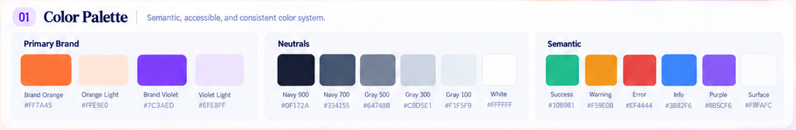

- **Shared-token conflict:** The current application and `UI_Tasks_home.md` already define shared tokens including Orange `#F97316`, Orange Subtle `#FFF7ED`, Violet Subtle `#EDE9FE`, and Border `#E2E8F0`. Those differ from the new board's printed values. Do not create `.library-page` overrides or a second palette. Before visual implementation, reconcile the shared design-system values in one place and update both UI plans/tests together, or retain the existing shared tokens and record the deliberate difference. The intended library-board target is the printed palette above; a product-wide token change must remain consistent on the home page.

- **Dark palette behavior:** Use the slide 2 light/dark sidebar and slide 6 card examples. Dark mode uses a deep ink/navy shell, a distinct but still dark surface for cards, legible pale text, restrained colored tints, and visible borders. The slide prints Sidebar Background Dark `#0F1220`, active background Dark `#2A1F17`, active text/icon Dark `#FF8A3D`, and default text Dark `#E2E8F0`. Other dark surface colors are visual starting estimates, not measured tokens. Avoid pure-black blocks, large violet fills, light-mode shadows pasted onto dark cards, and neon glow.
  **Required visual reference:** Inspect both theme examples and the active-state inset before styling dark surfaces.

  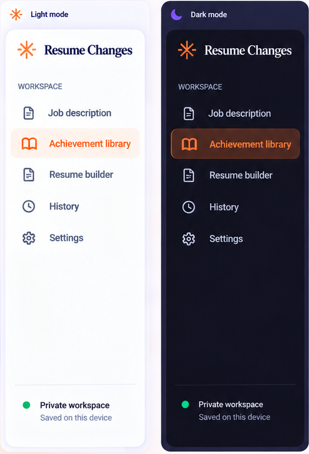

  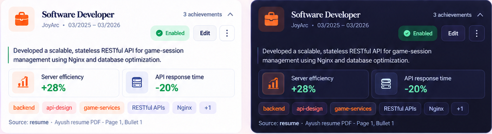

- **Type and exact scale:** The board labels its display face Playfair Display and UI face Inter; these are artwork annotations, not permission to replace the application's current fonts. Preserve the current serif title treatment (Georgia/Times) and Arial/Helvetica operational UI. Do not load remote fonts or add Playfair Display or Inter. The board's reference hierarchy is Display 56/64 (poster only), H1 48/56, H2 32/40, H3 24/32, H4 18/28, Body Large 16/24, Body 14/20, Body Small 12/16, Label 12/16, Caption 11/14. For the actual product, use a compact page title around 40/48 desktop and 32/40 mobile; use 24/32 section titles, 18-20/24 experience/card titles, 14/20 body, 12/16 metadata/helper, 11/14 captions, and 24-32/32 metric values. Keep `letter-spacing: 0`; never use viewport-scaled font sizes or squeeze text to fit.
  **Required visual reference:** Inspect both the board scale and the actual card-type sample before choosing component sizes. The poster's 56px title is not the app heading.

  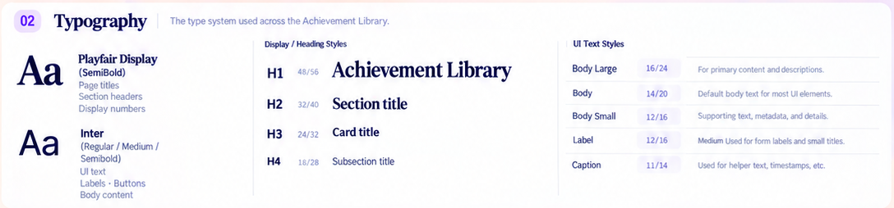

  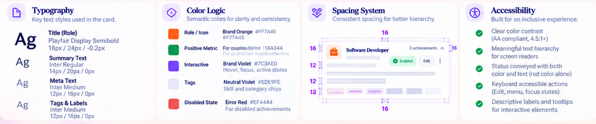

- **Spacing and proportions:** Use the 4/8/12/16/24/32/48/64px scale. Keep 24px as a common desktop surface inset, 16px inside compact content, 12-16px between related controls, and 8px between labels and supporting text. Main content uses a flexible width beside the existing sidebar; do not center the operational page inside a decorative poster/card. At narrower sizes reduce insets deliberately to 16px and then 12px. The boards show larger corner radii in some panels than the app's compact operational rule allows: use 6px controls, up to 8px cards, and full rounding only for chips, pills, or circular icons. Do not create cards inside cards.
  **Required visual reference:** Inspect the page composition, spacing scale, and radius strip before changing alignment or component dimensions.

  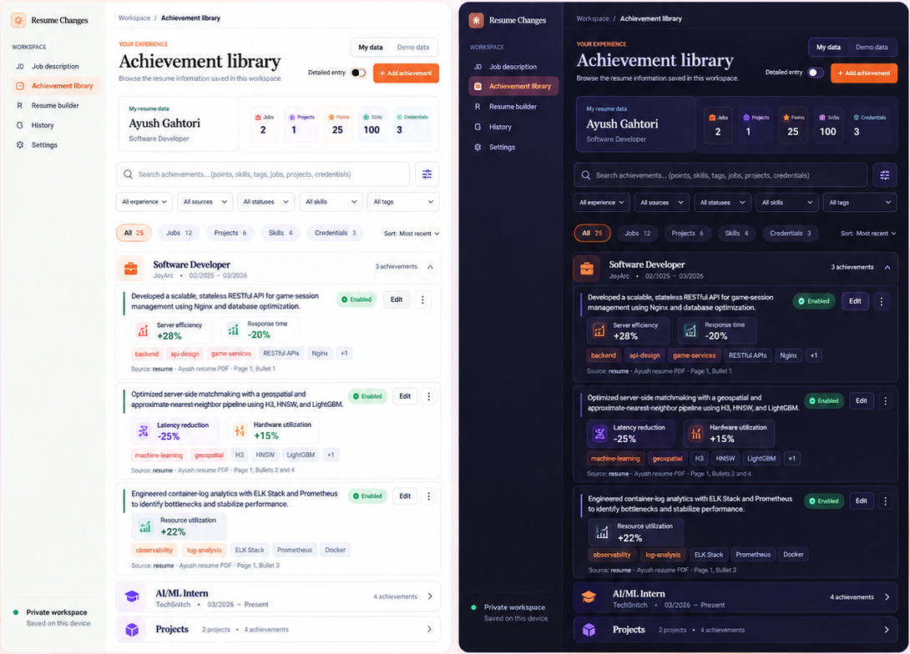

  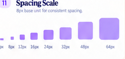

  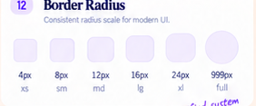

- **Border and shadow appearance:** Use crisp 1px borders on inputs and cards. Light cards may use a barely visible XS shadow; dark cards should use a thin border and surface contrast. Use no decorative glow around entire cards, no stacked shadows, and no elevation on nested content. The kit's largest shadow samples are not targets for this page.
  **Required visual reference:** Inspect the shadow strip and the actual card surface before assigning elevation.

  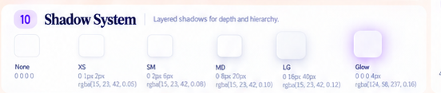

  

- **Button hierarchy:** `Add achievement` is the orange primary action with a leading plus icon. `Edit` is a compact tertiary/ghost action with a pencil icon. Search/filter controls use an icon button only when it opens a real filter panel. The board also depicts heart and trash controls; the current schema/API does not provide favorite or delete actions, so do not add those controls until behavior and persistence are explicitly implemented. Keep controls stable through hover, pressed, focus, disabled, and loading states.
  **Required visual reference:** Inspect the button gallery and the header's primary-action states.

  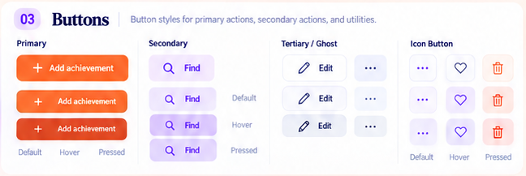

  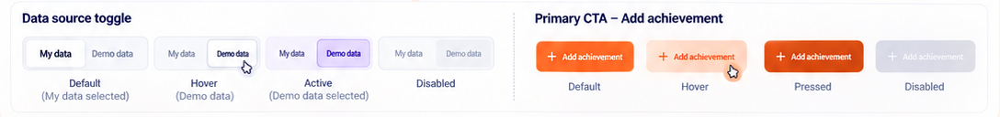

- **Input reference:** Inputs use a 1px neutral border, white/cool-neutral light surface, 6px radius, readable text, and a visible 2px violet focus ring. Error uses a red border plus text/icon; disabled uses a neutral alternate fill and remains legible. The search field has a leading magnifier and a trailing clear affordance only while it contains text. Native selects or accessible custom listboxes must remain keyboard operable. Do not include sample values as production placeholders.
  **Required visual reference:** Inspect the default, focused, error, and disabled field states before styling search or filters.

  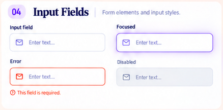

  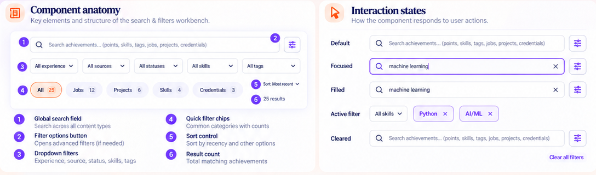

- **Chips and status pills:** Category/filter chips use compact full-round shapes with a visible count and a clear selected state. Category counts are derived from the current library, never the board's sample counts. Enabled is green with text; Disabled is red with text; source types and tag chips are neutral/outlined or softly tinted. The board's Draft pill is not a current `AchievementPoint` status: show Draft only if a real draft state exists. Avoid using semantic colors as decoration or relying on color alone.
  **Required visual reference:** Inspect the chip, filter, and status galleries together; their count and status treatments are different components.

  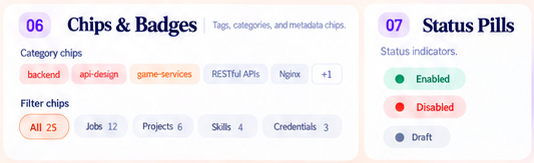

  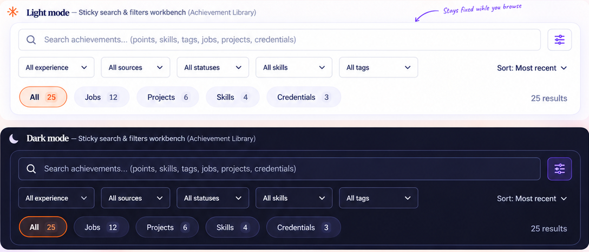

- **Profile summary:** The summary has a compact identity block (`My resume data`, full name, optional headline) and five dynamic metrics: Jobs, Projects, Points, Skills, Credentials. Counts come from the loaded `ResumeLibrary`; filtered result count is a separate search-workbench concern. The example name, title, and values are not defaults. The sample `View details` button is not supported by a profile destination in the current library flow; omit it unless an existing route is confirmed and the action is tested.
  **Required visual reference:** Inspect the light/dark summary and the metric hierarchy, not the surrounding explanatory poster cards.

  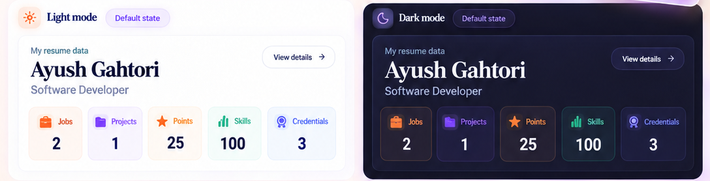

  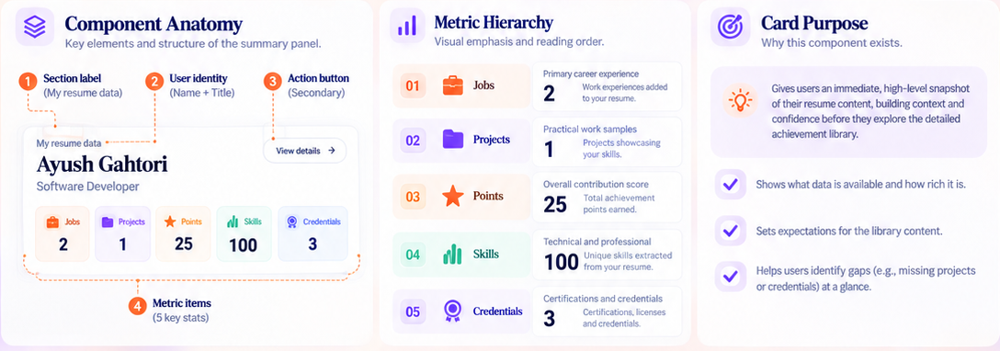

- **Search, filters, and quick navigation:** Preserve the current combined search across point text, IDs, experience, tags, skills/aliases, and provenance; preserve the current experience/source/status/skill/tag facets and reset behavior. The board's top controls show global search, an advanced-filter affordance, five facet dropdowns, category counts, sort, and result count. Add only controls with observable behavior. The long-page board describes sticky category tabs as navigation to Jobs, Projects, Skills, and Credentials; use those as in-page section navigation, not a second hidden filtering system. Advanced facet selects remain responsible for filtering.
  **Required visual reference:** Inspect the full workbench plus its interaction-state crop before implementing sticky positioning or active filters.

  

  

- **Information architecture:** The reference groups data into Jobs, Projects, Skills, and Credentials, with count/date context on section headings and progressive disclosure for long content. Current code renders each job/project as an experience group and puts Skills/Credentials in separate `
` disclosures. Preserve record identity and current grouping information while organizing the view into scannable sections. Do not move a skill or credential into an achievement, duplicate evidence, drop education data, or imply a job/project without a source record. Keep education visible wherever the existing product currently supports it; if a new Education section is needed, it must have real records and its own tests.
  **Required visual reference:** Inspect the after-state, page map, section hierarchy, and expanded item anatomy; the faded Before screenshot is explanatory only.

  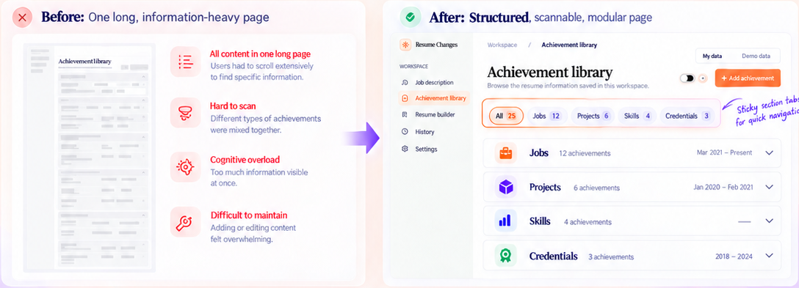

  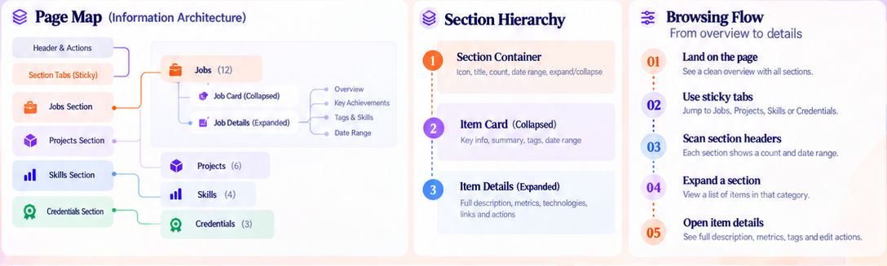

- **Achievement-card anatomy:** The visual order is experience context, concise achievement text, quantified metrics, relevant tags/linked skills, source/provenance, then supported state/actions. Show evidence only when present. Keep metric labels, values, units, evidence, and optional context paired; do not turn sample percentages into claims. Do not truncate away the source or an important metric merely to match a card height.
  **Required visual reference:** Inspect the annotated card and its interactive variants before styling the card or detail disclosure.

  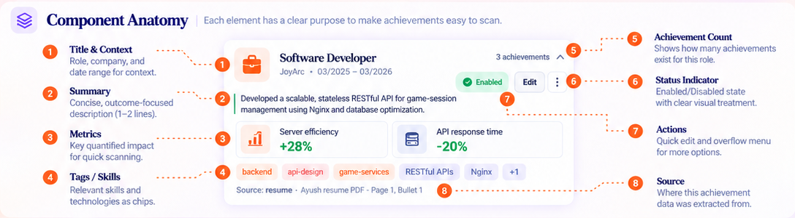

  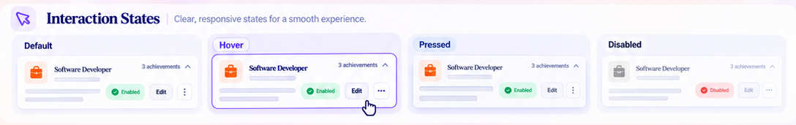

- **Exact reference copy and reference-only data:** Product labels printed in the boards include `Achievement library`, `YOUR EXPERIENCE`, `Browse the resume information saved in this workspace.`, `My data`, `Demo data`, `Detailed entry`, `Add achievement`, `Search achievements... (points, skills, tags, jobs, projects, credentials)`, `All experience`, `All sources`, `All statuses`, `All skills`, `All tags`, `All`, `Jobs`, `Projects`, `Skills`, `Credentials`, and `Most recent`. Use these labels when they accurately describe current behavior. `Ayush Gahotri`, `Jordan Example`, `Software Developer`, `JoyArc`, all sample achievement sentences, metric values, dates, company names, and counts are visual examples, not production defaults. Automated tests may use synthetic fixtures.

- **Product screen versus presentation board:** Recreate only the product page shown inside the light/dark app compositions. Do not build the cream/pink presentation background, giant slide heading, callout arrows, handwritten notes, slide counter, progress dots, explanatory poster panels, UI-kit swatches, floating document art, or decorative sparkle/orb artwork in the application. The page should feel like an operational resume data workspace, not a marketing landing page.

- **Data-source trust:** Keep `My data` and `Demo data` as navigation to their existing routes/query values. The personal library remains editable using the current local API flow; demo data remains explicitly fictional and read-only. Label the source visibly, never merge both sources, and never imply cloud storage or syncing. A failed personal load must retain its existing error explanation and alternate-source link.

- **Action and contract boundaries:** Current point editing/addition and AI-assisted creation flows already exist. Reuse their real handlers and accessible names. The board's `View details`, favorite/heart, delete/trash, date sorting, sticky category navigation, and compact item expand/collapse may not all have current product behavior. Implement a visual affordance only when its action is defined in this plan and works end to end; otherwise omit it, use a noninteractive label only when the visual context allows, or record a dependency instead of presenting a dead button.

- **No promotional upsell or fake identity:** There is no `Go Pro`, pricing, subscription, signed-in user/avatar, fake resume profile, fabricated metric, default sample record, or claim that every metric is verified. Do not add these just because the slides contain them.

### Required Image Links For Reference Interpretation

Before implementing any guidance in Reference Interpretation, open and inspect the corresponding crop below. Every crop is mandatory visual source material. The path and embedded preview are both provided; do not substitute memory of the full poster for the actual product/component crop.

- **Palette and use:** `docs/ui-images/achievement-library/library-color-palette.png`

  

- **Dark palette behavior:** `docs/ui-images/achievement-library/sidebar-light-dark.png`, `docs/ui-images/achievement-library/achievement-card-light-dark.png`, and `docs/ui-images/achievement-library/search-workbench-light-dark.png`

  

  

  

- **Type and exact scale:** `docs/ui-images/achievement-library/library-type-scale.png` and `docs/ui-images/achievement-library/achievement-card-type-color-spacing.png`

  

  

- **Spacing and proportions:** `docs/ui-images/achievement-library/achievement-overview-light-dark.png`, `docs/ui-images/achievement-library/library-spacing-gallery.png`, and `docs/ui-images/achievement-library/profile-metric-data-tokens.png`

  

  

  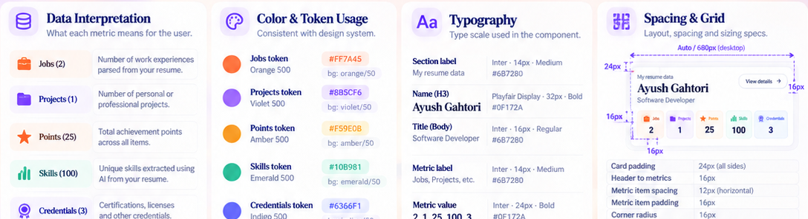

- **Border, shadow, and radius:** `docs/ui-images/achievement-library/library-shadow-gallery.png`, `docs/ui-images/achievement-library/library-radius-gallery.png`, and `docs/ui-images/achievement-library/achievement-card-light-dark.png`

  

  

  

- **Buttons and icon actions:** `docs/ui-images/achievement-library/library-button-states.png` and `docs/ui-images/achievement-library/source-toggle-add-control-states.png`

  

  

- **Input and search states:** `docs/ui-images/achievement-library/library-input-states.png` and `docs/ui-images/achievement-library/search-anatomy-and-states.png`

  

  

- **Chips and semantic status:** `docs/ui-images/achievement-library/library-chip-status-gallery.png` and `docs/ui-images/achievement-library/search-workbench-light-dark.png`

  

  

- **Profile summary and metrics:** `docs/ui-images/achievement-library/profile-summary-light-dark.png`, `docs/ui-images/achievement-library/profile-summary-anatomy.png`, and `docs/ui-images/achievement-library/profile-metric-data-tokens.png`

  

  

  

  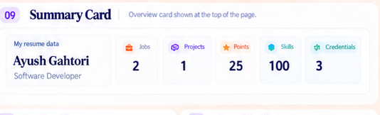

- **Information architecture and long-page behavior:** `docs/ui-images/achievement-library/long-page-before-after.png`, `docs/ui-images/achievement-library/page-map-hierarchy-browsing-flow.png`, and `docs/ui-images/achievement-library/experience-section-card-anatomy.png`

  

  

  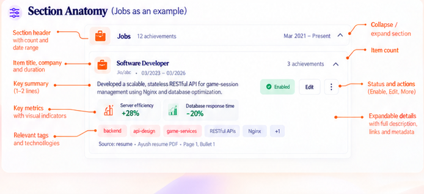

  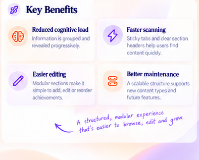

  

- **Achievement-card anatomy, metrics, tags, and source:** `docs/ui-images/achievement-library/achievement-card-anatomy.png`, `docs/ui-images/achievement-library/achievement-card-type-color-spacing.png`, and `docs/ui-images/achievement-library/achievement-card-before-after.png`

  

  

  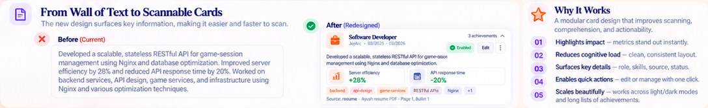

- **Header and source/action controls:** `docs/ui-images/achievement-library/library-header-light-dark.png`, `docs/ui-images/achievement-library/library-header-anatomy-hierarchy.png`, and `docs/ui-images/achievement-library/source-toggle-add-control-states.png`

  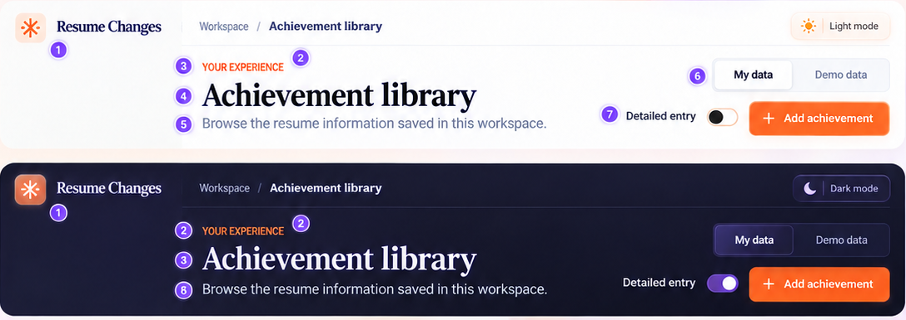

  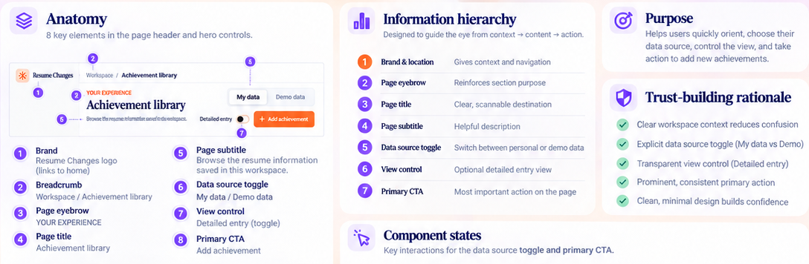

  

- **Whole-page acceptance:** `docs/ui-images/achievement-library/achievement-overview-light-dark.png` and `docs/ui-images/achievement-library/page-breakdown-design-principles.png`

  

  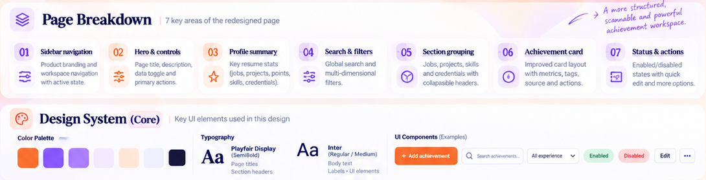

### Additional Exact Token Values From The Boards

The first column records printed light values. Dark values marked `estimate` are visual starting points, not measured labels. Compare the rendered UI in both themes and maintain WCAG contrast. Existing app-wide variables are the implementation source; do not add a second copy under `.library-page`.

| Token | Achievement board light value | Dark starting value | Intended use |
| --- | --- | --- | --- |
| Canvas | `#F8FAFC` | `#151522` estimate | Main page background |
| Sidebar | `#FAFBFD` | `#0F1220` | Persistent navigation |
| Surface | `#FFFFFF` | `#17192D` estimate | Summary and content surfaces |
| Surface alternate | `#F1F5F9` | `#202238` estimate | Inputs and subtle secondary regions |
| Text primary | `#0F172A` | `#F8FAFC` estimate | Titles and core content |
| Text secondary | `#334155` | `#C4C8D8` estimate | Supporting copy and nav |
| Muted text | `#64748B` | `#9BA2B8` estimate | Metadata and captions |
| Border | `#CBD5E1` | `#34374F` estimate | Card, control, and divider outlines |
| Brand orange | `#FF7A45` | `#FF7A45` | Primary Add action and job marker |
| Orange light | `#FFE9E0` | `#40251F` estimate | Soft action/category tint |
| Brand violet | `#7C3AED` | `#A78BFA` | Focus, selected state, project accent |
| Violet light | `#EFEBFF` | `#302342` estimate | Soft selection and category surfaces |
| Success | `#10B981` | `#34D399` estimate | Enabled/confirmed only |
| Warning | `#F59E0B` | `#FBBF24` estimate | A real warning only |
| Error | `#EF4444` | `#F87171` estimate | Validation/failed state |
| Info | `#3B82F6` | `#60A5FA` estimate | Neutral information |
| Purple category | `#8B5CF6` | `#A78BFA` estimate | Project/category marker only |

The type board prints Display 56/64, H1 48/56, H2 32/40, H3 24/32, H4 18/28, Body Large 16/24, Body 14/20, Body Small 12/16, Label 12/16, and Caption 11/14. The page title in the product mockup is more compact than the poster's Display sample. Preserve Georgia/Times and Arial/Helvetica; do not load the board's Playfair Display/Inter. The spacing board uses 4/8/12/16/24/32/48/64px and radius 4/8/12/16/24/full. The app's compact-card constraint takes precedence: controls use 6px radius, cards up to 8px, and small chips/pills may be fully rounded. Use only None/XS shadows for this workspace.

## Current Code Map

- `src/app/library/page.tsx` resolves the `source` query parameter, loads the selected library, and renders the existing data-load error with a link to the alternate source.
- `src/components/workspace-shell.tsx` owns the shared sidebar, current-route state, breadcrumb, theme control, responsive navigation, and local workspace status. The library plan must not duplicate or independently redesign the whole shell.
- `src/components/achievement-library.tsx` owns the current library heading, data-source links, creation/edit entry points, profile summary counts, search/facets, job/project groups, achievement rows, skills, and credentials.
- `src/components/achievement-point-editor.tsx` owns detailed manual point creation/editing and validation. Preserve its API-backed save/cancel behavior and labels.
- `src/components/achievement-imagination.tsx` owns the current assisted achievement creation flow. Preserve its current acceptance/save and close behavior; do not rewrite its AI logic here.
- `src/lib/data/achievement-search.ts` owns `LibraryFilters`, `filterAchievementLibrary`, `getLibraryFilterOptions`, and the current query/facet semantics. Any added view-model/sort helper must be pure, tested, and must not narrow search coverage.
- `src/lib/data/loaders.ts` owns the personal/demo library loading contract. Do not modify file paths, source selection, validation, or private data handling for visual tasks.
- `src/lib/schemas/resume-data.ts` defines profile, job, project, achievement, metric, skill, credential, and provenance data. Existing achievements have text, tags, linked skill IDs, metrics with evidence/context, source details, enabled state, and optional context; there is no favorite flag or delete workflow.
- `src/app/globals.css` owns shared tokens and current global, shell, library, card, and responsive styles. Prefer existing tokens; introduce new CSS custom properties only through the shared design-system conventions.
- `tests/e2e/library.spec.ts` covers demo grouping, source display, combined search facets, reset, empty state, mobile overflow, and source navigation.
- `tests/e2e/library-editing.spec.ts` covers long-page scrolling, manual/assisted create, persistence, edit/cancel, duplicate IDs, demo read-only behavior, and editor mobile fit.
- `tests/unit/data/achievement-search.test.ts` covers the pure search/filter behavior.

As the page is refactored, prefer focused components under `src/components/library/` only when they have a clear visual or behavioral responsibility. Keep `achievement-library.tsx` as the page coordinator and do not split components just to increase file count. Preserve the existing root-level component paths if moving them would create avoidable churn.

## Required Workflow And Test Rules

1. Implement tasks in order in small reviewable groups on the designated Achievement Library UI branch. Read each component and its tests before editing. Do not reset, overwrite, or reformat unrelated working-tree changes.
2. Before changing a component, list the user-visible behavior and existing test that protects it. Preserve behavior unless a task explicitly defines a supported client-side affordance.
3. Every new interactive component and every new non-trivial helper/function gets focused coverage in a named test file. Prefer `tests/e2e/library-*.spec.ts` for rendered states and user interactions; use `tests/unit/**/*.test.ts` for pure filter/sort/count/view-model helpers.
4. Keep tests deterministic. Use fictional fixtures such as the existing demo library or isolated synthetic data; never load the user's personal JSON, call Gemini, or depend on a network service in UI tests. Mock the existing `/api/library/points` endpoints where needed and assert the observable saved result.
5. Cover applicable default, hover, keyboard-focus, pressed, disabled/read-only, loading, success, and error states. Do not fabricate a state that the data contract cannot represent; document why a state is not applicable.
6. Check every layout in light and dark themes and at desktop, tablet, and narrow mobile sizes. Check page-level and nested horizontal overflow, sticky-header offsets, dropdown clipping, long labels, empty sections, and expanded content.
7. Use screenshots for visual review. Compare the product crop at equivalent scale; do not compare poster art, callouts, or presentation backgrounds. Test hover/focus and actual controls, not just a static default screenshot.
8. Before the UI PR run `npm run lint`, `npm run typecheck`, `npm test`, and relevant `npm run test:e2e` coverage. Report environment/startup failures honestly; do not describe them as passed. Run `git diff --check` and keep personal data, local logs, secrets, and generated files out of the diff.
9. A task is not complete because CSS exists. Mark it complete only after its real interactions, accessibility, focused tests, and screenshot comparison meet the task acceptance criteria.

## Task Roadmap

### Task 01: Establish The Achievement-Library Baseline

**Required image inspection:** Open the product-only overview crop and the page-map crop before inventory or implementation. The paired themes show the full information hierarchy; the bottom map is a presentation aid, not app content.

Reference files: `docs/ui-images/achievement-library/achievement-overview-light-dark.png`, `docs/ui-images/achievement-library/page-breakdown-design-principles.png`

**Files:** Inspect `src/app/library/page.tsx`, `src/components/achievement-library.tsx`, `src/components/workspace-shell.tsx`, `src/app/globals.css`, `src/lib/data/achievement-search.ts`, `src/lib/data/loaders.ts`, and existing library E2E/unit tests. Add no visual component in this inventory-only task.

- [ ] Record personal/demo route behavior, loader errors and alternate-source navigation, current visible sections, search fields, filter semantics, enabled/edit behavior, editor flows, and persistence/API calls before styling.
- [ ] Record current light/dark and viewport screenshots at 1440x900, 1024x768, 768x1024, 390x844, and 320x740 using synthetic/demo data only.
- [ ] Map each visible board component to current source files and mark whether the action already exists, can be derived safely from current data, or requires product/backend work.
- [ ] Note current data that the board does not show, including optional profile data, education, evidence, provenance, and empty values; no existing data may be silently removed during visual grouping.
- [ ] Run the existing focused library tests before any redesign and preserve their assertions as regression coverage.

**Acceptance:** A written inventory identifies behavior to preserve, visual conflicts, unsupported controls, and matching before screenshots. No production data, files, or backend behavior are changed.

**Visual specification:** Treat the paired light/dark product panes as the composition reference. The core reading order is persistent shell, breadcrumb/page heading, source/action controls, profile summary, search and filters, category navigation, grouped experience achievements, then skills/credentials. Capture screenshots at identical viewport and zoom for before/after review. Do not use the surrounding board's cream gradient, decorative art, callout text, slide number, or bottom component map as app content.

### Task 02: Reconcile Shared Color Tokens For The Library

**Required image inspection:** Inspect the exact palette crop, the printed dark sidebar swatches, and the existing shared token declarations before choosing values. Resolve the orange/violet/border mismatch with the home UI plan centrally.

Reference files: `docs/ui-images/achievement-library/library-color-palette.png`, `docs/ui-images/achievement-library/sidebar-color-type-spacing.png`

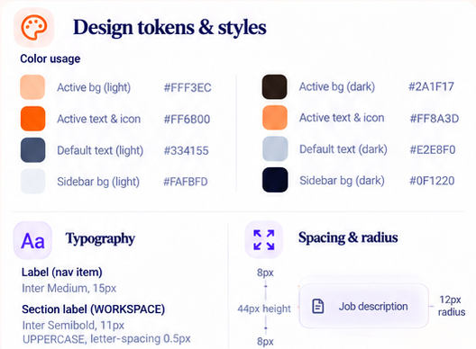

**Files:** `src/app/globals.css`; update `docs/UI_Tasks_home.md` token references only as part of an explicitly coordinated shared-token reconciliation; add `tests/unit/ui/design-tokens.test.ts` only if the project uses a TypeScript token contract rather than CSS variables.

- [ ] Define or reuse shared tokens for canvas, sidebar, surface, alternate surface, primary/secondary/muted text, border, orange, orange-soft, violet, violet-soft, success, warning, error, info, and focus.
- [ ] Use the Achievement Library board's printed orange `#FF7A45`, orange light `#FFE9E0`, violet `#7C3AED`, violet light `#EFEBFF`, primary text `#0F172A`, secondary `#334155`, muted `#64748B`, gray border `#CBD5E1`, and cool surface `#F8FAFC` as the visual targets.
- [ ] Reconcile these values with the already-established app-wide tokens (`#F97316`, `#FFF7ED`, `#EDE9FE`, `#E2E8F0`) in one shared place; never add page-specific token overrides just to hide the discrepancy.
- [ ] Keep category colors tied to labels: job orange, project violet, points amber, skills green, credentials indigo. These are identifiers, not health/status scores.
- [ ] Choose dark equivalents from the printed sidebar examples and verify text/control contrast; mark unprinted values as implementation estimates in review notes.

**Acceptance:** Library and home consume the same named token source, both themes remain readable, and no duplicate `.library-page` palette exists.

**Visual specification:** Use orange for the primary Add action and job accents, violet for selected/focus states and project accents, restrained green/amber/blue/indigo for labelled categories, and neutral surfaces for most content. Preserve at least 4.5:1 text contrast and visible 1px boundaries. Do not create a full-page gradient, large orange panel, or ornamental color block. Because the UI kit's exact orange differs from current app tokens, the visual implementation cannot be called pixel-accepted until the shared decision is explicit and both plans agree.

### Task 03: Define The Library Type Scale Without Changing Fonts

**Required image inspection:** Open and inspect the UI-kit typography crop and the actual card type specimen. The printed Playfair Display and Inter labels are reference artwork only; keep the current project font families.

Reference files: `docs/ui-images/achievement-library/library-type-scale.png`, `docs/ui-images/achievement-library/achievement-card-type-color-spacing.png`

**Files:** `src/app/globals.css`; add a unit test only if a pure TypeScript typography helper is introduced; add visual computed-style checks to the focused library E2E suite.

- [ ] Preserve the existing Georgia/Times title treatment and Arial/Helvetica UI, labels, controls, and metadata. Do not load fonts, import Inter/Playfair, or change global `font-family` declarations.
- [ ] Define/reuse named sizes and line heights for page title, section heading, profile name, experience/card title, body, field label, metadata, helper, and micro-label.
- [ ] Use the board hierarchy as a guide: product page title about 40/48 desktop and 32/40 mobile; section 24/32; profile name 28-32/36-40; achievement/experience heading 18-20/24; body 14/20; label/metadata 12/16; caption 11/14; prominent metric value 24-32/32.
- [ ] Keep semibold weights for labels and headings where shown; use regular body text and tabular numerals for count/metric comparisons.
- [ ] Keep letter spacing at `0`, avoid viewport-scaled font formulas, and allow controlled wrapping for long job titles, tags, source labels, and achievement content.
- [ ] Check both themes for muted text that looks disabled when it is not disabled.

**Acceptance:** Page hierarchy matches the board while preserving project fonts; no heading, count, label, or long value clips at the supported widths.

**Visual specification:** The 56/64 display sample is poster-only. The product title should remain compact above the content; section headings are more prominent than card labels; card title/context, achievement text, metrics, and source form a readable descending hierarchy. Keep a minimum 20px line box for 14px text, 16px line box for 12px metadata, and 14px for captions. Never shrink type to rescue an overflowing layout; fix width, wrapping, or layout instead.

### Task 04: Standardize Surface, Spacing, Border, And Shadow Tokens

**Required image inspection:** Inspect the spacing, shadow, and radius strips and the profile summary inset example before changing any surface dimensions.

Reference files: `docs/ui-images/achievement-library/library-spacing-gallery.png`, `docs/ui-images/achievement-library/library-shadow-gallery.png`, `docs/ui-images/achievement-library/library-radius-gallery.png`, `docs/ui-images/achievement-library/profile-metric-data-tokens.png`

**Files:** `src/app/globals.css` and only the library component styles that need to consume shared variables.

- [ ] Reuse the shared 4/8/12/16/24/32/48/64px rhythm. Use 24px desktop surface padding, 16px compact interior padding, and 12-16px gaps between related controls.
- [ ] Keep input/button radii near 6px and library cards at 8px maximum; category chips and status pills may be fully rounded.
- [ ] Use a crisp 1px border on surfaces and fields. Prefer no shadow for nested content, XS on controls if needed, and at most a very subtle Sm on a major light surface.
- [ ] In dark mode, separate surfaces with border and tonal steps instead of light-theme shadows or glow.
- [ ] Avoid card-inside-card nesting; metric tiles can be repeated items inside the summary surface but must not become individually floating cards with competing shadows.
- [ ] Reduce page/card insets deliberately on tablet/mobile without changing typography or producing horizontal scrolling.

**Acceptance:** Surface rhythm, control geometry, and elevation are consistent across page sections and themes.

**Visual specification:** Keep the experience page as an unframed app layout with section bands and concise surfaces. Summary and achievement surfaces use a thin neutral border, restrained fill contrast, and no more than 8px radius. Use 24px spacing before major sections, 16px inside content clusters, 12px between aligned metrics/filters, and 8px between text relationships. The board's 12-24px card radii and Glow shadow are not production targets where they conflict with compact app rules.

### Task 05: Standardize Button And Icon Conventions

**Required image inspection:** Inspect the button state gallery, the header Add states, and the card action examples before implementing controls. Heart/delete icons are unsupported unless real behavior is separately added.

Reference files: `docs/ui-images/achievement-library/library-button-states.png`, `docs/ui-images/achievement-library/source-toggle-add-control-states.png`, `docs/ui-images/achievement-library/achievement-card-interaction-states.png`

**Files:** Existing library components; use installed `lucide-react` icons; shared button styles in `src/app/globals.css`; focused `tests/e2e/library-actions.spec.ts` if new action states are introduced.

- [ ] Render `Add achievement` as the primary orange action with a leading plus icon, white/high-contrast text, and stable dimensions.
- [ ] Render `Edit` as a compact tertiary action with a pencil icon if space allows; keep a readable text label where icon-only meaning would be unclear.
- [ ] Give filter, expand/collapse, clear, and menu icon controls accessible names and tooltips for unfamiliar actions. Do not use letter abbreviations or emoji as icons.
- [ ] Do not add heart/favorite/delete buttons without a defined data contract, API operation, confirmation path, and focused tests.
- [ ] Keep click targets at least 44x44px when practical; maintain a stable 40-44px visual button height and 12px control gaps.
- [ ] Cover hover, visible focus, pressed, disabled/read-only, and any actual pending state; avoid transitions that resize or shift adjacent controls.

**Acceptance:** Every visible button performs its named action; icon-only actions are accessible and no reference-only action appears as a dead control.

**Visual specification:** Primary Add is orange, with the plus icon preceding `Add achievement`; edit/menu/low-emphasis controls use white or transparent neutral surfaces with a thin border; violet is reserved for focus/selected or AI-related accents. Hover adds a subtle fill/border change, pressed can reduce scale to about 0.98 for roughly 100ms, and focus has a clear 2px violet outline with offset. Respect reduced motion. Disabled demo actions remain absent or honestly disabled; they must not look like enabled controls.

### Task 06: Rebuild The Library Page Composition Inside The Existing Shell

**Required image inspection:** Open the full paired app composition and the header product crop before moving library sections. Use only the app panes, not the poster or the UI-kit content.

Reference files: `docs/ui-images/achievement-library/achievement-overview-light-dark.png`, `docs/ui-images/achievement-library/library-header-light-dark.png`

**Files:** `src/components/achievement-library.tsx`, any justified child components under `src/components/library/`, `src/app/globals.css`, and `tests/e2e/library-layout.spec.ts`.

- [x] Keep the existing shared `WorkspaceShell` as owner of brand, sidebar, breadcrumb, theme, and responsive navigation. Do not create a second shell or duplicate sidebar.
- [x] Arrange library content in the sequence: page context/header and controls, profile summary, sticky search/filter workbench, category navigation, Jobs/Projects/Skills/Credentials content, and truthful empty/error states.
- [x] Keep the main content in a flexible `minmax(0, 1fr)` track with `min-width: 0`; allow the page to scroll naturally for long libraries.
- [x] Use sibling section surfaces and unframed grouping; do not nest the entire page inside a marketing-style card.
- [x] Preserve source links, editor overlays, search state, filtering, and local save messages while components are extracted.
- [x] Add a focused layout test for landmarks, section order, and no horizontal overflow.

**Acceptance:** The library reads as a structured evidence workspace in the established app shell and all current workflows remain reachable.

**Visual specification:** At desktop, content fills the main column with a restrained maximum width and about 24-32px outer inset. The heading is followed by the profile summary and then the search workbench; the repeated experience content occupies the remaining long page. At mobile, use one column and 12-16px side padding. Keep the topbar and sidebar behavior in `workspace-shell.tsx`; this task only integrates the library route with that shell.

### Task 07: Show The Achievement Library As The Active Sidebar Destination

**Required image inspection:** Inspect the expanded light/dark sidebar and the active/collapsed variants. The navigation example is a component reference, not permission to redesign unrelated routes.

Reference files: `docs/ui-images/achievement-library/sidebar-light-dark.png`, `docs/ui-images/achievement-library/sidebar-active-collapsed-variants.png`

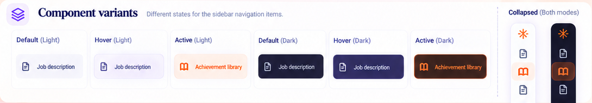

**Files:** `src/components/workspace-shell.tsx` only if route semantics or active treatment need correction; `src/app/globals.css`; `tests/e2e/library-shell.spec.ts` or the existing shell test.

- [ ] Confirm `/library` is the active route and `Achievement library` exposes `aria-current="page"`.
- [ ] Keep the existing icon-plus-label row and destination ordering; use the same 20px icon and 48px navigation hit row as other routes.
- [ ] Apply the library active state with orange text/icon and soft orange surface in light mode, and the printed dark active surface/text treatment in dark mode, after shared token reconciliation.
- [ ] Preserve collapsed-sidebar accessible names/tooltips and mobile drawer keyboard behavior; do not hide the library destination on narrow screens.
- [ ] Test direct navigation, refresh, active state in both themes, keyboard focus, and collapsed/mobile access.

**Acceptance:** Users can identify and keyboard-navigate to the active library route; no other route's active state changes.

**Visual specification:** The active row is approximately 44-48px tall, with 12px icon/label gap and 6-8px corners. Light active uses the board's pale orange background and stronger orange outline/text; dark active uses a warm deep-brown tint with orange icon/text. Inactive rows remain slate/muted, and hover is a small neutral tint. Keep brand, workspace label, footer, and other route rows unchanged unless existing shell tests reveal a required accessibility correction.

### Task 08: Build The Library Header And Context Hierarchy

**Required image inspection:** Inspect both header themes and the header anatomy crop before changing title, eyebrow, breadcrumb, or subtitle.

Reference files: `docs/ui-images/achievement-library/library-header-light-dark.png`, `docs/ui-images/achievement-library/library-header-anatomy-hierarchy.png`, `docs/ui-images/achievement-library/library-header-type-color-spacing.png`

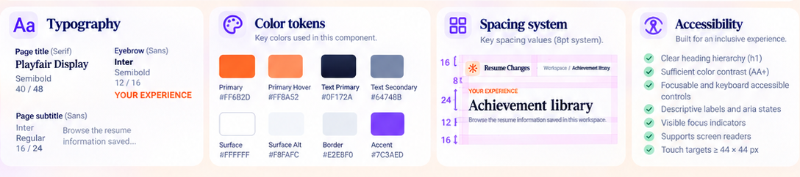

**Files:** `src/components/achievement-library.tsx`, shared breadcrumb in `src/components/workspace-shell.tsx` only if current route text is wrong, `src/app/globals.css`, and `tests/e2e/library-header.spec.ts`.

- [ ] Use the eyebrow `YOUR EXPERIENCE`, one page `h1` named `Achievement library`, and supporting line `Browse the resume information saved in this workspace.`
- [ ] Preserve the shared breadcrumb `Workspace / Achievement library`; do not repeat the brand in the page header.
- [ ] Place the heading left and keep source/action controls aligned to the right at desktop; wrap or stack without changing semantic order on narrow viewports.
- [ ] Use sentence case for normal controls and preserve uppercase only for the eyebrow and compact labels shown uppercase in reference.
- [ ] Do not copy poster headline `Achievement Library UI Kit`, slide numbers, callout writing, decorative artwork, or sample identity.
- [ ] Test one `h1`, breadcrumb text/current route, heading wrapping, and visible controls at 1440px and 320px.

**Acceptance:** The page's purpose and location are obvious without creating a large marketing hero or obscuring the content below.

**Visual specification:** Keep the eyebrow orange, 12px/16px semibold; the title uses the app's current serif face around 40px/48px desktop and 32px/40px mobile; subtitle uses 14-16px/20-24px secondary text. Leave about 8px between eyebrow/title and 8-12px between title/subtitle. The title block should occupy only the space required to leave the summary surface visible near the first fold on a standard desktop viewport.

### Task 09: Restyle The My Data And Demo Data Source Switch

**Required image inspection:** Inspect the header source-control crop and its selected/hover/disabled examples. These controls navigate to existing source routes; they are not an in-place data merger.

Reference files: `docs/ui-images/achievement-library/library-header-light-dark.png`, `docs/ui-images/achievement-library/source-toggle-add-control-states.png`

**Files:** `src/components/achievement-library.tsx`, `src/app/library/page.tsx` only if semantics need correction, shared styles, and `tests/e2e/library-source.spec.ts`.

- [ ] Preserve links to `/library` and `/library?source=demo`, with `aria-current="page"` on the selected source.
- [ ] Use a stable segmented-control appearance with a clear selected surface, border, and focus treatment; preserve link semantics because selecting a source navigates.
- [ ] Keep the visible data provenance label in the summary (`My resume data` for personal, `Fictional demo data` for demo) and never blend records across sources.
- [ ] Demo source stays read-only: hide or disable creation/edit actions consistently, and keep this distinction clear without relying only on color.
- [ ] Verify source selection after direct URL load, refresh, back/forward navigation, and keyboard activation.

**Acceptance:** Source navigation and read-only behavior match the current server-rendered route contract in both themes.

**Visual specification:** The switch is a compact two-option control with `My data` and `Demo data`, shared height around 36-40px, 6px outer radius or a restrained pill if consistent with the board, and a visible inset selected segment. Use neutral text for the inactive link and primary text for selected. Avoid implementing it as a checkbox/switch: the action changes route/source, not a persistent binary preference.

### Task 10: Style The Add Achievement And Detailed Entry Actions

**Required image inspection:** Inspect the header CTA and its state strip plus the button gallery before styling the existing creation entry points.

Reference files: `docs/ui-images/achievement-library/source-toggle-add-control-states.png`, `docs/ui-images/achievement-library/library-button-states.png`

**Files:** `src/components/achievement-library.tsx`, existing `achievement-point-editor.tsx` and `achievement-imagination.tsx` only for integration/accessibility, shared styles, and `tests/e2e/library-editing.spec.ts`.

- [ ] Keep `Detailed entry` wired to the existing point editor and `Add achievement` wired to the existing Imagination Canvas; do not change AI prompts, save contracts, or acceptance semantics.
- [ ] Use a clear button presentation for `Detailed entry`. Do not expose `role="switch"` unless it actually toggles persistent/in-place state; opening an editor is a button action.
- [ ] Render `Add achievement` as the primary orange action with leading plus icon and the existing accessible name. Preserve current behavior when personal data is unavailable or read-only.
- [ ] Keep both actions reachable at desktop/mobile and use a documented stack/wrap rule before controls become cramped.
- [ ] Test both entry flows, cancel, successful save, demo visibility, focus, and duplicate invocation while saving.

**Acceptance:** Visual polish does not change the two distinct create workflows or create an inaccurate toggle state.

**Visual specification:** `Add achievement` is the strongest control, at least 44px high with a leading 16-20px plus icon, 14px semibold label, 12px horizontal gap, orange fill, and a compact 6px radius. `Detailed entry` is secondary/tertiary, neutral or softly tinted, with equivalent text readability and visible focus. Hover/pressed states are subtle and do not move the header. Do not add a trailing arrow or spinner unless already supported by the component's real pending state.

### Task 11: Build The Profile Summary Surface

**Required image inspection:** Inspect the exact light/dark summary examples and the annotated anatomy before making the overview card.

Reference files: `docs/ui-images/achievement-library/profile-summary-light-dark.png`, `docs/ui-images/achievement-library/profile-summary-anatomy.png`

**Files:** Extract `src/components/library/profile-summary.tsx` only if this creates a coherent component; integrate from `src/components/achievement-library.tsx`; style in shared CSS; add `tests/e2e/library-summary.spec.ts`.

- [ ] Keep one summary surface with identity content and five metric items; do not create a second nested card around the identity or each individual metric.
- [ ] Label the source accurately and show full name plus optional headline only when present.
- [ ] Preserve Jobs, Projects, Points, Skills, and Credentials counts as data-derived values; counts must update only when their source data changes, not when search facets hide results.
- [ ] Separate total library counts from the search workbench's visible-result count so users do not confuse them.
- [ ] Use a responsive grid that preserves reading order and all labels at narrow widths.
- [ ] Test personal/demo sources, missing optional headline, zero counts, large counts, and mobile wrapping with synthetic data.

**Acceptance:** The summary provides an honest overview of the loaded library without hardcoded identity or count values.

**Visual specification:** Use a single horizontal identity-and-metrics surface on desktop. Identity occupies roughly one-third of the width; five compact metric tiles share the remaining width. The surface has a thin border, quiet white/cool-neutral fill, up to 8px radius, and 24px desktop padding. On dark mode use a lifted ink surface and thin border. On mobile stack the identity above a 2-column metric grid, leaving no horizontal scroll or clipped labels.

### Task 12: Present Profile Identity And Summary Navigation Honestly

**Required image inspection:** Inspect the identity/title/action anatomy crop and the board's summary interactions before adding any link or profile action.

Reference files: `docs/ui-images/achievement-library/profile-summary-anatomy.png`, `docs/ui-images/achievement-library/profile-interaction-accessibility.png`

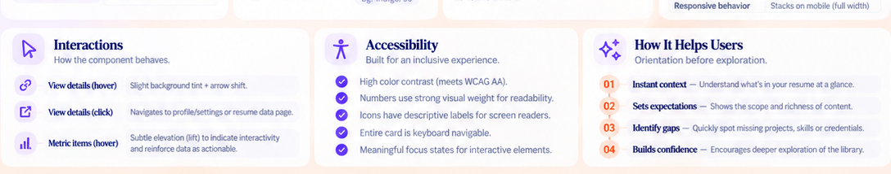

**Files:** Profile summary component/page coordinator and `tests/e2e/library-summary.spec.ts`.

- [ ] Display the current profile name and optional headline; omit absent values without placeholder identity or an empty row.
- [ ] Use the source label `My resume data` or `Fictional demo data` as current code provides.
- [ ] The board's `View details` action may be added only if an existing profile/settings route and meaningful destination are confirmed. Otherwise omit it; do not create a dead link or pretend the profile is editable from here.
- [ ] If a supported destination exists, use a secondary button/link with a descriptive accessible name and real route, preserving unsaved state behavior.
- [ ] Test empty optional profile fields and supported navigation; if no target exists, add a test asserting the unsupported CTA is absent.

**Acceptance:** Summary identity is real, source-aware, and free of invented account/profile affordances.

**Visual specification:** The source label is compact 12px/16px, the profile name is the strongest summary text at about 28-32px/36-40px in the existing serif title face, and the headline is 14-16px/20-24px secondary text. Keep the optional action aligned to the right only when it is supported; do not let an absent action leave a misleading blank target or unbalanced spacing.

### Task 13: Create Consistent Dynamic Metric Tiles

**Required image inspection:** Inspect both the summary metric row and the board's metric hierarchy/data interpretation crop before styling category colors or numeric emphasis.

Reference files: `docs/ui-images/achievement-library/profile-summary-light-dark.png`, `docs/ui-images/achievement-library/profile-metric-data-tokens.png`, `docs/ui-images/achievement-library/library-summary-card-gallery.png`

**Files:** Profile summary component, `src/app/globals.css`, and `tests/e2e/library-summary.spec.ts`; add a pure count helper test only if count mapping is extracted.

- [ ] Derive Jobs from `library.jobs.length`, Projects from `library.projects.length`, Points from the total points across jobs/projects, Skills from `library.skills.length`, and Credentials from `library.credentials.length`.
- [ ] Keep each icon/label/value grouped; use actual accessible label text and expose counts as text, not icon/color alone.
- [ ] Apply restrained category accents: Jobs orange, Projects violet, Points amber, Skills green, Credentials indigo. Do not turn metric color into a positive/negative score.
- [ ] Format values without lossy rounding; long counts must wrap or use stable number formatting without changing tile dimensions.
- [ ] Keep metric tiles visually aligned and keyboard-neutral unless the metric is an actual link.

**Acceptance:** Every number has a clear meaning and tracks the selected real library, including empty and large libraries.

**Visual specification:** Metric labels are about 12px/16px medium; values 24-32px/32px bold. Use small 18-20px category icons and a subtle tinted inner surface or border, not saturated full backgrounds. Horizontal gaps are about 8-12px. At tablet, allow five equal minmax columns only while labels fit; otherwise wrap to a second row. On mobile use a 2-column grid plus one full-width final tile where needed.

### Task 14: Build The Sticky Search And Filter Workbench

**Required image inspection:** Inspect the paired sticky workbench and spacing crop. Verify the reference's fixed-on-scroll intent against the existing topbar height before choosing sticky offsets.

Reference files: `docs/ui-images/achievement-library/search-workbench-light-dark.png`, `docs/ui-images/achievement-library/search-style-spacing-accessibility.png`

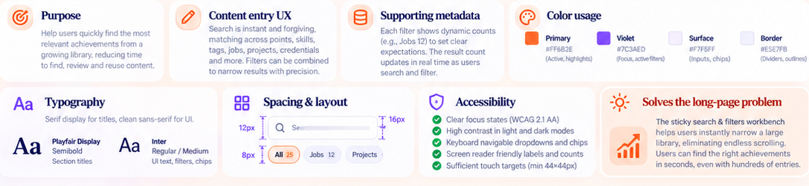

**Files:** Extract `src/components/library/search-workbench.tsx` only if justified; integrate existing `LibraryFilters` state; style in shared CSS; add `tests/e2e/library-search.spec.ts` and `tests/e2e/library-responsive.spec.ts`.

- [ ] Place search, filter controls, category navigation, sort, and result summary in a predictable order below the profile summary.
- [ ] Make the workbench sticky only after confirming the shared header offset; keep it below the topbar, provide an opaque theme-aware surface, and use a border rather than a strong shadow.
- [ ] Do not let sticky content cover focused inputs, dropdown options, category headings, or browser anchor targets; apply `scroll-margin-top` to destination sections.
- [ ] On mobile, either keep a compact search row sticky and allow filter controls to wrap/scroll accessibly, or disable sticky behavior when it crowds content; preserve all controls.
- [ ] Test scroll position, focus visibility, filter dropdown stacking, theme, and no horizontal page overflow at 320/390/768/1024/1440px.

**Acceptance:** Search/filter controls remain discoverable during long-page browsing without blocking content or keyboard focus.

**Visual specification:** Use one workbench surface with 16px padding, 8-12px gaps, a 40-44px search control, and a flexible row of 5 advanced filters. The selected category navigation and result count occupy a distinct lower row on desktop. Keep one-pixel borders and modest radius. Sticky stacking must account for the actual topbar; do not fix the workbench to the viewport in a way that consumes mobile height or covers page text.

### Task 15: Style Global Search And Its Input States

**Required image inspection:** Inspect the search anatomy and interaction states plus the UI-kit input states before changing the search textbox or clear action.

Reference files: `docs/ui-images/achievement-library/search-anatomy-and-states.png`, `docs/ui-images/achievement-library/library-input-states.png`

**Files:** `src/components/achievement-library.tsx` or search-workbench component, `src/lib/data/achievement-search.ts` only if preserving its semantics requires a tested helper change, and `tests/e2e/library-search.spec.ts`.

- [ ] Preserve the accessible name `Search library` and existing coverage of point text/ID, experience, tags, linked skill names/aliases, and provenance fields.
- [ ] Use the board copy `Search achievements... (points, skills, tags, jobs, projects, credentials)` as placeholder only; the label must remain available to assistive technology.
- [ ] Add a leading magnifier icon and a trailing clear button only when text is present; clear must reset the query without clearing unrelated filters unless the control is explicitly named `Reset filters`.
- [ ] Keep typing immediate and deterministic; do not introduce hidden debouncing, a server search request, or stale query results without product requirement.
- [ ] Ensure search-empty and no-results states are distinct from load/API errors and keep query text available for editing.
- [ ] Test keyboard typing, clear, multiple facets composed with query, zero results, long query wrapping, and both themes.

**Acceptance:** Search remains global and composable with every existing facet, and all visible input affordances work.

**Visual specification:** The search field spans the workbench width on desktop, has a 1px neutral border, 6px radius, 14px/20px text, and 12-16px horizontal inset. Default uses neutral icon/text, focus uses a 2px violet ring, filled state keeps the focus-independent neutral border, and the clear icon appears at the trailing edge only when needed. On mobile the text can wrap only in placeholder rendering; user-entered input stays on one line and scrolls horizontally within the input as native behavior.

### Task 16: Present The Existing Advanced Filter Facets

**Required image inspection:** Inspect the dropdown row and active-filter states in the search board. The slide's controls are filters only when each selection changes real results.

Reference files: `docs/ui-images/achievement-library/search-workbench-light-dark.png`, `docs/ui-images/achievement-library/search-anatomy-and-states.png`

**Files:** Search workbench/library component, `src/lib/data/achievement-search.ts` only for required reusable pure behavior, `tests/unit/data/achievement-search.test.ts`, and `tests/e2e/library-filters.spec.ts`.

- [ ] Preserve current facets: Job or project (`All experience`), Point source (`All sources`), Point status (`All statuses`), Linked skill (`All skills`), and Tag (`All tags`).
- [ ] Generate choices from the loaded library and preserve stable labels/order; do not show fabricated skills/tags or empty nonfunctional dropdowns.
- [ ] Keep all filters combinable with the query; result count and visible groups update together.
- [ ] Preserve the `Reset filters` behavior and use an explicit reset action only when at least one filter/query differs from default.
- [ ] Keep native select semantics or implement a fully keyboard-accessible listbox; do not hide native focus/option behavior with CSS-only faux menus.
- [ ] Test each facet, cross-facet combination, empty options, disabled source controls when appropriate, reset, and long labels on mobile.

**Acceptance:** Filters match existing `LibraryFilters` behavior, remain accessible, and cannot silently show stale counts or result sections.

**Visual specification:** On wide desktop, place five evenly spaced controls below search, with compact 40-44px heights, white/dark surface, 1px border, 6px corners, 12px text, and a trailing chevron. At 768px allow two/three columns; at 390px stack or use a horizontally scrollable labeled row with visible affordance and keyboard access. Active filters receive a restrained violet outline/tint and textual selected value; never apply a purple filled block to every dropdown.

### Task 17: Add Counted Category Navigation For Long Libraries

**Required image inspection:** Inspect the quick category chip gallery and the information-architecture browsing-flow crop. The long-page slide says these tabs jump to sections; keep that behavior distinct from advanced filters.

Reference files: `docs/ui-images/achievement-library/library-search-filter-gallery.png`, `docs/ui-images/achievement-library/page-map-hierarchy-browsing-flow.png`

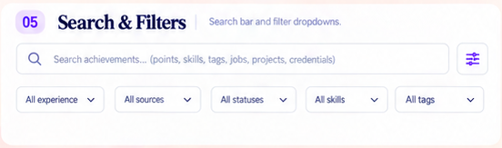

**Files:** Add a focused `src/components/library/category-navigation.tsx` only if useful; integrate with category sections; add `tests/e2e/library-category-navigation.spec.ts`.

- [ ] Render `All`, `Jobs`, `Projects`, `Skills`, and `Credentials` in the reference order, with counts derived from the selected library and current matching data where applicable.
- [ ] Treat these controls as in-page section navigation: selecting one scrolls the corresponding section into view and updates the active/current section state; it does not hide the other categories or modify advanced filters.
- [ ] `All` returns to the page overview/top of the content. If a category has zero entries, show its zero count and either navigate to its truthful empty state or disable only when that choice is genuinely unavailable.
- [ ] Use real section IDs and `aria-current`/appropriate tab semantics; do not claim `role=tab` unless implementing the full tab panel interaction model.
- [ ] Keep the navigation sticky only within the workbench rules and apply anchor offset so section headings remain visible.
- [ ] Test mouse, keyboard, screen-reader labels, active state while scrolling, counts, zero categories, reduced motion, and mobile overflow.

**Acceptance:** Category controls help users jump through the long page and remain separate from search facets and result filtering.

**Visual specification:** Use full-round compact chips about 34-40px high with a 12px label and a small count badge. `All` is selected at the initial overview with orange emphasis as shown; other chips use a quiet surface with clear border. Focus uses the shared violet ring. On narrow widths permit horizontal chip scrolling only with a visible edge cue and keyboard-operable focus; do not shrink labels or cause page-level horizontal overflow.

### Task 18: Add Real Sort, Result Count, And Reset Feedback

**Required image inspection:** Inspect the right side of the workbench and its interaction states. The printed `Most recent` label is a real control only if the implemented choices reorder actual library records.

Reference files: `docs/ui-images/achievement-library/search-workbench-light-dark.png`, `docs/ui-images/achievement-library/search-anatomy-and-states.png`

**Files:** Search component; add a pure sort/view-model helper under `src/lib/data/` only if useful; cover helper under `tests/unit/data/achievement-search.test.ts` and UI in `tests/e2e/library-filters.spec.ts`.

- [ ] Show a visible matching-point count separate from the total summary metrics; use singular/plural copy correctly.
- [ ] If `Sort: Most recent` is interactive, provide real deterministic sort options supported by date/title data (for example most recent, oldest, alphabetical) and preserve stable order for ties or missing dates.
- [ ] If only the reference's default most-recent ordering is implemented, show it as a noninteractive label rather than a dead dropdown.
- [ ] Sorting must never mutate source JSON, saved array order, provenance, or point IDs; it affects only the derived view model.
- [ ] Show `Reset filters` only when the current query/facets are nondefault; reset them without changing data source or theme.
- [ ] Test sort stability, missing/ongoing dates, search/filter composition, count updates, reset visibility, and singular/plural.

**Acceptance:** The result count and any sort affordance describe the exact currently visible data and never imply hidden or lost records.

**Visual specification:** Place sort control at the right of the category/result row on desktop and put the result count aligned with the navigation row. Use a 12-14px control label, compact chevron, and clear focus. Result count is 13-14px secondary text with tabular numerals. On mobile let sort and count wrap onto their own row; do not pin them over content or cut off the menu.

### Task 19: Organize Content Into Jobs, Projects, Skills, And Credentials

**Required image inspection:** Inspect the after-state page map and category section overview before changing grouping. The faded Before panel and its explanatory captions are not product UI.

Reference files: `docs/ui-images/achievement-library/long-page-before-after.png`, `docs/ui-images/achievement-library/page-map-hierarchy-browsing-flow.png`, `docs/ui-images/achievement-library/achievement-overview-light-dark.png`

**Files:** `src/components/achievement-library.tsx`, justified section components under `src/components/library/`, `src/app/globals.css`, and `tests/e2e/library-groups.spec.ts`.

- [ ] Create clear Jobs and Projects regions containing their existing experience groups; Skills and Credentials remain distinct data sections with their real item counts.
- [ ] Preserve current record identity and order unless a tested sort mode changes only the displayed ordering.
- [ ] A search/facet filter must update matching content consistently across point groups, linked skills, and credentials; do not show a point's parent section when no child point matches.
- [ ] Preserve empty sections or omit their body based on the designed zero-state rule; never remove records from the loaded `ResumeLibrary`.
- [ ] Preserve Education or other supported data outside the four illustrated categories; do not mislabel it as a credential or silently hide it. Document the product-approved placement if the current app exposes it.
- [ ] Test mixed category data, empty categories, query results in secondary sections, data source changes, and both personal/demo modes.

**Acceptance:** The hierarchy matches the library's evidence structure without data loss, duplication, or false category assignment.

**Visual specification:** Each top-level section has a concise heading, count, and clear separation; nested job/project groups remain visually subordinate. Use 24px/32px section titles and 8-16px relationships. Each category may use a small colored icon tile consistent with its token; do not use a large full-width saturated banner. Long lists scroll in the document, not inside nested fixed-height cards.

### Task 20: Build Section Headers, Counts, Date Ranges, And Disclosure

**Required image inspection:** Inspect the section-header and expanded-item anatomy; pay attention to the right-aligned date/count and the compact chevron interaction.

Reference files: `docs/ui-images/achievement-library/experience-section-card-anatomy.png`, `docs/ui-images/achievement-library/page-map-hierarchy-browsing-flow.png`

**Files:** Experience group/section components in `src/components/achievement-library.tsx` or `src/components/library/`; `tests/e2e/library-groups.spec.ts`.

- [ ] Show role/company or project name/context, visible point count, and a date range only when dates exist in source data.
- [ ] Format stored `YYYY-MM` values in an accessible month/year format; display `Present` only when `endDate` is actually null, never for an absent/malformed date.
- [ ] If a section is collapsible, use a real button/disclosure with `aria-expanded`, a stable icon, keyboard activation, and preserved focus. Do not make the whole header a button if it also contains independent actions.
- [ ] Preserve filter state and scroll position when a group opens/closes; do not collapse all sections unexpectedly after edits or query changes.
- [ ] Use accessible heading levels and ensure empty groups are either omitted or have a purposeful empty-state message.
- [ ] Test jobs/projects, absent dates, ongoing roles, long names, collapsed/expanded keyboard behavior, and filter results.

**Acceptance:** Every group communicates its type and current content count, and disclosure is stable and accessible.

**Visual specification:** A section header is a full-width, 56-64px minimum row with a 32px icon tile, 12px gap, 16-20px semibold title, 12-14px muted count/date, and a right-aligned chevron if expandable. Use a soft neutral border/surface and at most 8px radius. Date range is secondary and may wrap below the title on narrow screens; count remains visible and is not squeezed behind the chevron.

### Task 21: Build The Achievement Card Surface And Reading Order

**Required image inspection:** Inspect the card in light and dark themes plus the overall card gallery. Compare actual card scale rather than the enlarged poster annotations.

Reference files: `docs/ui-images/achievement-library/achievement-card-light-dark.png`, `docs/ui-images/achievement-library/library-achievement-card-gallery.png`

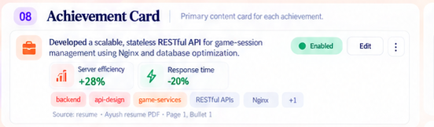

**Files:** `PointRow`/achievement-card component, `src/app/globals.css`, and `tests/e2e/library-cards.spec.ts`.

- [ ] Render one card per real `AchievementPoint`, retaining accessible article/heading structure and unique identity.
- [ ] Arrange available data in this order: experience context where needed, achievement text, quantified metrics, tags/linked skills, and provenance; show enabled state and edit action in the header area when personal source allows.
- [ ] Omit absent metrics/tags/source fields cleanly; do not show blank placeholders, skeleton lines in a loaded card, or sample demo sentences as generic UI copy.
- [ ] Preserve long descriptions and source details; use progressive disclosure only under Task 27 and never truncate without an accessible way to reveal the full value.
- [ ] Keep cards visually stable when a card has zero/one/many metrics, tags, or skills.
- [ ] Test card identity, long text, missing optional fields, both themes, and demo read-only behavior.

**Acceptance:** Cards surface real achievement evidence in the board's scan order while preserving every supported field.

**Visual specification:** Use a single white/cool-neutral card with thin 1px border, subtle XS shadow in light mode, dark surface and visible border in dark mode, up to 8px radius, and 16px internal padding. Keep a 12-16px gap between cards. A 32-40px category icon tile may sit left of the title; maintain a 12px gap. Do not create separate nested cards for each metric or tag group; use aligned subrows and low-contrast dividers instead.

### Task 22: Style Achievement Narrative, Role Context, And Summary Text

**Required image inspection:** Inspect the annotated card's title/context/summary regions and the before/after content comparison to distinguish the achievement sentence from the experience heading.

Reference files: `docs/ui-images/achievement-library/achievement-card-anatomy.png`, `docs/ui-images/achievement-library/achievement-card-before-after.png`

**Files:** Achievement-card component and `tests/e2e/library-cards.spec.ts`.

- [ ] Keep job/project title, organization/role, and date context separate from the achievement point's actual `text`.
- [ ] Render achievement text as the most prominent body content in the point card, at 14px/20px regular or the existing app body style; preserve exact text without rewriting or AI summarization.
- [ ] Use a subtle leading accent rule only if it remains visible in both themes and does not imply unverified positive status.
- [ ] Allow natural wrapping and `overflow-wrap:anywhere` for unusually long words/URLs; avoid line clamp unless full content is still accessible by a tested disclosure control.
- [ ] Do not include demo sample copy in empty/default production states.
- [ ] Test multiline text, punctuation, long tokens, source change, and zoom/narrow layout.

**Acceptance:** Users can scan the actual achievement sentence without confusing it with its employer/project context.

**Visual specification:** Keep title/context at 16-18px/24px semibold with organization/date at 12-14px/18px secondary. Achievement text uses 14px/20px, primary text color, and 8-12px separation from context. A 2px orange/neutral leading line may mark the text block but must not carry status meaning. Never force fixed card height to reproduce a compact poster sample.

### Task 23: Present Quantified Metrics With Evidence And Context

**Required image inspection:** Inspect the card's two-metric row and metric typography/color sample. Use the illustrated values solely to understand layout, never as real results.

Reference files: `docs/ui-images/achievement-library/achievement-card-anatomy.png`, `docs/ui-images/achievement-library/achievement-card-type-color-spacing.png`

**Files:** Achievement-card metric renderer; optional pure formatter under `src/lib/`; `tests/e2e/library-cards.spec.ts` and a focused unit test if formatting logic is extracted.

- [ ] For each `Metric`, show the real label, value, optional unit, evidence, and optional context without changing its meaning.
- [ ] Keep the evidence string inspectable; do not hide it behind hover or discard it to save space.
- [ ] Use color/icons as secondary distinction only. Positive-looking values in board examples are not proof of success; do not add green arrows or positive emphasis unless the stored metric explicitly supports it.
- [ ] Handle no metrics, one metric, odd counts, long labels/evidence, units, and long numeric strings without overflow.
- [ ] Preserve all metric IDs and values through edit/save; no metric is duplicated between collapsed and expanded presentation.

**Acceptance:** Every displayed metric remains traceable to its saved evidence and is readable at all viewports.

**Visual specification:** Use a responsive two-column grid when at least two metrics fit; each row aligns a small 20-24px icon/tile, 12-14px label, and 18-22px semibold value. Evidence/context uses 12px/16px muted text below or in an accessible details region. Use subtle neutral/violet/orange surfaces with no metric-specific floating card nesting. Stack metrics at 320-390px and maintain 8-12px spacing.

### Task 24: Style Tags, Linked Skills, And Overflow Chips

**Required image inspection:** Inspect the card tag row, the UI-kit chip gallery, and the search skill/tag examples before defining removable or clickable chip behavior.

Reference files: `docs/ui-images/achievement-library/achievement-card-type-color-spacing.png`, `docs/ui-images/achievement-library/library-chip-status-gallery.png`, `docs/ui-images/achievement-library/library-search-filter-gallery.png`

**Files:** `PointRow`/achievement card and `tests/e2e/library-cards.spec.ts`; preserve `onTag` and `onSkill` handlers.

- [ ] Render tags and linked skills distinctly but compactly; keep current click-to-filter behavior for tags and skills.
- [ ] Preserve exact skill names from referenced IDs; ignore dangling IDs visually only if schema/load validation explicitly permits them, and never invent a fallback skill label.
- [ ] Use a maximum visible-chip rule only when overflow is conveyed with a working `+N` disclosure that reveals all hidden labels.
- [ ] Do not use removable-chip affordances inside a read-only card; remove behavior belongs in the editor if supported.
- [ ] Test duplicate-free display, long tag names, keyboard activation, active-filter result changes, hidden-chip expansion, and demo read-only behavior.

**Acceptance:** Facet chips support efficient filtering while preserving all tags/skills in data and their semantic distinction.

**Visual specification:** Chips are 24-30px tall, full-round, with 11-12px text and 8px horizontal padding. Tags use a subtle orange/coral fill or outline; linked skills use neutral or violet-soft fill; selected filter state has a visible violet border/fill and accessible state. Keep 6-8px gaps. A `+N` chip is a button only if it opens/reveals the remaining labels; do not display a decorative count that loses information.

### Task 25: Keep Source And Provenance Visible And Inspectable

**Required image inspection:** Inspect the source line in the card anatomy and the full card sample at readable scale. The board's resume/PDF/page/bullet values are examples, not defaults.

Reference files: `docs/ui-images/achievement-library/achievement-card-anatomy.png`, `docs/ui-images/achievement-library/achievement-card-before-after.png`

**Files:** Achievement-card component; do not modify the source schema/load contract; add/extend `tests/e2e/library-cards.spec.ts`.

- [ ] Display `point.source.type` and available `label`/`reference` fields as provenance, not decorative metadata.
- [ ] Include a clear `Source:` label or equivalent accessible context and preserve punctuation/content safely.
- [ ] When the source lacks a label/reference, omit the empty segment rather than appending separators or a fictitious page/bullet location.
- [ ] Keep provenance visible in the normal card or provide a tested, keyboard-accessible details affordance that does not require hover.
- [ ] Do not render personal file paths or sensitive local paths that are not already intentionally exposed by the product; use the existing safe source label/reference behavior.
- [ ] Test each source type, optional fields, long references, light/dark contrast, and responsive wrapping.

**Acceptance:** Users can see where a point came from without being shown invented or unsafe source details.

**Visual specification:** Place provenance after tags/metrics at 11-12px/16px with muted but readable text. Keep `Source:` and the source type distinguishable by weight, then use a separator only when a following label/reference exists. Give the row enough width to wrap; do not ellipsize the only audit trail. A thin divider above it is optional and should remain subtle.

### Task 26: Present Enabled State And Supported Card Actions

**Required image inspection:** Inspect the enabled/disabled card examples and the interaction strip; distinguish actual status from the presentation's decorative controls.

Reference files: `docs/ui-images/achievement-library/achievement-card-interaction-states.png`, `docs/ui-images/achievement-library/library-chip-status-gallery.png`

**Files:** `PointRow`/card component, existing point editor integration, `src/app/globals.css`, and `tests/e2e/library-editing.spec.ts`.

- [ ] Pair the stored `point.enabled` value with a text label `Enabled` or `Disabled` and a semantic icon/color.
- [ ] Personal data may expose the current `Edit` action. Demo data must not show an enabled editor action or call a disabled state editable.
- [ ] Preserve existing status filtering and save behavior; status updates occur through the real editor/API only.
- [ ] Do not add a status toggle directly to the card unless the API/confirmation/undo semantics are explicitly designed and tested.
- [ ] Do not add favorite/heart, delete/trash, or overflow actions because the current schema/route does not support them.
- [ ] Test enabled/disabled rendering, filter alignment, demo action absence, edit success/failure, keyboard operation, and status color plus text.

**Acceptance:** Status is truthful, text-backed, and consistent with existing filter/edit contracts.

**Visual specification:** Enabled uses a compact pale-green pill with green dot/check and 12px/16px text; Disabled uses a pale-red neutral-readable pill with an explicit `Disabled` label. Do not rely on green/red alone. Edit is a neutral 36-40px outlined/ghost action, 12-14px semibold, with pencil icon. Hover/pressed may adjust surface/border, while focus has a visible ring. Keep pill/button dimensions stable and fit within the card header.

### Task 27: Integrate Expanded Details, Editing, And Read-Only Demo States

**Required image inspection:** Inspect the section anatomy, expanded item detail, and edit/status card states before changing disclosure or editor placement.

Reference files: `docs/ui-images/achievement-library/experience-section-card-anatomy.png`, `docs/ui-images/achievement-library/achievement-card-anatomy.png`, `docs/ui-images/achievement-library/achievement-card-interaction-states.png`

**Files:** `src/components/achievement-library.tsx`, `src/components/achievement-point-editor.tsx`, `src/components/achievement-imagination.tsx` only for integration, `tests/e2e/library-editing.spec.ts`, and `tests/e2e/library-groups.spec.ts`.

- [ ] If progressive disclosure is added, preserve a visible summary and a real expand button with `aria-expanded`; the expanded region must reveal, not replace, source, metrics/evidence, context, tags, and linked skills.
- [ ] Preserve the existing detailed editor's ID, text, tags, skills, metrics, provenance, enabled state, validation, duplicate-ID handling, save, cancel, and persistence.
- [ ] Preserve the existing assisted creation flow separately from manual detailed entry; both must close/cancel and save using current contracts.
- [ ] Keep demo data read-only and label it fictional; no edit button should open an editor that cannot persist.
- [ ] Preserve an error message and entered values when save fails; do not collapse the card or close the editor on failure.
- [ ] Test keyboard open/close, focus return, unsaved cancel, failed/successful saves, refresh persistence, duplicate ID, and mobile editor fit.

**Acceptance:** Visual disclosure and editing integrate with existing, tested data flows and do not lose user-entered details.

**Visual specification:** Summary state keeps role/project context, concise point text, status, and supported edit action visible. Expanded state uses the same card surface with a 12-16px inset content region, not a second floating card; use a subtle divider between summary and details. Chevron rotates only if motion is allowed. Manual editor and Imagination Canvas retain their own clear headings, focus management, error states, and close/cancel actions. Keep modal content viewport-bounded and internally scrollable on mobile.

### Task 28: Complete Responsive, Empty, Error, And Accessibility States

**Required image inspection:** Inspect the overview, responsive sidebar example, search state strip, and accessibility panels. Supplied boards do not provide a full mobile Achievement Library screenshot; do not claim pixel matching for an unprovided mobile design.

Reference files: `docs/ui-images/achievement-library/achievement-overview-light-dark.png`, `docs/ui-images/achievement-library/sidebar-active-collapsed-variants.png`, `docs/ui-images/achievement-library/search-anatomy-and-states.png`, `docs/ui-images/achievement-library/profile-interaction-accessibility.png`, `docs/ui-images/achievement-library/long-page-benefits.png`, `docs/ui-images/achievement-library/library-component-principles.png`

**Files:** Library components and `src/app/globals.css`; focused `tests/e2e/library-responsive.spec.ts`, `tests/e2e/library-empty-states.spec.ts`, and component-specific keyboard tests.

- [ ] At 1440px use the wide summary and filter rows; at 1024/768px wrap metrics/filters and keep sections full width; at 390/320px stack summary, search, controls, content, and metric tiles without hiding actions.
- [ ] Keep page-level horizontal overflow absent and test nested search chips, long metadata, metric rows, source references, and editor dialogs.
- [ ] Distinguish no data, no search matches, unavailable personal file, and demo read-only states with concise messages and correct semantics; preserve the current loader error and alternate-source route.
- [ ] Provide semantic landmarks/headings, labels, descriptive icon names, active route state, visible keyboard focus, text-backed status, and focus management for editor dialogs.
- [ ] Maintain 44x44px touch targets where practical, WCAG AA text contrast, `prefers-reduced-motion`, and no hover-only critical data.
- [ ] Test all applicable states in light/dark and at widths 320, 390, 768, 1024, and 1440 CSS pixels; test keyboard navigation and representative long content.

**Acceptance:** All real content/actions remain available at small widths; empty/error/read-only states are understandable, accessible, and non-overlapping.

**Visual specification:** At mobile widths, use one column and 12-16px page inset; summary metrics become a compact 2-column grid, filters stack or scroll within their region, category chips remain keyboard-operable, and cards grow vertically. Never shrink text to fit. Sticky workbench must not cover content or focused controls. Focus is a clear 2px violet ring with offset; status uses text plus color/icon; motion is not required to understand a state.

### Task 29: Add Component Tests And Final Visual Acceptance

**Required image inspection:** Before final acceptance, open the full composition and every component crop relevant to the test under review. The paired overview and component-kit crops below are minimum page-level references; tasks 1-28 link their own mandatory component images.

Reference files: `docs/ui-images/achievement-library/achievement-overview-light-dark.png`, `docs/ui-images/achievement-library/library-color-palette.png`, `docs/ui-images/achievement-library/library-type-scale.png`, `docs/ui-images/achievement-library/long-page-before-after.png`, `docs/ui-images/achievement-library/achievement-card-light-dark.png`

**Files:** At minimum preserve/extend `tests/e2e/library.spec.ts`, `tests/e2e/library-editing.spec.ts`, and `tests/unit/data/achievement-search.test.ts`; add focused files such as `tests/e2e/library-shell.spec.ts`, `library-header.spec.ts`, `library-summary.spec.ts`, `library-search.spec.ts`, `library-filters.spec.ts`, `library-category-navigation.spec.ts`, `library-groups.spec.ts`, `library-cards.spec.ts`, and `library-responsive.spec.ts` only for new behavior not already covered. Keep each component's tests in a clearly named file.

- [ ] Every new interactive component and non-trivial helper/function has focused coverage; avoid duplicate tests that only rename existing assertions.
- [ ] Preserve regressions for source switching, group/provenance display, combined search/facets, empty results, reset, create/edit/cancel/save, duplicate ID, demo read-only, theme, and mobile layout.
- [ ] Compare product screenshots in light and dark mode at 1440x900 and 390x844; add 1024x768 and 320px checks for wrapping/overflow. Capture the application viewport only, not the poster or browser dev overlays.
- [ ] Exercise search, filters, category navigation, sorting (if present), disclosure, hover/focus/pressed states, edit, create, error, no-results, and source changes; inspect console/network errors.
- [ ] Before PR run `npm run lint`, `npm run typecheck`, `npm test`, and relevant `npm run test:e2e`; report environment failures separately and do not claim tests passed if the server/browser could not start.
- [ ] Run `git diff --check`; confirm no personal JSON, local logs, `.env*`, generated files, unsupported API behavior, unrelated route redesign, or poster assets entered the implementation diff.

**Acceptance:** Focused and existing tests pass, both themes and responsive layouts are visually reviewed, all app behavior is truthful, and the PR is limited to the Achievement Library UI.

**Visual acceptance checklist:** Compare the current app pane to the matching crop at equivalent scale. Verify heading/context hierarchy, shared palette decision, exact fonts remain unchanged, summary identity/counts are real, add/edit/source controls work, search and all existing facets compose, category navigation reaches sections, sort is not a dead control, sticky workbench never overlays content, group/date/count metadata is correct, card metrics retain evidence, tags/skills remain distinct, provenance stays inspectable, enabled/disabled states include labels, demo stays read-only, and light/dark surfaces remain legible. Check 320px, 390px, 768px, 1024px, and 1440px, keyboard focus, reduced motion, empty/error states, and no console errors. Do not ship fake user/profile values, sample achievement claims, favorite/delete controls, Go Pro, poster decorations, page-wide gradients, decorative orbs, clipped text, or horizontal overflow.

## Out Of Scope And Dependencies

- Changes to `docs/project-plan.md` backend/API contracts, `ResumeLibrary`/achievement schemas, personal-data paths, loader validation, AI prompts/providers, Gemini behavior, achievement writing/selection, PDF generation, and resume-generation workflows are out of scope.
- The sample `View details` action needs a real destination before implementation. Do not add a dead link or invent profile editing.
- Favorite/heart and delete/trash actions need explicit data/API behavior, confirmation/undo policy, and tests; visual references alone do not authorize them.
- Any new sort modes must be deterministic from existing dates/title and tested as a derived view only. Do not mutate or save reordered source data.
- Current app-wide orange/violet/border tokens differ from some printed values in this board and `UI_Tasks_home.md`. A coordinated shared-token decision is required before claiming exact cross-page color fidelity.
- The boards' Playfair Display/Inter annotations do not override the product requirement to retain current Georgia/Times and Arial/Helvetica fonts.
- Demo names, companies, achievement text, dates, metric values, and counts are illustrative. Never copy them into production defaults or use personal library data in tests/screenshots.
- Decorative poster artwork, UI-kit panels, handwritten notes, slide counters, Pro upsell, fake account controls, fabricated ATS/resume score, and presentation backgrounds must not ship in the product page.
