# Home Page UI Redesign Task Plan

## Purpose And Scope

This document is the frontend companion to [`project-plan.md`](project-plan.md). It turns the supplied Resume Changer UI boards into an ordered, component-by-component implementation plan for the application's home page. In this application, "home page" means the Job Description workspace at `/`, not a public marketing or landing page. The target is the product screen shown inside the full-page concept: persistent navigation sidebar, compact top bar, job setup form, and a truthful analysis preview.

Nine image files were supplied; the first and last are duplicates of the UI-kit overview, leaving eight distinct boards. Each was reviewed individually. The overview establishes shared tokens; the other boards specify the action bar, ATS preview, job-description editor, role-details form, header/top bar, sidebar, and complete home-page composition. The full-page concept is the layout authority; component boards are detail specifications.

This is a visual and interaction plan, not authorization to change backend behavior. Preserve the existing local-first draft workflow, validation, character/token count, analyze request, analysis cache, error behavior, theme preference, navigation destinations, and accessibility semantics. Do not change AI prompts, APIs, schemas, selection logic, PDF generation, or storage contracts as part of these UI tasks. If a visual asks for functionality that does not exist, identify the dependency and do not ship a fake or unsafe control.

## Reference Interpretation

- **Palette and use:** Primary violet `#7C3AED` is for AI actions, active emphasis, focus, and analysis accents; light violet `#A78BFA` is secondary emphasis; violet subtle `#EFEBFF` is a quiet selected/pro-tip surface. Orange `#FF7A45` is the main Save action and required/attention accent; light orange `#FDBA74` is a softer accent; orange subtle `#FFE9E0` is a light badge surface. Use text primary `#0F172A`, secondary `#334155`, border `#CBD5E1`, surface `#F8FAFC`, alternate surface `#F1F5F9`, inverse `#FFFFFF`, success `#10B981`, warning `#F59E0B`, error `#EF4444`, and info `#3B82F6`. Gradients `#7C3AED → #A855F7` and `#FF7A45 → #FDBA74` are accents for branded/AI controls only, not page backgrounds or decorative section fills.
  **Shared-token reconciliation (Achievement Library Task 02):** these values are the single shared token source in `src/app/globals.css`, reconciled with [`UI_Tasks_achievement_library.md`](UI_Tasks_achievement_library.md) so the home page and the library render the same palette. Orange is used as a fill with the dark label `#0F172A`; orange _text_ uses the darker orange-strong `#B23C0C` so small labels stay readable, so the reference's white-on-orange text is not used.
  **Required visual reference:** Before applying these tokens, open and inspect the palette crop. This image is mandatory reference material.

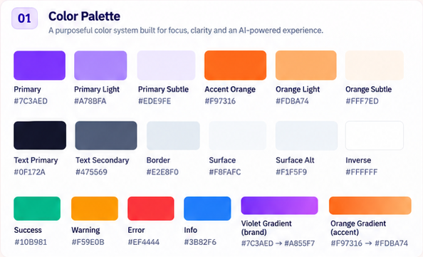

- **Dark palette behavior:** Use deep ink page and sidebar surfaces, a slightly lifted card surface, a clear one-pixel border, pale primary text, muted gray secondary text, and the same semantic violet/orange/status hues adjusted only as needed for contrast. Do not simply invert light colors, use pure black, or put light-mode shadows on dark cards. Active navigation is a tinted violet surface; primary Save remains orange; AI action remains violet.
  **Required visual reference:** Open and inspect the dark-mode sidebar and action-bar crops before implementing dark surfaces. The screenshot colors are visual references; use written/project contrast rules where necessary.

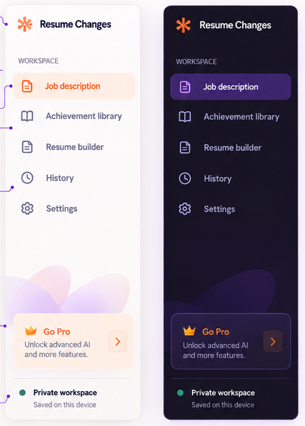

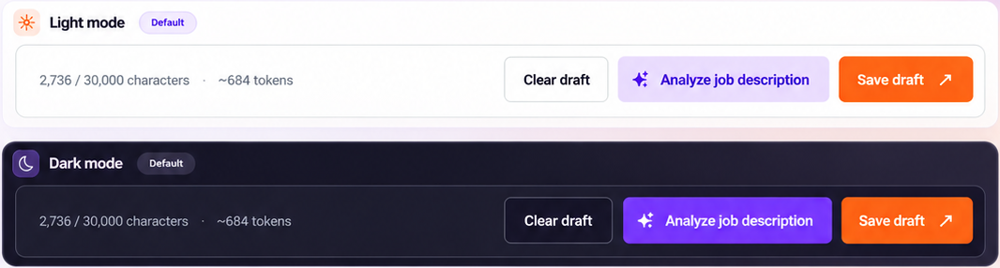

- **Type and exact scale:** Keep existing Arial/Helvetica body, control, metadata, and navigation fonts, and Georgia/Times brand/page-title treatment. Do not use Inter, even though some boards label it. Use display/page title 40px/48px bold where the existing page-title style permits; section heading 24px/32px semibold; card heading 16px/24px semibold; field label 14px/20px semibold; body 14px/20px regular; large supporting copy 16px/24px; helper 12px/16px; caption 12px/16px; micro-label 11px/14px. On mobile the page title may step down to 32px/40px, but must not be viewport-scaled. Keep letter spacing at `0`, per project convention.
  **Required visual reference:** Inspect the typography crop before choosing text sizes, weights, and hierarchy. It includes the board's Inter labels; those are not permission to change this app's existing fonts.

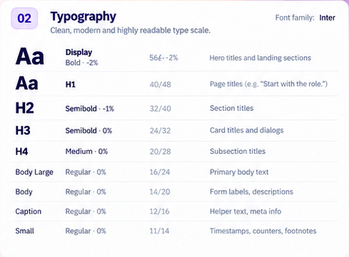

- **Spacing and proportions:** Use the board's 4/8/12/16/24/32/48/64px spacing values. Use 24px desktop form/card insets where space allows, 16px for compact preview content, 16-24px between major columns, 12px between related controls, and 8px between label/helper pairs. Reduce insets to 16px on tablet and 12-16px on narrow mobile. Keep a compact control radius of 6px, card radius no greater than 8px unless a matching established project token requires otherwise, and full-round shapes only for small status/category chips and circular icon/avatar controls.
  **Required visual reference:** Inspect the spacing crop and spacing-scale crop. Match this grid rhythm rather than eyeballing inconsistent gaps.

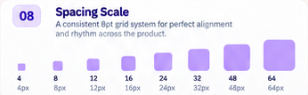

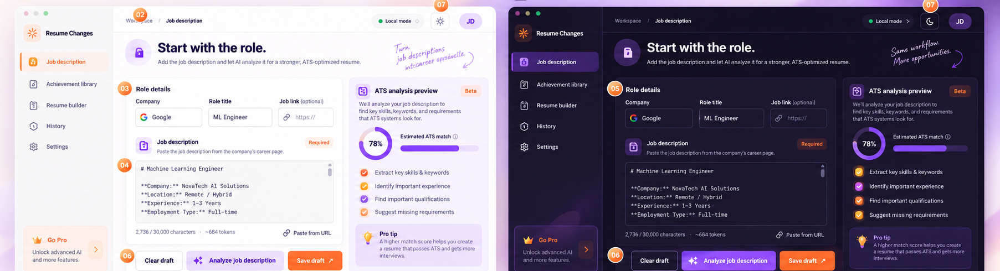

- **Border and shadow appearance:** Inputs and buttons have a crisp `1px` border; cards use a subtle `1px` neutral border and a very soft low-elevation shadow in light theme. Dark theme relies primarily on a visible border and surface step, not glow. The UI kit demonstrates None, XS, Sm, Md, Lg, and XL shadow levels: home should use no shadow for nested elements, XS for inputs/actions where needed, and at most Sm for the primary form/preview surfaces. Do not stack cards inside cards.
  **Required visual reference:** Inspect the shadow-scale and radius-scale crops before assigning card elevation or corner radii. The labeled radius examples are references; the app's compact-card constraints still apply.

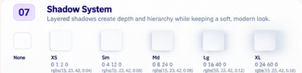

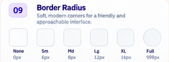

- **Button reference:** Save draft is orange with white semibold text and a northeast arrow icon; Analyze job description is violet with white or high-contrast violet styling and a sparkle icon; Clear draft is neutral/outlined and intentionally lower emphasis. The boards show default, hover, pressed, disabled, and loading examples. Use stable 44px control height, 12px button gaps, roughly 20px horizontal padding for primary actions, visible focus, subtle 200ms hover transition, and approximately 0.98 pressed scale for 100ms. Loading label and spinner replace the idle label without resizing the button.
  **Required visual reference:** Inspect the input-fields crop for text and textarea default, focused, filled, error, and disabled states. Do not copy sample Google values into production.

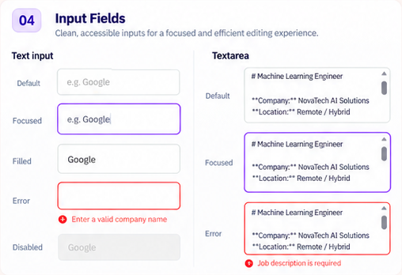

- **Field reference:** Text inputs are white/light-surface rectangles with a `1px` neutral border, `6px` radius, left icon only where meaningful, `14px` entered text, and 12-14px horizontal padding. Focus uses a `2px` violet outline/ring; filled fields keep the neutral border; errors use a red border plus an error icon/message; disabled fields use an alternate gray surface and readable muted text. Textareas have the same border/radius, `14px/20px` text, inner padding, native vertical scrolling, and no horizontal overflow.
  **Required visual reference:** Inspect the chip/badge crop before creating shared variants. Reuse these visual forms only for matching real concepts in the product.

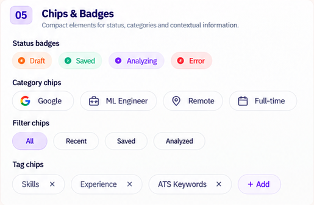

- **Badge/chip reference:** Small status badges are compact, roughly 24-28px high, with a pale semantic fill, colored dot/icon, and 12-14px text: Draft/orange, Saved/green, Analyzing/violet, Error/red. Category chips are outlined, content-sized pills with small leading brand/category icons (the board examples are Google, ML Engineer, Remote, Full-time). Filter chips show one soft-violet selected state among neutral options (All, Recent, Saved, Analyzed). Tag chips show a label and a trailing remove icon (Skills, Experience, ATS Keywords) followed by a bordered + Add action. These are component variants in the UI kit, not a requirement to add unrelated chips or filters to the home page.
  **Required visual reference:** Inspect the role-details and analysis-card crop. It shows the two distinct surface anatomies; never combine them into one nested card.

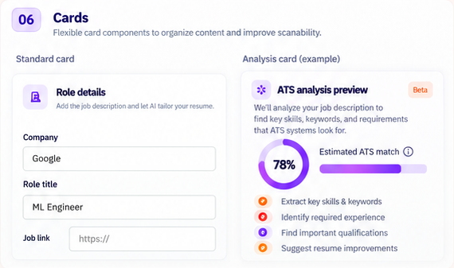

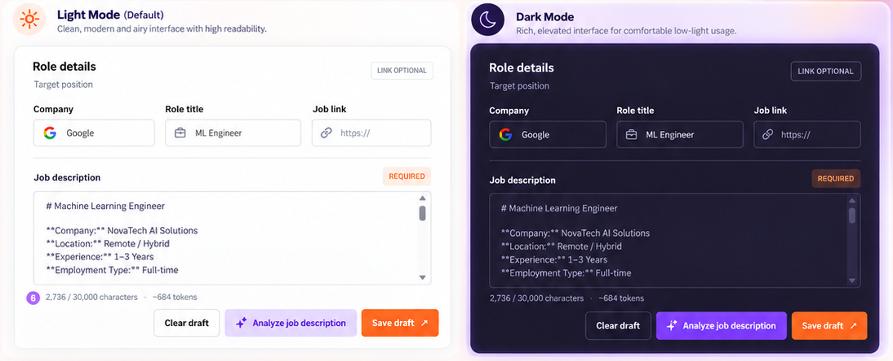

- **Card anatomy:** The role form uses one main surface, not multiple nested cards: section title/supporting label at top, optional badge right, metadata fields, divider, required JD editor, metadata footer, then actions. The analysis preview uses one separate surface: small violet icon tile plus title and orange Beta badge, short description, real-data summary, and optional subtle tip surface. Do not reproduce sample values as live content.
  **Required visual reference:** Open all three crops before choosing space, shadow, and radius tokens; they isolate the small labeled examples at the bottom of the kit board.

- **Spacing/radius board tokens:** The UI-kit scale is 4/8/12/16/24/32/48/64px. Its radius examples are None 0, Sm 6, Md 8, Lg 12, XL 16, Full 999px. Prefer None/6/8px for this operational workspace; use Full only for the small rounded badges and circular controls, not cards or large buttons.
- **Exact home-screen copy:** Use `Workspace / Job description` in the breadcrumb; `NEW APPLICATION` and `01 / 04` above `Start with the role.`; supporting text `Add the job description and let AI analyze it for a stronger, ATS-optimized resume.` when it fits the real workflow; section `Role details` and support `Target position`; fields `Company`, `Role title`, `Job link`; `LINK OPTIONAL`; JD label `Job description`, `REQUIRED` and helper `Paste the job description from the company's career page.`; actions `Clear draft`, `Analyze job description`, `Save draft`; analysis title `ATS analysis preview` and the reference description `We'll analyze your job description to find key skills, keywords, and requirements that ATS systems look for.`. Keep copy sentence case except the reference's compact uppercase eyebrow/badges.
- **Reference-only values and artwork:** `Google`, `ML Engineer`, `NovaTech AI Solutions`, example JD text, `2,736 / 30,000 characters`, `~684 tokens`, and `78%` illustrate the boards. Use synthetic test fixtures only, not hardcoded production defaults. The heading/description may be used only where truthful for the current workflow.
- **Product screen versus presentation board:** Recreate the app region in the full-page concept, not the poster. Do not reproduce cream/pink poster canvas, handwritten annotations, numbered callouts, explanatory cards, component inventories, marketing copy, or floating document/sparkle artwork. Keep the app's own canvas quiet, operational, and responsive.
- **Layout conflict resolution:** Sidebar owns the persistent product mark/name. Topbar starts with breadcrumb and existing supported local/theme controls; do not repeat the logo. Do not invent a signed-in account/profile. Main page title spans the content grid; form and analysis preview are the primary working surfaces.
- **No promotional upsell:** The sidebar boards show a `Go Pro` card. It is reference-only and must not appear in the application. Do not create a fake subscription, pricing, upgrade, or account capability.
- **Honest analysis UI:** The boards use `78%` and green/orange checklist distributions as illustrative art. Do not hardcode/infer an ATS match score, resume coverage, successful check, or recommendation from the artwork. `docs/project-plan.md` lists **ATS Readiness Review** as future work. Until an approved backend/data contract supplies real scores and check results, show only clearly named, data-backed JD-analysis content; omit the numeric ring and any claims that require a resume comparison.

### Required Image Links For Reference Interpretation

Before implementing any guidance in Reference Interpretation, open and inspect the corresponding crop below. Each crop is mandatory source material; its written location and embedded preview are both provided here.

- **Palette and use:** docs/ui-images/home/ui-kit-palette.png

  

- **Dark palette behavior:** docs/ui-images/home/sidebar-light-dark.png and docs/ui-images/home/action-bar-light-dark.png

  

  

- **Type and exact scale:** docs/ui-images/home/ui-kit-type-scale.png

  

- **Spacing and proportions:** docs/ui-images/home/ui-kit-spacing-scale.png and docs/ui-images/home/job-page-full-layout-both-themes.png

  

  

- **Border and shadow appearance:** docs/ui-images/home/ui-kit-shadow-scale.png and docs/ui-images/home/ui-kit-radius-scale.png

  

  

- **Button reference:** docs/ui-images/home/ui-kit-buttons.png and docs/ui-images/home/action-bar-button-states.png

  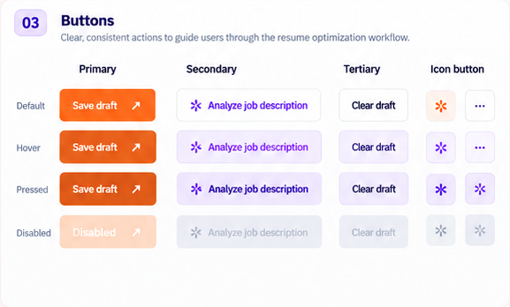

  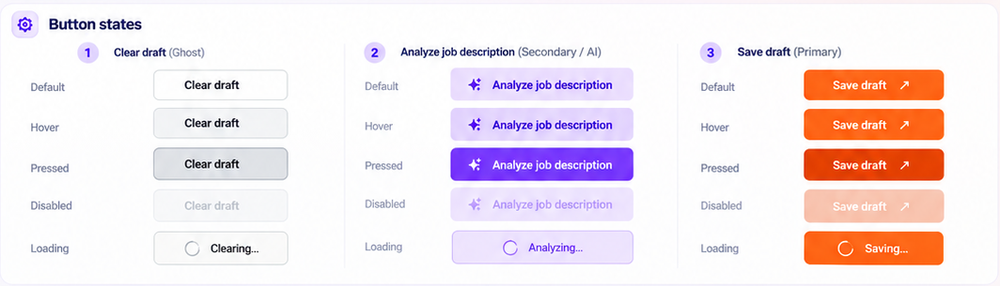

- **Field reference:** docs/ui-images/home/ui-kit-input-fields.png and docs/ui-images/home/jd-editor-input-states.png

  

  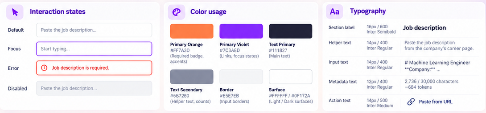

- **Badge and chip reference:** docs/ui-images/home/ui-kit-chips-badges.png

  

- **Card anatomy:** docs/ui-images/home/ui-kit-cards.png and docs/ui-images/home/role-details-anatomy-and-field-behavior.png

  

  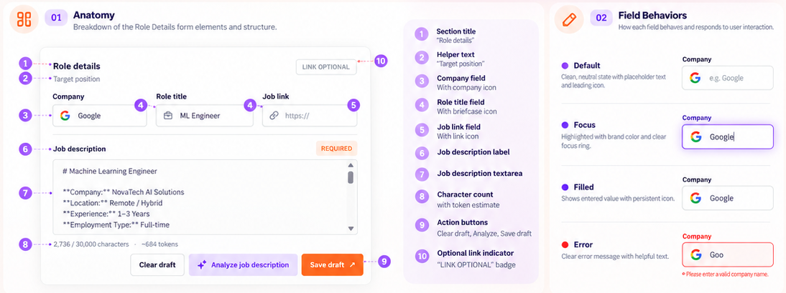

- **Spacing and radius tokens:** docs/ui-images/home/ui-kit-spacing-scale.png and docs/ui-images/home/ui-kit-radius-scale.png

  

  

- **Exact home-screen copy:** docs/ui-images/home/header-page-heading-themes.png, docs/ui-images/home/role-details-full-form-themes.png, and docs/ui-images/home/jd-editor-light-dark.png

  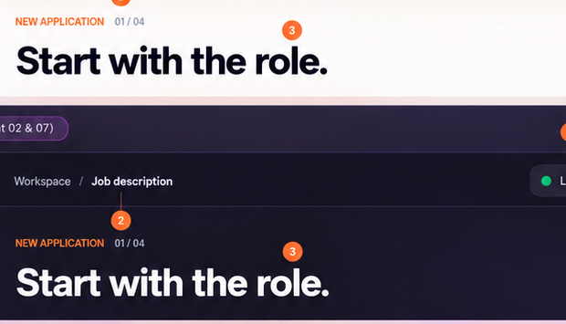

  

  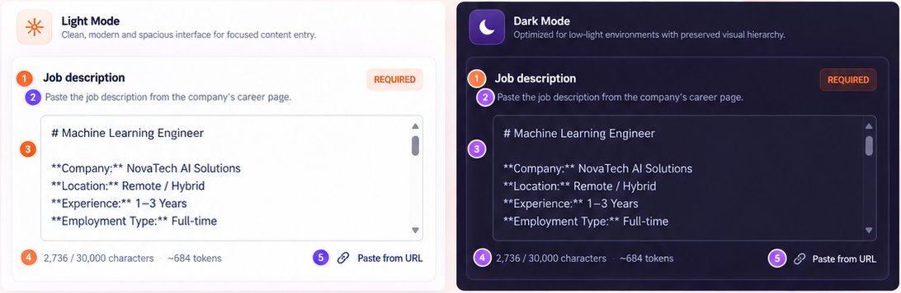

- **Reference-only values and artwork:** docs/ui-images/home/job-page-full-layout-both-themes.png and docs/ui-images/home/ats-preview-light-dark.png

  

  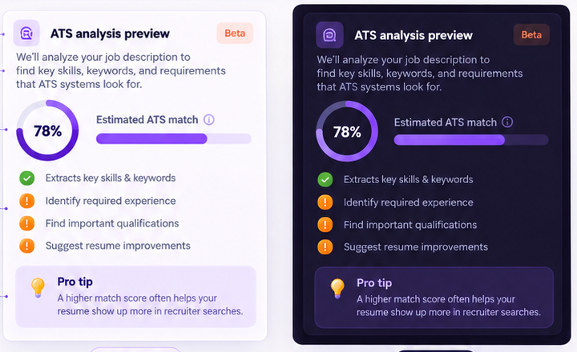

- **Product screen versus presentation board:** docs/ui-images/home/job-page-full-layout-both-themes.png

  

- **Layout conflict resolution:** docs/ui-images/home/sidebar-light-dark.png and docs/ui-images/home/header-topbar-themes.png

  

  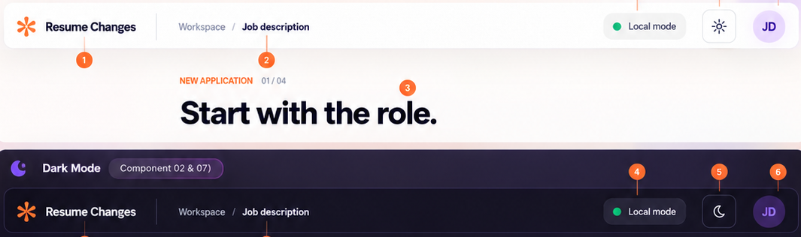

- **No promotional upsell:** docs/ui-images/home/sidebar-workspace-status.png

  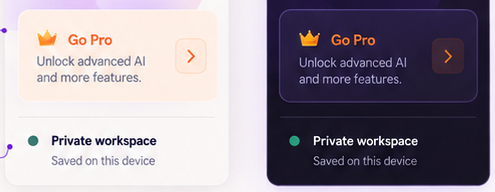

- **Honest analysis UI:** docs/ui-images/home/ats-preview-light-dark.png and docs/ui-images/home/ats-preview-component-anatomy.png

  

  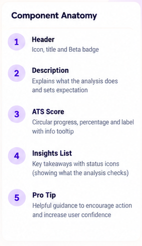

### Additional Exact Token Values From The Boards

The light-theme hex values printed on the UI-kit board are the source tokens. The dark-mode board is visual-only and has no printed hex labels; the dark values below are explicit starting estimates to make implementation/test review reproducible, and must be contrast-checked against the rendered controls before acceptance.

**Reconciled with the Achievement Library board (Task 02).** The home board and the Achievement Library board print different orange, violet-soft, text-secondary, and border values. The values below are now the single shared token source in `src/app/globals.css` for both plans: the Achievement Library board's printed values won where the two boards disagreed, and the dark column carries the matching dark equivalents. See [`docs/ui-audit/library-task-02/README.md`](../ui-audit/library-task-02/README.md) for the printed-versus-estimated breakdown.

| Token             | Light reference | Dark starting value | Intended use                        |
| ----------------- | --------------- | ------------------- | ----------------------------------- |
| Canvas            | `#F8FAFC`       | `#151522`           | Main workspace background           |
| Sidebar           | `#FAFBFD`       | `#0F1220`           | Persistent navigation surface       |
| Surface           | `#FFFFFF`       | `#17192D`           | Form and preview                    |
| Surface alternate | `#F1F5F9`       | `#202238`           | Inputs, hover and secondary regions |
| Text primary      | `#0F172A`       | `#F8FAFC`           | Titles and entered values           |
| Text secondary    | `#334155`       | `#C4C8D8`           | Supporting copy and navigation      |
| Border            | `#CBD5E1`       | `#34374F`           | Input/card outlines and dividers    |
| Violet primary    | `#7C3AED`       | `#7C3AED`           | AI button and selected actions      |
| Violet light      | `#A78BFA`       | `#A78BFA`           | Focus/highlight/icon                |
| Violet subtle     | `#EFEBFF`       | `#302342`           | Selected and tip surfaces           |
| Orange primary    | `#FF7A45`       | `#FF7A45`           | Save action and required markers    |
| Orange light      | `#FDBA74`       | `#FDBA74`           | Soft orange accent                  |
| Orange subtle     | `#FFE9E0`       | `#40251F`           | Beta/required badge backgrounds     |
| Success           | `#10B981`       | `#34D399`           | Saved/confirmed state               |
| Warning           | `#F59E0B`       | `#FBBF24`           | Attention state                     |
| Error             | `#EF4444`       | `#F87171`           | Validation/failure state            |
| Info              | `#3B82F6`       | `#60A5FA`           | Neutral information                 |

The orange fill carries the dark label `#0F172A` (`#151522` in dark mode) because white on `#FF7A45` is only 2.6:1. Small orange text uses the darker orange-strong `#B23C0C` (light) and `#FDBA74` (dark) so a 9-12px label still clears 4.5:1.

The board's full type scale is Display 56/64 bold, H1 40/48 bold, H2 32/40 semibold, H3 24/32 semibold, H4 20/28 medium, Body Large 16/24 regular, Body 14/20 regular, Caption 12/16 regular, and Small 11/14 regular. Preserve the app's existing font families and apply the H1 scale to this page rather than the 56px poster title. The spacing scale is 4/8/12/16/24/32/48/64px; radius examples are 0/6/8/12/16/999px; the shadow board shows None/XS/Sm/Md/Lg/XL, with home cards limited to XS/Sm. Use orange for the primary Save action and required markers, violet for AI action/focus/selection, neutral surfaces for form fields, and semantic status colors only when the associated status is real.

## Current Code Map

- `src/app/page.tsx` mounts the home page.
- `src/app/layout.tsx` provides the global shell and stylesheet.
- `src/components/workspace-shell.tsx` owns sidebar, breadcrumb, local-mode status, and persistent theme toggle.
- `src/components/jd-workspace.tsx` owns JD/role fields, draft persistence, validation, analysis request and result states.
- `src/app/globals.css` contains global tokens and home-page, shell, form, and responsive styles.
- `src/lib/jd-draft.ts` owns the existing draft shape, validation, maximum character count, and token estimate; these are behavior contracts, not redesign targets.
- `src/lib/jd-analysis-cache.ts` owns the current analysis cache contract; preserve it.
- `tests/e2e/home.spec.ts` covers home navigation, draft persistence, validation, theme persistence, and viewport behavior.
- Existing Playwright conventions live under `tests/e2e/`; pure helper tests live under `tests/unit/`.

As components are separated, prefer focused files under `src/components/home/` (or another existing, consistent location) and keep `jd-workspace.tsx` as the page-level coordinator. Do not split components merely to create files; each extraction needs a clear visual or behavioral responsibility.

## Required Workflow And Test Rules

1. Implement tasks in order, in small reviewable groups, on the UI task branch. Read each component and its tests before editing. Do not reset or overwrite unrelated working-tree changes.
2. Before changing a component, identify the behaviors and tests that protect it. Preserve current workflows unless a task explicitly adds a frontend affordance using an existing supported capability.
3. Every new interactive component and every new non-trivial helper/function gets focused tests. Prefer Playwright for rendered states and user interactions; use unit tests for pure helpers such as theme parsing, preview view-model mapping, and counter formatting. Current conventions are `tests/e2e/*.spec.ts` and `tests/unit/**/*.test.ts`.
4. Keep tests deterministic. Use synthetic companies, descriptions, analysis responses, and localStorage. Do not use personal achievement data or live Gemini requests in UI tests. Mock network responses where needed. Assert accessible roles/names and observable outcomes; use CSS selectors only when measuring visual geometry.
5. Cover applicable default, hover, keyboard-focus, pressed, disabled, loading, success, and error states. Do not test impossible states just to fill a checklist; explain when a state does not apply.
6. Check every layout/component change in light and dark modes and at desktop, tablet, and narrow mobile sizes. Check page-level and nested horizontal overflow. Use screenshots for visual review; do not add the external reference boards as runtime assets unless separately approved.
7. Run focused tests during implementation. Before a UI PR, run `npm run lint`, `npm run typecheck`, `npm test`, and relevant `npm run test:e2e` coverage; report environmental failures separately. Review `git diff --check` and ensure no user data, local logs, secrets, or unrelated generated files were added.
8. A task is not complete because its CSS exists. Mark it complete only after visual acceptance, functional states, and required tests pass.

## Task Roadmap

### Task 01: Establish The Home-Page Baseline

**Required image inspection:** Before beginning this task, open and inspect the full-page crop. This is the mandatory composition reference; its illustrative scores, poster notes, and upgrade card are not production requirements.

Reference file: docs/ui-images/home/job-page-full-layout-both-themes.png

**Files:** `src/app/page.tsx`, `src/app/layout.tsx`, `src/components/workspace-shell.tsx`, `src/components/jd-workspace.tsx`, `src/app/globals.css`, `tests/e2e/home.spec.ts`.

- [ ] Record current routes, form interactions, local draft keys, analysis request/cache behavior, theme behavior, and responsive rules before styling. Do not alter business logic during this inventory.
- [ ] Use the full-page concept as the composition reference and component boards as detail specifications. Capture the app at 1440px desktop, 1024px tablet, 390px mobile, in both existing themes.
- [ ] Map each planned component to a source file. Identify conflicts between the visual sample and actual product capabilities, especially the sample ATS percentage and URL-paste action.
- [ ] Ensure the baseline home Playwright tests pass before visual refactoring.

**Acceptance:** The implementation team can state which current behaviors must remain unchanged and compare before/after screenshots at matching viewport sizes.

**Visual review details:** Save baseline screenshots with the browser chrome excluded at 1440×900, 1024×768, and 390×844. Capture the app's actual light and dark themes, not a color-filtered image. For each screenshot record sidebar width, topbar height, page padding, form/preview widths, visible text, overflow, and the vertical position of the three actions. Name images by viewport/theme and keep them out of production assets unless the repo's existing test-artifact policy says otherwise.

### Task 02: Create Shared Color Tokens

**Required image inspection:** Before defining tokens, open and inspect the palette crop. Use the printed light-theme hex values as the exact source; dark values are separately marked estimates in this plan.

Reference file: docs/ui-images/home/ui-kit-palette.png

**Files:** `src/app/globals.css`; optionally `tests/unit/ui/design-tokens.test.ts` if tokens use a testable TypeScript module instead of CSS custom properties.

- [ ] Replace scattered home colors with named light/dark custom properties for canvas, sidebar, surface, alternate surface, primary/secondary/quiet text, border, violet, violet-soft, orange, orange-soft, success, warning, error, info, and focus ring.
- [ ] Match the reference light palette where it remains legible with the existing fonts: violet `#7C3AED`, light violet `#A78BFA`, subtle violet `#EFEBFF`, orange `#FF7A45`, light orange `#FDBA74`, subtle orange `#FFE9E0`, text `#0F172A`, secondary `#334155`, border `#CBD5E1`, surface `#F8FAFC`, alternate `#F1F5F9`, success `#10B981`, warning `#F59E0B`, error `#EF4444`, info `#3B82F6`. Reconciled with the Achievement Library board in Task 02 of [`UI_Tasks_achievement_library.md`](UI_Tasks_achievement_library.md); the shared token source is `src/app/globals.css`.
- [ ] Choose dark equivalents that preserve contrast and the board's deep ink/violet atmosphere; keep orange an accent, not the page background. Use the existing theme attribute so other pages retain theme behavior.
- [ ] Keep the broad background quiet and mostly flat. Gradients may accent relevant AI/brand actions; do not add decorative orbs, bokeh, or a full-page gradient.

**Acceptance:** Home components consume shared tokens rather than one-off colors, and both themes keep text, borders, focus rings, and statuses legible.

**Visual specification:** Use the palette/use list above as the source of truth. Define separate tokens for canvas, sidebar, primary surface, alternate surface, primary/secondary/muted text, border, violet/action, violet-soft, orange/action, orange-soft, success, warning, error, info, and focus. The light page canvas is a near-white cool neutral; the sidebar and cards are distinct through surface/border, not large colored blocks. In dark mode use a deep ink canvas/sidebar, lifted charcoal-plum cards, pale text, muted lavender-gray text, and restrained violet highlights. Status colors always appear with a label or icon. Sample gradients must remain confined to a small brand/AI accent.

### Task 03: Define The Type Scale Without Changing Fonts

**Required image inspection:** Open and inspect the typography crop before setting type sizes or hierarchy. The pictured Inter label is reference artwork only; preserve the application's current font families.

Reference file: docs/ui-images/home/ui-kit-type-scale.png

**Files:** `src/app/globals.css`; add a unit test only if a testable typography helper is introduced.

- [ ] Preserve Arial/Helvetica for body, controls, metadata, and navigation, and Georgia/Times for the existing brand/page-title treatment. Do not load Inter, download a font, or change global font families.
- [ ] Define styles or variables for page title, section heading, card heading, field label, body, helper, caption, and micro-label. Use the board's hierarchy as a size guide: page title about 40px; section headings 24-32px; card headings 16-20px; body 14-16px; helper 12-14px.
- [ ] Use readable line heights and semibold labels. Keep `letter-spacing: 0`; allow controlled wrapping on narrow screens instead of shrinking headings until they fit.
- [ ] Verify counters, statuses, validation, and helper text remain readable rather than looking disabled.

**Acceptance:** Typography matches the intended hierarchy without replacing current typefaces or clipping text.

**Visual specification:** Preserve the current serif-like Georgia/Times page-title treatment and sans-serif Arial/Helvetica for all operational UI. The reference's page title is visually dominant but compact enough to leave the form visible in the first viewport: desktop 40px/48px, mobile 32px/40px. The orange uppercase eyebrow is 12px/16px semibold; progress context is 12px/16px muted; section title is 20-24px/28-32px; card title 16px/24px; body/form text 14px/20px; field labels 12-14px/20px semibold; helper and counter 12px/16px. Do not use negative letter spacing, all-caps navigation labels, or font-size-by-viewport formulas.

### Task 04: Standardize Surface, Spacing, Border, And Shadow Tokens

**Required image inspection:** Open and inspect each of these three crops before assigning spacing, shadow, and corner-radius tokens. Apply the compact operational constraints in this plan where they are stricter than the board.

Reference files: docs/ui-images/home/ui-kit-shadow-scale.png, docs/ui-images/home/ui-kit-spacing-scale.png, docs/ui-images/home/ui-kit-radius-scale.png

**Files:** `src/app/globals.css`.

- [ ] Define reusable spacing based on 4/8/12/16/24/32/48/64px. Use about 24px card insets on desktop and reduce deliberately on mobile.
- [ ] Define compact control radii, modest card radii, and visible focus rings. Keep cards at 8px radius or less unless the existing system documents a reason otherwise.
- [ ] Use light shadows only to separate surfaces from the canvas. Dark mode uses subtle borders/surface contrast rather than a light-mode shadow pasted onto dark surfaces.
- [ ] Avoid cards inside cards. Use full-width bands or unframed content when the parent surface already establishes hierarchy.

**Acceptance:** Surface hierarchy and spacing are consistent without nested floating cards or heavy shadows.

**Visual specification:** Use an 8px base rhythm and the explicit 4/8/12/16/24/32/48/64px steps. Main form and preview surfaces use white/cool-neutral fill, thin `#CBD5E1` border, up to 8px corner radius, and only an XS/Sm shadow. Form interior uses 24px desktop padding, 16px tablet padding, and 12-16px mobile padding. Inputs/buttons use 6px radius; badges and chips may be fully rounded; circular theme/status icon controls remain circular. Maintain at least 16px between the form and preview and 24px before a new major page section.

### Task 05: Standardize Button And Icon Conventions

**Required image inspection:** Inspect both crops before choosing button colors, hierarchy, icons, and states. The action-bar crop includes the loading presentation not shown in the general button gallery.

Reference files: docs/ui-images/home/ui-kit-buttons.png, docs/ui-images/home/action-bar-button-states.png

**Files:** `src/components/home/` for justified shared controls; `src/app/globals.css`; `tests/e2e/home-action-bar.spec.ts`.

- [ ] Use clear button variants: primary orange for Save/continue, secondary violet for AI analysis, tertiary/ghost for safe low-emphasis actions such as Clear draft.
- [ ] Use an installed icon library if present. If none exists, select one icon dependency as part of this task; do not use letter abbreviations, emoji, or ad-hoc hand-drawn SVGs as interface icons.
- [ ] Give icon-only controls accessible names and tooltips for unfamiliar actions. Keep dimensions stable across hover, loading, and long labels.
- [ ] Test roles/names, focus, disabled states, and click behavior. Add unit tests only for an extracted pure variant/label mapper.

**Acceptance:** Button intent is obvious and icon controls remain usable without a pointer.

**Visual specification:** Use an orange filled Save draft button with white semibold text and northeast-arrow icon; violet Analyze job description with sparkle icon; and white/transparent Clear draft with neutral border and dark text. All are at least 44px tall with 6px radius, centered icon/text, and 12px gaps. Keep the primary/AI/ghost order and visual weights identical in light and dark themes; in dark mode only adjust contrast/surface. Reuse the installed icon package and its consistent 16-20px stroke icons; do not substitute emoji or hand-built starbursts.

### Task 06: Rebuild The Application Frame For The Reference Composition

**Required image inspection:** Open and inspect the complete light/dark product composition before restructuring the shell. Use the screenshot's app region, not its surrounding annotations or presentation-board decoration.

Reference file: docs/ui-images/home/job-page-full-layout-both-themes.png

**Files:** `src/components/workspace-shell.tsx`, `src/app/globals.css`, `src/app/layout.tsx`, `tests/e2e/home-shell.spec.ts`.

- [ ] Use a stable desktop grid with a fixed sidebar track and flexible `minmax(0, 1fr)` main track. Prevent nested grids or long values from expanding the viewport.
- [ ] Keep brand/navigation in the sidebar, breadcrumb and controls in the top bar, and home content in main. Do not duplicate the brand in the topbar.
- [ ] Keep shared shell changes safe for `/library`, `/generate`, `/history`, and `/settings`; do not redesign those pages in this plan beyond compatible shared tokens.
- [ ] Test landmarks, route accessibility, and horizontal overflow on desktop, tablet, and mobile.

**Acceptance:** Home uses the sidebar/topbar/content hierarchy shown in the embedded app mockup while other routes remain navigable.

**Visual specification:** At desktop, the shell is a full-height two-column app frame: a 260px sidebar on the left and a flexible content column with a 56-64px top bar. The top bar has a subtle bottom border and no large colored banner. Main content uses a constrained width, 32px desktop inset, a 24px tablet inset, and 16px mobile inset. Light mode uses a near-white app canvas with white form/preview surfaces; dark mode uses deep ink chrome and lifted dark surfaces. Keep the content frame flush and work-focused; do not center it inside a marketing card.

### Task 07: Restyle Sidebar Brand And Workspace Label

**Required image inspection:** Open both sidebar crops before changing the brand/header/footer regions. The footer crop intentionally includes the reference-only Go Pro tile; do not implement that tile.

Reference files: docs/ui-images/home/sidebar-light-dark.png, docs/ui-images/home/sidebar-workspace-status.png

**Files:** `src/components/workspace-shell.tsx`, `src/app/globals.css`, `tests/e2e/home-sidebar.spec.ts`.

- [ ] Show the orange Resume Changer mark and product name at the top of the expanded sidebar. Preserve the brand link's accessible name and `/` destination.
- [ ] Place the quiet uppercase `WORKSPACE` label below the brand, separated from the navigation.
- [ ] Target an expanded width around 260px and 24px horizontal inner spacing on desktop; adapt deliberately at narrower widths.
- [ ] Test brand navigation, label visibility, keyboard focus, and the longest destination label.

**Acceptance:** Brand and workspace sections are distinct and readable in both themes.

**Visual specification:** Expanded brand row is approximately 40px high, with the orange product mark at about 24px, a 12px gap, and the existing product name in bold 16px text. Keep 24px horizontal sidebar inset. Put the muted `WORKSPACE` caption below the brand, 11px/14px semibold uppercase, with a clear 24px separation before the first destination. Use the same layout in dark mode, keeping the orange mark as the single vivid accent. Do not draw a new logo if the project already has a brand asset/component.

At the bottom of the expanded sidebar, separate workspace status from navigation with a thin border and about 16px top padding. Show a green 8px dot, the exact label `Private workspace` in 14px/20px medium, and `Saved on this device` below in 13px/18px secondary text. This is a static local-storage status, not cloud sync. Keep this region anchored near the bottom with 24px horizontal inset; on mobile drawer it follows navigation naturally. Omit the `Go Pro` tile entirely.

At the bottom of the expanded sidebar, separate workspace status from navigation with a thin border and about 16px top padding. Show a green 8px dot, the exact label `Private workspace` in 14px/20px medium, and `Saved on this device` below in 13px/18px secondary text. This is a static local-storage status, not cloud sync. Keep the region anchored near the bottom with 24px horizontal inset; on mobile drawer it follows navigation naturally. Omit the `Go Pro` tile entirely.

### Task 08: Restyle Sidebar Destinations And Active State

**Required image inspection:** Open and inspect the destination crop in both themes before styling navigation rows, icons, active state, and spacing.

Reference file: docs/ui-images/home/sidebar-destinations.png

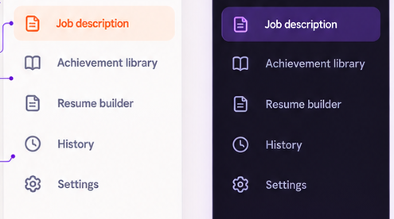

**Files:** `src/components/workspace-shell.tsx`, `src/app/globals.css`, `tests/e2e/home-sidebar.spec.ts`.

- [ ] Preserve destinations and URLs: Job description `/`, Achievement library `/library`, Resume builder `/generate`, History `/history`, Settings `/settings`.
- [ ] Use a consistent icon-plus-label row, approximately 48px high, 8px vertical gap, and 20px icons; align icon baselines and readable labels.
- [ ] Highlight active route with brand accent and soft tinted surface in light mode, violet-tinted surface in dark mode. Inactive items use muted text/icons and subtle hover. Keep `aria-current="page"`; active state must not rely on color alone.
- [ ] Test each route/active item, hover/focus, keyboard traversal, and route state after refresh.

**Acceptance:** Sidebar is scannable and current location is visually and programmatically clear.

**Visual specification:** Render the five labels in this order: `Job description`, `Achievement library`, `Resume builder`, `History`, `Settings`. Each row has a 20px outline icon, 12px icon-to-label gap, 14-15px medium label, 48px minimum row height, and 8px vertical separation. Use subdued slate text/icons when inactive. The active Job description row uses orange text/icon with a pale orange surface in light mode and a restrained violet surface/text in dark mode, matching the image's theme contrast; round the row by 6-8px. Hover adds only a slight surface tint; focus uses a clear outline. Keep a thin separator before workspace-status content. Never show the reference-only upgrade tile.

### Task 09: Add Responsive Sidebar Collapse And Small-Screen Navigation

**Required image inspection:** Inspect the sidebar-variants crop for expanded, active, hover, dark, and collapsed examples. It shows a collapsed desktop rail, not a full mobile-drawer design; follow the written mobile behavior and test requirements for the missing state.

Reference file: docs/ui-images/home/sidebar-component-variants.png

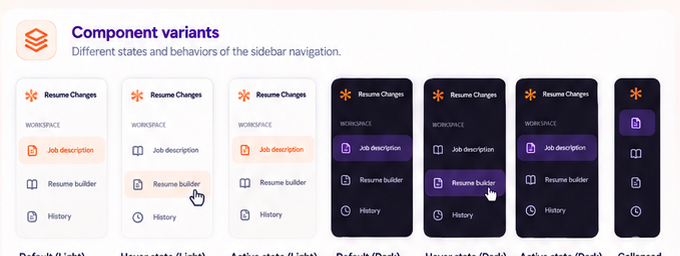

**Files:** `src/components/workspace-shell.tsx`, `src/app/globals.css`, `tests/e2e/home-sidebar.spec.ts`, `tests/e2e/home-responsive.spec.ts`.

- [ ] At wide desktop, allow an expanded sidebar around 260px; offer a collapsed icon rail around 72px only if it remains understandable and keyboard-accessible.
- [ ] Preserve brand mark, active state, focus order, and descriptive labels when collapsed; tooltips/accessible names are required for icon-only links.
- [ ] At mobile width, use an accessible compact drawer pattern instead of a permanent desktop sidebar. Provide an obvious open/close button, close on navigation, and prevent focus from remaining behind an open modal drawer.
- [ ] Respect reduced motion and keep the main page usable when JavaScript has not hydrated.

**Acceptance:** Navigation works at 320px and above with no hidden destinations or horizontal scrolling.

**Visual specification:** Desktop expanded width is 260px; collapsed rail is 72px, with centered 20px icons and 48px hit rows. In collapsed mode keep the orange brand mark, active background, accessible link names, and hover tooltips; hide only visible text. On mobile, use a left-side drawer no wider than 280px or 85vw, full-height, with a dim neutral scrim, a visible close icon, and the same expanded nav rows. The open button is a 44px icon control in the topbar. Opening/closing may use a short horizontal transition but must respect reduced motion; do not leave keyboard focus behind the drawer.

### Task 10: Restyle Breadcrumb, Local Status, Theme Control, And Avatar

**Required image inspection:** Inspect the topbar crop in light and dark modes before changing breadcrumb, local-mode indicator, or theme control. The sample JD avatar is not an authenticated profile and must not be copied as one.

Reference file: docs/ui-images/home/header-topbar-themes.png

**Files:** `src/components/workspace-shell.tsx`, `src/app/globals.css`, `tests/e2e/home-topbar.spec.ts`.

- [ ] Keep breadcrumb left aligned: `Workspace / Job description`, with current route emphasized. Sidebar remains the only persistent brand location.
- [ ] Keep the green-dot `Local mode` status and text together. Do not imply cloud sync or account sign-in.
- [ ] Restyle the theme toggle as a stable icon button with descriptive accessible name, hover surface, visible focus ring, and persisted light/dark preference. Preserve current localStorage behavior.
- [ ] The reference avatar says `JD`. Do not hardcode identity or invent authentication. If no profile source exists, omit the avatar or use a neutral local menu control exposing only existing destinations/settings.
- [ ] Test theme persistence, status label, route breadcrumb, keyboard use, and any menu dismissal behavior.

**Acceptance:** Topbar provides trustworthy location, local-mode, and theme context without unsupported account claims.

**Visual specification:** Topbar is 56-64px high with 24px horizontal padding on desktop and 16px on mobile. Breadcrumb uses 14px/20px text: `Workspace` muted, a small slash separator, and `Job description` in primary semibold. Right-align a compact `Local mode` pill (green 8px dot plus 12-13px label on a pale green/neutral surface), then a 40-44px square theme-toggle button with sun/moon icon, neutral 1px border, and 6px radius. Do not render `JD` or another pretend identity. If there is no account feature, omit that avatar entirely rather than adding an empty decorative circle.

### Task 11: Add The Home Context Eyebrow And Main Heading

**Required image inspection:** Open the title crop and inspect the exact eyebrow, progress label, title placement, and light/dark contrast before implementing this header.

Reference file: docs/ui-images/home/header-page-heading-themes.png

**Files:** `src/components/jd-workspace.tsx` (or a focused home-header component), `src/app/globals.css`, `tests/e2e/home-header.spec.ts`.

- [ ] Present the small orange `NEW APPLICATION` eyebrow and muted `01 / 04` context above the title. Treat it as context, not a clickable wizard unless actual step navigation exists.
- [ ] Use the exact heading `Start with the role.` and concise supporting copy that says the user enters a target role and description before analysis.
- [ ] Align heading and saved-draft state on desktop; stack on narrow screens without overlap. Keep restore/storage notices adjacent to the form and visible.
- [ ] Test title hierarchy, wrapping, and save-state announcement.

**Acceptance:** The page immediately explains its workflow without implying unsupported step navigation.

**Visual specification:** Use the exact hierarchy `NEW APPLICATION` (orange, 12px/16px semibold uppercase) and `01 / 04` (muted slate, 12px/16px) on one compact line. Place `Start with the role.` below with about 8px top gap, 40px/48px bold desktop and 32px/40px mobile. Use supporting copy `Add the job description and let AI analyze it for a stronger, ATS-optimized resume.` in 16px/24px secondary text, max width about 680px and 8px below the title. Do not use the handwritten annotation or the sample purple-gradient lettering from the poster. The context count is display-only until actual workflow navigation exists.

### Task 12: Build The Role Form Surface And Section Header

**Required image inspection:** Open the role-form crop in both themes before changing the form surface, section heading, optional-link badge, divider, or field grouping.

Reference file: docs/ui-images/home/role-details-full-form-themes.png

**Files:** `src/components/jd-workspace.tsx` (or `src/components/home/role-details-form.tsx` after deliberate extraction), `src/app/globals.css`, `tests/e2e/home-role-details.spec.ts`.

- [ ] Group role details and JD editor into one clear form surface. Use `Role details`, supporting label `Target position`, and compact `LINK OPTIONAL` badge aligned opposite.
- [ ] Use a simple divider between metadata and required JD. Keep borders/surface restrained; do not add a nested card.
- [ ] Preserve current form submission, validation ownership, field IDs, and semantics. Do not duplicate state during component extraction.
- [ ] Test headings/landmarks and use with validation and storage notices.

**Acceptance:** Role/JD read as one workflow with clear optional/required distinctions.

**Visual specification:** This is the main light card in the content column: white/cool-white fill, 1px `#CBD5E1` border, up to 8px radius, no nested card, and 24px inner padding on desktop. Header row has `Role details` at 18-20px/28px semibold, `Target position` directly below at 13-14px/20px muted, and a right-aligned `LINK OPTIONAL` badge with 10-11px uppercase text, 1px neutral outline, white/transparent fill, and 4-6px radius. Separate the role fields and JD section with a 1px divider and 20-24px vertical spacing. In dark mode preserve this anatomy with a lifted surface and visible border.

### Task 13: Restyle Company, Role Title, And Job-Link Inputs

**Required image inspection:** Inspect the form anatomy and field-behavior crop, then the input-state crop. They show the field icons, label alignment, three-column proportions, focus/error states, and color tokens.

Reference files: docs/ui-images/home/role-details-anatomy-and-field-behavior.png, docs/ui-images/home/role-details-input-states-and-tokens.png

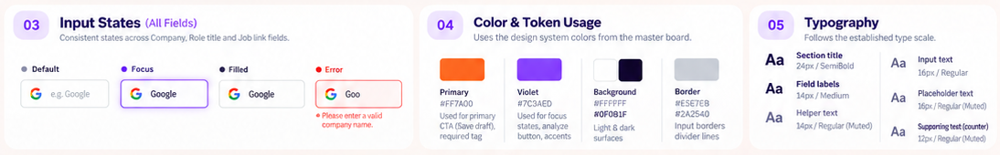

**Files:** `src/components/jd-workspace.tsx` (or extracted form), `src/app/globals.css`, `tests/e2e/home-role-detail-inputs.spec.ts`.

- [ ] Align Company, Role title, and Job link in three desktop columns. Keep existing labels/placeholders; add icons only as leading adornments that do not steal input width.
- [ ] Use stable-height inputs with clear border, surface, text, and placeholder tokens. URL field should communicate HTTP(S) input.
- [ ] Implement default, focused, filled, invalid, and disabled treatments. Focus uses a visible violet ring; invalid URL gets associated error text; disabled controls remain legible.
- [ ] Stack fields at tablet/mobile widths with labels above and full error text visible.
- [ ] Do not make company/title required unless current `validateDraft` does; visual emphasis must match actual validation.

**Acceptance:** Inputs preserve values and validation while matching reference hierarchy at every viewport.

**Visual specification:** Desktop row contains three equal-width fields with 12-16px gaps. Each field label sits 6-8px above a 44px input. Company placeholder is `Company name`, role placeholder `e.g. Backend Engineer` (or keep the existing placeholder if that is the established product copy), and link placeholder `https://`. Use an existing company/building icon, briefcase icon, and chain-link icon at 16-18px, slate-colored and inset 12px from the left; keep text start aligned across fields when icons are present. Input text is 14px/20px, placeholder 14px/20px secondary, 1px `#CBD5E1` border, white surface, and 6px radius. Focus is a violet 2px outer ring; invalid link is red border plus a 12px error line below; disabled is `#F1F5F9` with readable muted text. Do not insert the reference's Google logo or Google value.

### Task 14: Restyle Required JD Label And Helper Copy

**Required image inspection:** Open and inspect the JD-editor crop and anatomy crop before changing the required badge, helper text, label alignment, or error presentation.

Reference files: docs/ui-images/home/jd-editor-light-dark.png, docs/ui-images/home/jd-editor-anatomy.png

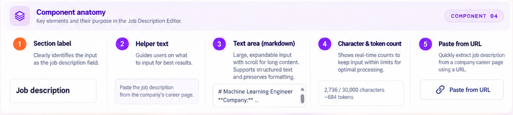

**Files:** `src/components/jd-workspace.tsx`, `src/app/globals.css`, `tests/e2e/home-jd-editor.spec.ts`.

- [ ] Place `Job description` and orange `REQUIRED` badge on one line, wrapping gracefully on small screens.
- [ ] Add concise helper copy from the reference: "Paste the job description from the company's career page." Avoid duplicative long explanations.
- [ ] Associate helper, error, and count text via `aria-describedby`; keep required semantics aligned with current validation.
- [ ] Test label, required indicator, and error association through accessible queries.

**Acceptance:** Required input is unmistakable visually and to assistive technology.

**Visual specification:** The JD section header has `Job description` in 14px/20px semibold at left and a compact orange `REQUIRED` badge at right: pale orange fill, orange text, 10-11px/14px semibold uppercase, 4px radius, and about 6px vertical/8px horizontal padding. The helper line below is exactly `Paste the job description from the company's career page.` in 13px/18px secondary text, with 4-6px separation. If validation fails, show a red outlined alert icon and concise red message below the field; never replace the required label or hide the user's text.

### Task 15: Restyle The JD Textarea For Long Descriptions

**Required image inspection:** Inspect the light/dark editor crop for textarea dimensions, border, padding, text, and scrollbar, and the state crop for focus/error/disabled appearances. The sample job content is not a production default.

Reference files: docs/ui-images/home/jd-editor-light-dark.png, docs/ui-images/home/jd-editor-input-states.png

**Files:** `src/components/jd-workspace.tsx`, `src/app/globals.css`, `tests/e2e/home-jd-editor.spec.ts`.

- [ ] Use a wide textarea with adequate desktop height, readable line spacing, inner padding, and visible scrollbar for long content. Preserve pasted plain/markdown-like text exactly; never render it as HTML.
- [ ] Keep default border, violet focus ring, red invalid state, and muted disabled state. Text and placeholder contrast must pass WCAG AA in both themes.
- [ ] Keep vertical resizing only if it does not break the grid; clamp width to its container and preserve mobile usability.
- [ ] Test typing, paste, multiline content, keyboard focus, validation, input near existing limit, and mobile scrolling/resizing.

**Acceptance:** Long JDs remain easy to inspect/edit without overflow or text changes.

**Visual specification:** Use a single-column text area spanning the form width, roughly 180-200px tall on desktop (enough for about 6-8 lines), with 12-14px inset, 14px/20px text, 6px radius, 1px neutral border, and an inner vertical scrollbar once content exceeds the visible area. Keep the browser's vertical resize affordance only if it does not break alignment. Focus ring is violet; error is red border plus message; disabled surface is muted gray. The board's markdown-looking JD sample is illustrative: do not inject or prefill it in production. At mobile, retain a useful minimum height and allow vertical scroll without a horizontal scrollbar.

### Task 16: Present Live Character And Token Metrics

**Required image inspection:** Open the tightly cropped counter/URL strip and inspect the exact placement, scale, and separation of character count, token estimate, and URL action.

Reference file: docs/ui-images/home/jd-editor-count-and-paste-url.png

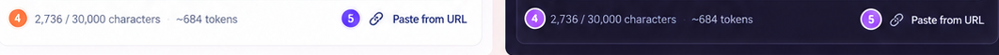

**Files:** `src/components/jd-workspace.tsx`, `src/lib/jd-draft.ts` only for a justified pure helper, `src/app/globals.css`, `tests/e2e/home-jd-editor.spec.ts`, optional `tests/unit/jd-draft.test.ts` extension.

- [ ] Align `N / 30,000 characters` and existing approximate token estimate below textarea, left of actions. Use tabular numerals and muted-but-readable styling.
- [ ] Preserve `MAX_JD_CHARACTERS` and `estimateTokenCount`; do not change context limits in a visual-only task. Emphasize over-limit count and connect it to validation.
- [ ] Announce count changes politely without interrupting assistive technology excessively on every keystroke.
- [ ] Test empty, normal, exact maximum, over-limit, and restored-draft counts.

**Acceptance:** Displayed numbers match the existing logic exactly.

**Visual specification:** Put the character count and token estimate on one compact row directly below the textarea: for example, the live format is `N / 30,000 characters`, then a muted dot/separator, then `~N tokens`. Use 12px/16px secondary text, tabular numerals, and a 12px gap. The board values `2,736` and `~684` are examples only; calculate from the actual draft. Keep metrics left-aligned and the optional URL action right-aligned on desktop; wrap into two tidy rows on narrow screens. An over-limit/error count uses error red and remains associated with the textarea.

### Task 17: Design “Paste From URL” Without Unsafe Fetching

**Required image inspection:** Inspect the URL-action crop before styling this control. It is a visual reference only: implement it as active only if an approved safe extraction capability exists.

Reference file: docs/ui-images/home/jd-editor-count-and-paste-url.png

**Files:** JD editor component, `src/app/globals.css`, `tests/e2e/home-jd-editor.spec.ts`.

- [ ] Include the compact link-icon `Paste from URL` action beside JD metrics only if an existing approved extraction service supports it.
- [ ] Inspect routes and security rules before wiring it. Never fetch arbitrary user URLs directly from browser/server as a styling shortcut; do not introduce an SSRF-prone proxy or imply unsupported extraction works.
- [ ] If extraction is unsupported, do not ship a dead enabled button. Record the dependency for a separate backend task in `docs/project-plan.md` and omit the control or render a clearly explained disabled affordance only if approved.
- [ ] If an approved service exists, design accessible URL-entry/loading/error/success states; preserve the current draft until successful explicit replacement; test validation, cancel, failure, and success using mocked responses.

**Acceptance:** Reference affordance is handled without unsafe network behavior or a nonfunctional button.

**Visual specification:** If and only if an approved extraction endpoint exists, show a text button labeled `Paste from URL` with a 16px chain-link icon before the label, 13-14px medium violet text, and no oversized filled button background. Align it at the end of the metrics row; give it a 36-40px minimum hit height and a visible focus ring. Its hover surface is pale violet, pressed state briefly darkens/tints, and disabled/loading states remain labeled. Use the URL supplied by the user, never the board's sample URL; do not render a clickable-looking control when functionality is absent.

### Task 18: Build The Action-Bar Layout And CTA Hierarchy

**Required image inspection:** Open and inspect the light/dark action-bar crop before placing the live metrics and three actions or assigning their visual priority.

Reference file: docs/ui-images/home/action-bar-light-dark.png

**Files:** `src/components/jd-workspace.tsx` (or `src/components/home/jd-action-bar.tsx`), `src/app/globals.css`, `tests/e2e/home-action-bar.spec.ts`.

- [ ] Place metrics left and actions right on desktop: Clear draft (ghost/tertiary), Analyze job description (violet secondary/AI), Save draft (orange primary). Save is main CTA; Analyze is AI value action; Clear stays low emphasis.
- [ ] Keep one row when space permits, with stable 44px minimum height, around 12px gaps, aligned centers, and enough width for long labels. Avoid horizontal overflow.
- [ ] At narrow widths, wrap or stack actions deliberately. Keep Save most prominent and metrics readable.
- [ ] Preserve current behavior: Clear uses existing clear logic, Analyze calls existing endpoint, Save validates and writes draft. Do not combine/reorder business logic.

**Acceptance:** CTA hierarchy matches reference and remains usable from 320px to desktop.

**Visual specification:** The action footer follows the live count row with 16px top separation. On desktop, the metrics group stays left while actions align right in this order: `Clear draft`, `Analyze job description`, `Save draft`. Clear is a white/transparent neutral outlined button; Analyze is violet with sparkle icon; Save is orange with northeast arrow. Use 44px height, 12px gaps, about 20px horizontal padding for Analyze/Save, 14px semibold labels, and 6px corners. Align control centers; do not let the long Analyze label wrap. On mobile, stack or wrap actions into full-width buttons with Save first visually or last in tab order only if reading/action order remains clear; never shrink to tiny controls.

Inspect the action-bar system-spec crop as a second required reference for button hierarchy, spacing, control height, and motion timing.

Reference file: docs/ui-images/home/action-bar-system-specs.png

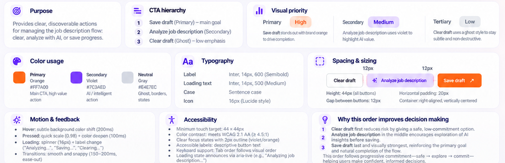

### Task 19: Implement Button Hover, Pressed, Disabled, And Loading Feedback

**Required image inspection:** Inspect the action-bar state matrix before styling state transitions. Compare Clear, Analyze, and Save separately across default, hover, pressed, disabled, and loading.

Reference file: docs/ui-images/home/action-bar-button-states.png

**Files:** `src/app/globals.css`, action bar component, `tests/e2e/home-action-bar.spec.ts`.

- [ ] Clear: subtle hover surface, visible pressed feedback, muted disabled state when relevant. Show `Clearing...` only if clearing becomes truly async.
- [ ] Analyze: soft violet default in light mode and stronger violet in dark mode; subtle hover shift; brief pressed feedback; visibly muted disabled state; inline spinner and `Analyzing...` during existing request without width shift.
- [ ] Save: orange default, darker hover/pressed treatment, legible disabled state, truthful local save status; show `Saving...` only while actually saving.
- [ ] Use about 200ms hover and 100ms pressed feedback; honor reduced motion. Aim for 44x44px touch targets.
- [ ] Test rendered states through behavior, not only CSS class assertions.

**Acceptance:** State changes are calm and immediate without shifting controls or obscuring feedback.

**Visual specification:** Match the reference's state matrix: Clear default white with neutral border, hover pale gray, pressed slightly darker gray, disabled very pale gray with muted label; Analyze default pale/solid violet with sparkle, hover stronger violet, pressed deepest violet, disabled pale lavender with muted icon/text, loading with violet spinner and `Analyzing...`; Save default orange with white label and arrow, hover/pressed deeper orange, disabled pale orange with muted white, loading with white spinner and `Saving...`. For any async Clear operation use `Clearing...` only while pending. Spinner is 16px and sits where the icon was so width remains constant. Maintain visible 2px focus outline and 44px target in every state; do not use color alone to show loading/disabled.

### Task 20: Integrate Draft Save, Restore, Clear, And Storage Feedback

**Required image inspection:** Inspect the sidebar footer crop for the local-workspace status and action-bar state crop for Saving feedback. The footer says “Saved on this device”; do not imply cloud sync.

Reference files: docs/ui-images/home/sidebar-workspace-status.png, docs/ui-images/home/action-bar-button-states.png

**Files:** `src/components/jd-workspace.tsx`, `src/components/workspace-shell.tsx` only if status moves, `tests/e2e/home-draft-state.spec.ts` or focused additions to `tests/e2e/home.spec.ts`.

- [ ] Present draft state as text plus status dot: loading, saving, saved locally, error, and no saved draft. Never communicate state by color alone.
- [ ] Preserve current 350ms debounced local autosave, explicit Save draft, restore notice, storage-unavailable feedback, Clear behavior, and analysis-cache invalidation semantics.
- [ ] Keep transient save feedback near actions and announce as status. Error remains visible until user edits or retries.
- [ ] Test first load, restored draft, edit/save, refresh, storage unavailable, clear, and post-clear refresh with isolated localStorage.

**Acceptance:** Persistence is trustworthy and all existing draft semantics remain intact.

**Visual specification:** Keep the small save indicator near the action row, not as a large alert/card. Use a 8px status dot plus 12-13px text: `Saved on this device` in green, `Saving...` in neutral/violet while pending, and a concise error in red. No draft state uses muted secondary text. Restore and storage error notices use a single low-emphasis full-width inline row with a 16px status icon, 12-14px copy, and a neutral or semantic-tinted background; do not nest them inside another card. Keep success/error text visible long enough to read and accessible as a polite status/live alert as appropriate.

### Task 21: Present Existing Analysis Loading, Error, And Success States

**Required image inspection:** Inspect the analysis-preview crop for card hierarchy and real-result presentation. The source crop shows a static analysis example, not loading or failure; use the written behavior spec for those unpictured states.

Reference file: docs/ui-images/home/ats-preview-light-dark.png

**Files:** `src/components/jd-workspace.tsx` (or extracted panel), `src/app/globals.css`, `tests/e2e/home-analysis.spec.ts`.

- [ ] Restyle analysis without changing `POST /api/ai/analyze-job-description`, request fields, cache rules, cancellation, or response schema.
- [ ] Loading has compact progress and status text; error uses an error surface, preserves draft, and offers current retry; success presents real target title, seniority, required/preferred qualifications, responsibilities, tools/platforms, domain concepts, ATS terms, inferred context, and terminology distinctly.
- [ ] Empty categories say `None identified`, not a fake check/error. Keep inferred context separate from explicit requirements.
- [ ] Test loading, failure/retry, success with empty/populated data, stale-analysis invalidation after edit, and cache-unavailable notice using mocked responses.

**Acceptance:** Analysis is understandable and all content comes from the current response.

**Visual specification:** The analysis result is a structured section, not one paragraph. Use 16px/24px semibold category headings, 14px/20px body text, and 8-12px spacing between related lines. Distinguish explicit requirements from inferred context with a small text label and subtle tinted surface, never just color. If a category is empty, show `None identified` in 13px muted text rather than an empty box or green check. Loading uses fixed-height gray/lavender skeleton lines and a small violet spinner with `Analyzing job description...`; failure uses a pale red inline panel, red icon, readable explanation, and a neutral/violet `Retry` button. Keep the original role/JD form visible and unchanged in each state.

### Task 22: Create The ATS Preview Surface And Honest Empty State

**Required image inspection:** Open both the preview crop and its component-anatomy crop before implementing header, description, Beta badge, summary rows, and tip placement. The score shown is illustrative only.

Reference files: docs/ui-images/home/ats-preview-light-dark.png, docs/ui-images/home/ats-preview-component-anatomy.png

**Files:** Add `src/components/home/ats-analysis-preview.tsx` if justified; integrate from `src/components/jd-workspace.tsx`; style in `src/app/globals.css`; add `tests/e2e/home-ats-preview.spec.ts`.

- [ ] Place preview in the right desktop column aligned with the role/JD form. Use compact header icon/title, small `Beta` badge, short explanatory copy, and structured content.
- [ ] Before analysis, show a neutral prompt to enter/analyze a JD. While loading, show stable-size skeleton/progress. On failure, show retryable error without hiding or erasing draft. On success, show only data in `JobAnalysisResult`.
- [ ] Map real analysis categories into a scannable summary. Do not show sample company/role values, claim resume coverage before comparing a resume, or ship hardcoded demo content.
- [ ] Stack preview after form on tablet/mobile instead of squeezing inputs.

**Acceptance:** Card resembles reference while honestly representing current JD analysis.

**Visual specification:** Preview is a single white/cool-neutral surface with 16px padding, a 1px neutral border, up to 8px radius, and a subtle XS shadow. Header row: 32px violet-soft icon tile with a 16-18px analysis/sparkle icon; `ATS analysis preview` in 16px/24px semibold; small orange `Beta` badge on the far right. Under it place the exact concise sentence from the reference in 14px/20px secondary text with a maximum readable line length. In the empty state, show a neutral one-line prompt and no checklist/score; after analysis, list real extracted categories with clear headings and natural wrapping. Keep 12-16px vertical gaps and do not turn each category into its own floating card.

Use the reference sentence verbatim beneath the preview heading: `We'll analyze your job description to find key skills, keywords, and requirements that ATS systems look for.` Set it at 14px/20px in the secondary text color. This describes the analysis scope; it must not be paired with a fabricated score or claims that a resume has already been checked.

### Task 23: Gate Score Ring And ATS-Match Claims On A Real Contract

**Required image inspection:** Inspect the score-ring crop to understand the pictured geometry, but do not ship its sample 78% or any implied score until a separate validated contract exists.

Reference file: docs/ui-images/home/ats-preview-light-dark.png

**Files:** ATS preview component; any future approved score schema/API belongs to its own `docs/project-plan.md` task; `tests/e2e/home-ats-preview.spec.ts`.

- [ ] Treat reference `78%` as sample artwork, never production data. Do not derive a score from word overlap, number of extracted terms, or decorative progress.
- [ ] Current `JobAnalysisResult`/APIs do not provide a validated resume-to-JD score. Keep the numeric ring and `Estimated ATS match` absent, or show a clear non-error `Not scored` explanation, until the separately planned ATS Readiness Review is implemented and approved.
- [ ] If a future approved contract supplies a score, render the value, accessible progress semantics, explanation, and text from the response. Validate/clamp at contract boundary; never promise ATS passage or hiring outcomes.
- [ ] Test that current response renders no score, and only an explicit supported fixture renders one.

**Acceptance:** No fabricated percentage, progress, or claim of resume matching appears on JD entry.

**Visual specification:** The component board's example ring is about 64px in diameter with a 6px violet progress stroke over a pale-violet track; its center label is 20px/28px bold, with `Estimated ATS match` at 13-14px semibold and a small info icon. A horizontal progress bar is about 8px high with a fully rounded track and violet fill. This is a conditional visual spec only: until a real approved score is returned from the product contract, render none of the ring, center percentage, progress bar, or match label. For a supported future value, provide a textual accessible value and `role=progressbar`/ARIA range; no fake 78% placeholder, indeterminate numeric value, or decorative empty ring.

### Task 24: Render Analysis Signal Rows With Textual Status

**Required image inspection:** Inspect the list rows and their icon/text spacing in the preview crop. The green/orange/violet distribution is illustrative; derive statuses only from current response data.

Reference file: docs/ui-images/home/ats-preview-light-dark.png

**Files:** ATS preview/current analysis panel, `src/app/globals.css`, `tests/e2e/home-ats-preview.spec.ts`, optional `tests/unit/ui/analysis-preview-model.test.ts`.

- [ ] Use compact rows with consistent icon positions and concise labels. Apply success/warning/info tokens only when current response data justifies them.
- [ ] Pair every icon/color status with text. Green check means a check actually occurred; orange warning means a real attention item; violet is informational, not coverage proof.
- [ ] Derive rows from analysis response or show neutral category labels. Never reuse the board's illustrative distribution as current-JD data.
- [ ] Test mixed statuses, empty lists, long wrapping labels, screen-reader text, and both themes.

**Acceptance:** Users understand each signal without relying on color or confusing JD extraction with resume coverage.

**Visual specification:** Each signal is a compact 20-24px row: a 16-18px icon inside or beside a 20px status circle, then a 12px gap, then 13-14px/20px label. Success uses green with a check only for a completed real extraction; attention uses orange with an exclamation only for a present real finding; informational items use violet with a neutral info/sparkle icon. Text examples printed in the board are `Extract key skills & keywords`, `Identify required experience`, `Find important qualifications`, and `Suggest resume improvements`; show these as descriptive capabilities only when the backend contract actually reports/checks them. Do not pre-render the board's one-green/three-orange pattern. Long labels wrap without pushing icons out of alignment.

### Task 25: Add Supporting Tip, Badge, And Chip Treatments

**Required image inspection:** Inspect both the UI-kit chip crop and the ATS preview crop before implementing the badge, tip surface, or any shared chip variant. Do not add irrelevant chips to the home workflow.

Reference files: docs/ui-images/home/ui-kit-chips-badges.png, docs/ui-images/home/ats-preview-light-dark.png

**Files:** ATS preview component and `src/app/globals.css`; `tests/e2e/home-ats-preview.spec.ts`.

- [ ] Style `Beta` as a compact orange-subtle badge with contrast in both themes; it is not a button without a real action.
- [ ] Add a quiet tip surface with a small lightbulb icon and short guidance. It is supplemental and must not outrank the form or primary action.
- [ ] Avoid unsupported claims about interview rates, guaranteed ATS passage, or hiring outcomes. Use copy about clarity and reviewing extracted requirements.
- [ ] Test wrapping, contrast, and noninteractive semantics.

**Acceptance:** Supporting copy builds confidence without promising unsupported outcomes.

**Visual specification:** The optional tip uses a pale violet surface, 12-16px inset, 8px radius, a 20px bulb icon, and an adjacent `Pro tip` title at 14px/20px semibold; body is 12-13px/18px. Use honest guidance such as `Review the extracted requirements before tailoring your resume.` The Beta badge is 24-26px high, pale orange, orange text, 11-12px semibold, and 4px radius. If shared chip variants are implemented for other applicable surfaces, define status chips Draft (orange), Saved (green), Analyzing (violet), Error (red); outlined category chips with 16px leading icons; selected filters with pale violet fill; and removable tags with a trailing 14px close icon. Keep these compact (28-32px height, 12-14px text, full-round shape), keyboard-operable where interactive, and do not add irrelevant filter/category/tag rows to this home page.

The exact UI-kit examples to preserve as reusable variants are status badges `Draft` / `Saved` / `Analyzing` / `Error`; category chips `Google` / `ML Engineer` / `Remote` / `Full-time`; filters `All` / `Recent` / `Saved` / `Analyzed`; tags `Skills` / `Experience` / `ATS Keywords` with trailing remove icons; and outlined `+ Add` action. Use 28-32px height, 12px horizontal padding, 12-14px text, 8px icon-to-label gap, and 1px neutral outlines for category/filter/tag variants. Statuses use a semantic dot/icon and pale tint: orange, green, violet, red. Selected filters use violet-soft fill and violet text; unselected filters stay neutral. Removable tags use a trailing close icon with a minimum 28px hit target. These are reusable style references, not a reason to add irrelevant chips to the home page.

### Task 26: Match Desktop Grid, Alignment, And Vertical Rhythm

**Required image inspection:** Inspect the full-page crop, then compare the separate light and dark product crops for column width, top alignment, sidebar, and action placement.

Reference files: docs/ui-images/home/job-page-full-layout-both-themes.png, docs/ui-images/home/job-page-light.png, docs/ui-images/home/job-page-dark.png

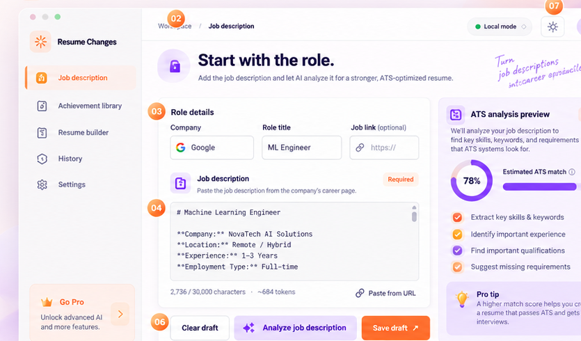

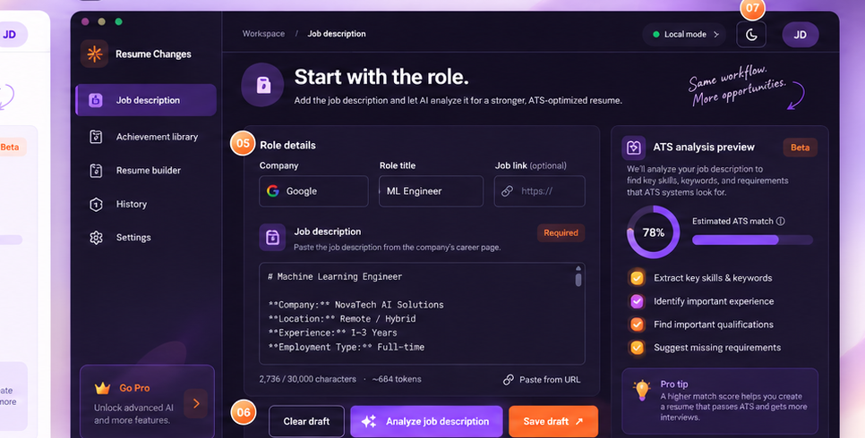

**Files:** `src/app/globals.css`, home components, `tests/e2e/home-responsive.spec.ts`.

- [ ] At desktop, use a two-column main grid: form roughly two thirds, analysis preview roughly one third, with consistent 16-24px gap and aligned top edges.
- [ ] Page heading spans content grid; action bar belongs to form, not preview. Keep metadata fields aligned and preview content within its column.
- [ ] At 1440px preserve generous but work-focused whitespace and readable maximum width. Do not add the board's explanatory panels around the app.
- [ ] Test 1440x900, 1280x800, and 1024x768, including long names, titles, errors, and analysis items. Assert no horizontal overflow or overlap.

**Acceptance:** First viewport communicates the task and key controls; longer content scrolls naturally.

**Visual specification:** At 1280px and wider, main work area uses an approximately 2:1 form-to-preview ratio (e.g. 2fr/1fr), 16-24px gap, and top-aligned surfaces. Page header sits above and spans both columns. The form card is not nested in a second card; the preview card is a sibling. Keep sidebar fixed at about 260px and topbar full-width over the main column. Main content maximum width is around 1440px with 32px inset. Use 24px between page header and content and 24-32px between major sections. Avoid fixed heights except input/button targets; allow analysis content to grow and page to scroll.

### Task 27: Adapt The Workflow To Tablet And Mobile

**Required image inspection:** Inspect the full-page crop for desktop composition and the sidebar-variants crop for the collapsed rail. The supplied references do not include a mobile page layout; follow the explicit responsive measurements in this task and validate them at every listed viewport.

Reference files: docs/ui-images/home/job-page-full-layout-both-themes.png, docs/ui-images/home/sidebar-component-variants.png

**Files:** `src/app/globals.css`, `src/components/workspace-shell.tsx`, home components, `tests/e2e/home-responsive.spec.ts`.

- [ ] At tablet widths stack preview if columns become too narrow; use two or one metadata columns based on actual available width.
- [ ] At 390px and 320px stack Company/Role/Link, textarea, metrics, buttons, and preview in reading order. Buttons may become full-width rows; Save stays easy to find.
- [ ] Preserve mobile navigation, breadcrumb/status/theme controls, page title, and visible errors. No fixed-width textarea/card may force horizontal scrolling.
- [ ] Check mobile keyboard focus/scroll when field focus or errors move the viewport.
- [ ] Cover at least 320, 390, 768, 1024, and 1440 CSS pixel widths in Playwright geometry or screenshot review.

**Acceptance:** All content/actions remain available without clipping or horizontal scroll.

**Visual specification:** At 1024px, retain the two-column layout only while each column remains at least about 320px; otherwise stack preview below the form. At 768px, compact/collapse the sidebar and reduce outer padding to 20-24px. At 390px and 320px, use one column, 12-16px page/card inset, full-width metadata fields, textarea, count row, actions, and preview; header copy wraps normally. Hide only collapsed sidebar labels, never controls or field labels. Do not shrink text to fit. Ensure dialogs/drawers fit within viewport height and scroll internally when needed.

### Task 28: Complete Keyboard, Screen-Reader, Contrast, And Motion Requirements

**Required image inspection:** Inspect the role-form and JD-editor accessibility crops for visible focus, labels, spacing, contrast, and status conventions. Treat the boards as visual examples, not as proof that the implementation meets WCAG.

Reference files: docs/ui-images/home/role-details-spacing-and-accessibility.png, docs/ui-images/home/jd-editor-layout-accessibility.png

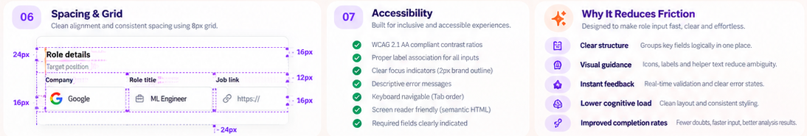

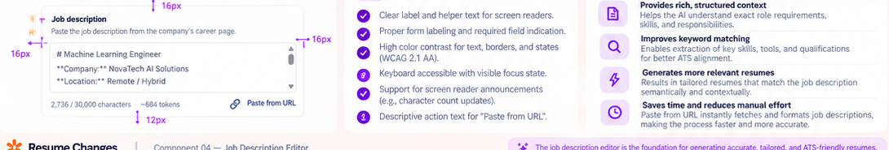

**Files:** shell and home interactive components, `src/app/globals.css`, relevant E2E tests.

- [ ] Preserve semantic landmarks, a single page `h1`, ordered headings, associated labels, descriptive names for icon buttons, and current-route semantics.
- [ ] Provide visible keyboard focus for nav, theme, fields, buttons, URL dialog if present, and menus. Focus indicators must not be clipped.
- [ ] Meet WCAG AA contrast in both themes; aim for 44x44px touch targets; pair status text with color; politely announce save/analysis states.
- [ ] Honor `prefers-reduced-motion`; never rely on animation to communicate progress. Manage focus on mobile drawer/dialog open and close.
- [ ] Add Playwright keyboard/accessibility assertions for actual flows; record manual screen-reader checks in PR notes.

**Acceptance:** Every home workflow is keyboard usable and labels/errors/statuses remain perceivable without color or motion.

**Visual specification:** Focus ring is a clearly visible 2px violet outline with 2px offset on light and dark surfaces. Error state pairs red border with icon and text; success/warning/info pair semantic color with text. Touch targets are at least 44×44px for all actionable controls, including menu, theme, add/remove, retry, and mobile drawer buttons. Maintain 4.5:1 contrast for normal text and 3:1 for large text and essential component boundaries. Use `aria-live=polite` for save/analysis progress only where it won't repeat the entire result; preserve focus on retry and move focus into/out of a modal drawer correctly. No animation is needed to identify the current state.

### Task 29: Add Component Tests And Final Visual Acceptance

**Required image inspection:** Before final visual acceptance, open the overall composition and each component crop relevant to the test under review. The two images below are the minimum page-level references; tasks 1-28 link their own required component crops.

Reference files: docs/ui-images/home/job-page-full-layout-both-themes.png, docs/ui-images/home/action-bar-button-states.png

**Files:** At minimum `tests/e2e/home-shell.spec.ts`, `tests/e2e/home-sidebar.spec.ts`, `tests/e2e/home-topbar.spec.ts`, `tests/e2e/home-header.spec.ts`, `tests/e2e/home-role-details.spec.ts`, `tests/e2e/home-jd-editor.spec.ts`, `tests/e2e/home-action-bar.spec.ts`, `tests/e2e/home-analysis.spec.ts`, `tests/e2e/home-ats-preview.spec.ts`, and `tests/e2e/home-responsive.spec.ts`; extend `tests/e2e/home.spec.ts` rather than deleting regression coverage.

- [ ] Every new component/function has focused coverage in one named test file. Add `tests/unit/ui/*.test.ts` for pure helpers such as token formatting, preview mapping, or theme parsing. Avoid duplicate tests with renamed assertions.
- [ ] Update existing tests for intentional copy/structure changes while preserving navigation, draft persistence, validation, clear, theme, and viewport regression coverage.
- [ ] Visually compare the product region against supplied boards at matching viewport sizes and themes. Do not compare/copy poster callouts or background art. Inspect console/network errors while exercising input, save, clear, analysis success, failure, and retry.
- [ ] Before PR run `npm run lint`, `npm run typecheck`, `npm test`, and `npm run test:e2e`. Report environmental failures honestly; do not call them passed.
- [ ] Review `git diff --check` and confirm no backend behavior, unrelated routes, personal JSON, local PDFs/LaTeX, logs, `.env*`, or generated build files entered the diff.

**Acceptance:** Component and existing regression tests pass; light/dark desktop/mobile visual review is complete; no unsupported ATS score or upsell appears; PR scope is limited to home UI.

**Visual acceptance checklist:** Compare light and dark screenshots with the boards at equivalent content scale. Verify exact heading/copy hierarchy, correct orange-versus-violet action emphasis, crisp field borders and focus/error states, 48px navigation rows, unobstructed `Local mode` and theme controls, consistent icon alignment, card radius/shadow restraint, chip variants only where relevant, and responsive wrapping. Test idle, hover, focus, pressed, disabled, saving, analyzing, saved, validation error, analysis error, analysis success, and empty preview. Confirm no placeholder score, Google/sample job data, fake user avatar, Go Pro card, poster illustration, page-wide gradient, decorative orb, horizontal scroll, or console error.

## Out Of Scope And Dependencies

- **ATS Readiness Review** (post-generation PDF/resume checks and any resume-to-JD match score) remains the future feature in `docs/project-plan.md`. This plan may style a truthful, data-backed JD analysis preview, but does not implement readiness scoring.
- Arbitrary job-board URL extraction is not enabled by styling. If no approved safe extraction endpoint exists, the URL action remains omitted/blocked until a backend task defines validation, network restrictions, errors, and tests.
- The boards' `Go Pro` promotion, fake user account, hardcoded sample company/role, 78% sample score, poster decorations, and marketing explanation panels must not ship in the product home page.
- No changes to AI prompts/providers, achievement selection, Guided Tailor, resume rendering, PDF compilation, data schemas, saved-JD feature, or generated-history behavior are included in this frontend plan.
