# Imagination Canvas UI Redesign Task Plan

## Purpose And Scope

This document breaks the Imagination Canvas page redesign into ten codebase-grounded work items. Together they replace the current tall modal opened from the Achievement Library with the dedicated, full-workspace authoring page shown in the supplied design. This is one page, not a 29-task application redesign.

The target board and all six current-state screenshots were reviewed. Full, unmodified copies and pixel crops are stored under `docs/ui-images/imagination-canvas/`. Each relevant crop is embedded below and is mandatory visual reference: open it before implementing that part. Do not modify the originals or substitute memory of the full screenshot for the linked crop.

| Reference                            | What it documents                                            |
| ------------------------------------ | ------------------------------------------------------------ |
| `target-full-page.png`               | Intended full-page composition and hierarchy                 |
| `current-popup-top.png`              | Current modal entry, destination, composer, and empty canvas |
| `current-popup-writing-controls.png` | Current controls and instruction flow                        |
| `current-popup-save-footer.png`      | Current save/cancel behavior and footer                      |
| `current-popup-list-scrolled.png`    | Current long-scroll and context-list behavior                |
| `current-popup-skills-expanded.png`  | Current expanded skill categories                            |
| `current-connected-context.png`      | Current selected achievement and skill                       |

This is an implementation task, not authorization to change achievement schemas, library ownership, source attribution, AI-provider selection/consent, factual validation, PDF compilation, or when resume changes become effective. Reuse existing behavior and API contracts where they are sound. Do not reproduce board sample data as production defaults.

**Task independence:** Tasks 01-10 are peer work packages, not an execution sequence. Each agent starts from the current `main` branch and must be able to implement and test its assigned scope without another task being completed first. Do not rely on, merge, revert, or overwrite another agent's branch. Keep changes within the named ownership boundary; where existing shared files are involved, make only the assigned behavior change and preserve unrelated edits. The tasks are intentionally scoped to separate route, component, API, and test ownership where practical. Integrate the resulting PRs after their individual checks pass.

## Current Implementation Map

- `/library` is the existing Achievement Library route and is rendered inside `WorkspaceShell`.
- `src/components/achievement-library.tsx` opens `AchievementImagination` as a dialog for “Add achievement.”
- `src/components/achievement-imagination.tsx` owns the current draft, source selection, skill selection, prompts, generated result, and save flow.
- `src/app/api/ai/achievement/route.ts` already validates context, resolves the selected destination and skills against the library, calls the configured provider, rejects unsupported numeric claims/skills, and measures achievement lines with LaTeX.
- `src/app/api/library/points/route.ts` and the existing library writer already persist achievements. `src/lib/generation/imagination-draft.ts` validates the locally saved unfinished draft.
- The six current writing-control buttons replace the instruction text; Ask Imagination then submits it to the existing AI route. Preserve that working relationship, but make each selected mode explicit and verifiable as described below.

## Independent Task Assignments

Each task must first read the Purpose And Scope, Current Implementation Map, Reference Interpretation, and its own complete section, then inspect every required crop named below. A screenshot crop is mandatory source material, not optional inspiration.

### Task 01: Dedicated Route And Library Entry

**Scope:** Replace opening the create-mode dialog from `src/components/achievement-library.tsx` with navigation to `/library/imagination`. Add the dedicated App Router page, preserve the existing `WorkspaceShell`, source query behavior, library destination data, cancel/back navigation, and keep Achievement Library active in the sidebar for the nested route. The page must no longer dim or cover `/library` with a dialog. Do not redesign the page internals or change AI/save behavior in this task.

**Code ownership:** `src/app/library/imagination/page.tsx` (new), `src/components/achievement-library.tsx`, and the nested-route matching in `src/components/workspace-shell.tsx`. Add a focused route/navigation test.

**Required reference:** Open the full target and current popup top; the target breadcrumb establishes this as a library page, while the current screenshot shows the modal to remove.

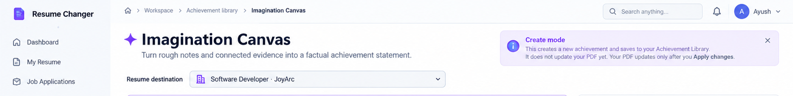

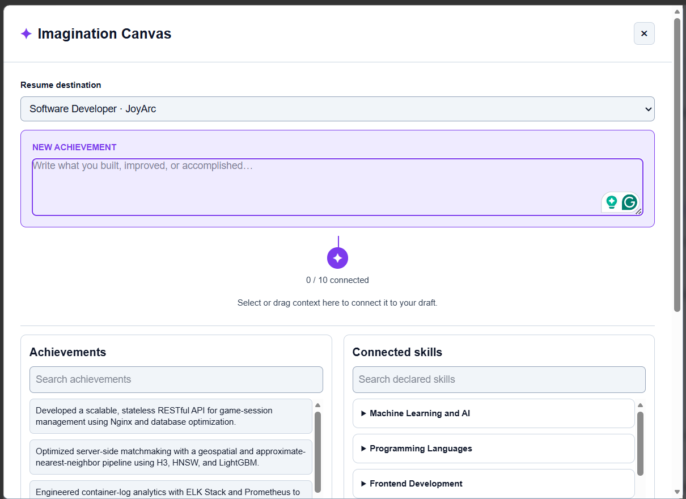

**Acceptance:** Direct navigation and refresh load the page; the library action opens it; cancel/back returns to the library; light/dark shell and personal/demo source rules remain intact.

### Task 02: Two-Column Page Scaffold And Responsive Layout

**Scope:** Build the target's left authoring workspace and right writing-control column with a bounded, non-overlapping bottom action region. Use the existing workspace shell and shared tokens. Keep a clear desktop proportion, stack in a deliberate reading order on mobile, and remove the current dialog's excessive whole-panel scrolling and clipped content. This task owns layout and responsive geometry only; do not implement AI or persistence changes.

**Code ownership:** Add `src/components/imagination-canvas-layout.tsx` as a presentational layout with named slots for title, composer, connection canvas, context libraries, writing controls, result, and footer; add scoped styles in `src/app/globals.css`. Provide a component test for desktop/mobile slot ordering and overflow-sensitive structure. Do not edit API or library writer files.

**Required reference:** Open the full target and current long-scroll screenshots before setting proportions or responsive order.

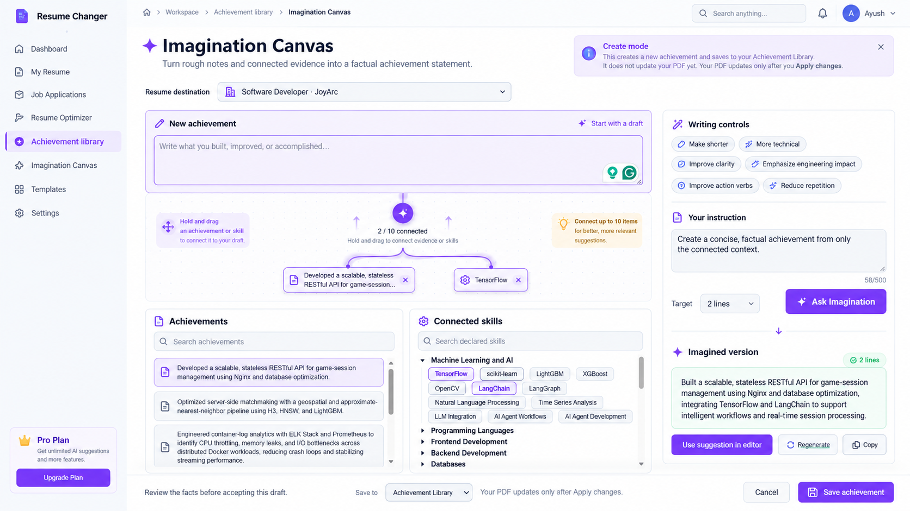

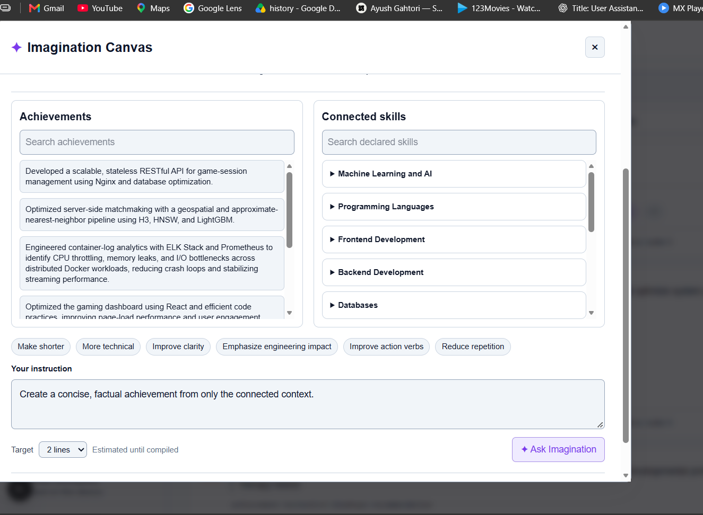

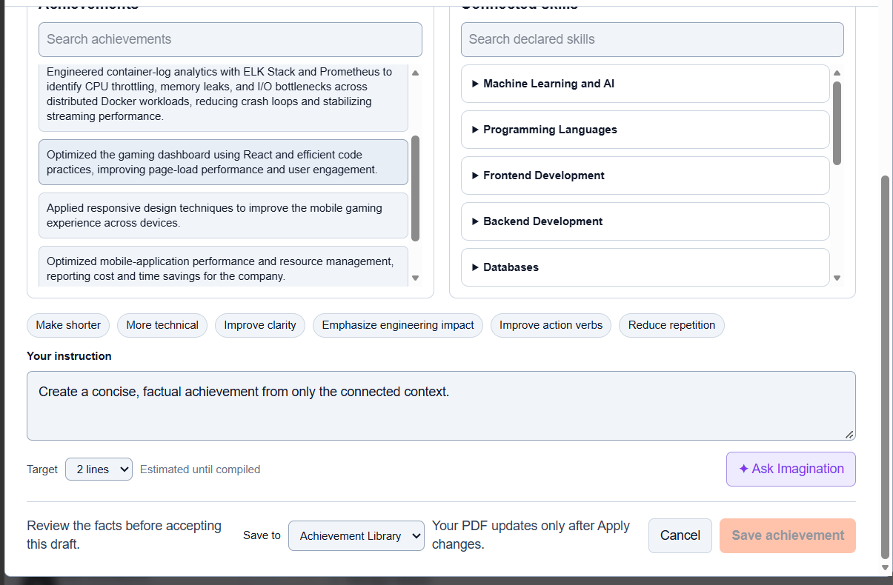

**Acceptance:** The left workspace/right controls composition matches the board's hierarchy at desktop widths; mobile has no horizontal overflow, clipped actions, nested scroll traps, or footer overlap.

### Task 03: Page Heading, Destination, And Draft Composer

**Scope:** Implement the exact `Imagination Canvas` title with Lucide `Sparkles`, subtitle, truthful create-mode notice, real resume destination selector, and editable `New achievement` composer. Preserve the existing 8,000-character achievement text limit, focused editing, local unfinished-draft restore, and destination-change reconciliation. No sample company/job values may become defaults.

**Code ownership:** Add a controlled `src/components/imagination-composer.tsx` component and focused tests for destination, composer, character limit, and restore-ready values. Keep AI generation and save requests out of this component.

**Required reference:** Open the title, composer, and current popup crops before implementation.

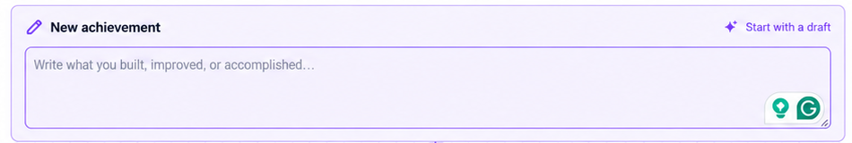

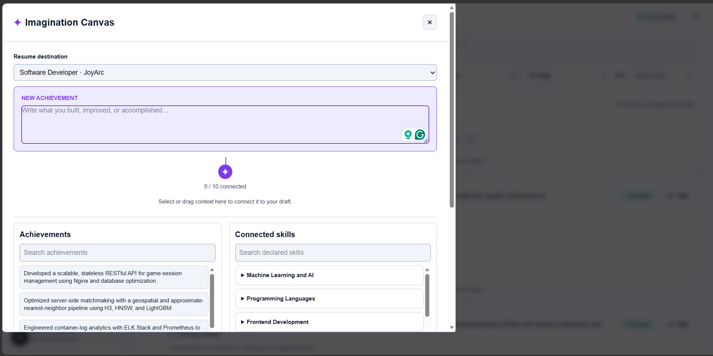

**Acceptance:** Labels and placeholder match the target; destination choices come from the loaded library; changing destination cannot leave incompatible achievement context selected; draft remains editable and restorable.

### Task 04: Connection Canvas, Dragging, And Relationship Lines

**Scope:** Build the central root/sparkle, live `N / 10 connected` count, drop surface, connected chips and remove actions. Support drag from evidence, plus click/tap and keyboard selection. Render connector paths from root to actual chip positions and keep them aligned as chips wrap or the canvas resizes. Enforce ten distinct items and prevent duplicates.

**Code ownership:** Add `src/components/imagination-connection-canvas.tsx` and component tests for empty/one/many/max connections, duplicate handling, removal, drag payloads, and responsive path updates. The parent owns selected IDs; this component receives connected items and emits connect/remove events. Do not edit AI routes or library source cards.

**Required reference:** Open the target connection crop and current selected-context crop. The absent connector lines in the current state are a required redesign, not an optional detail.

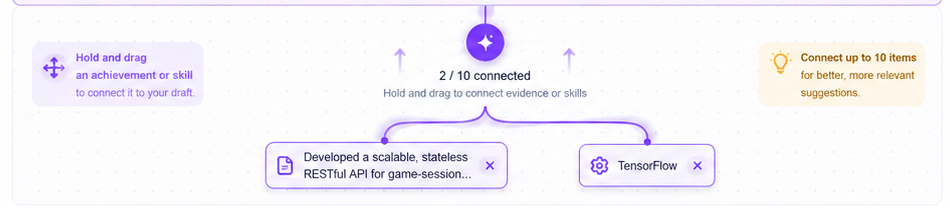

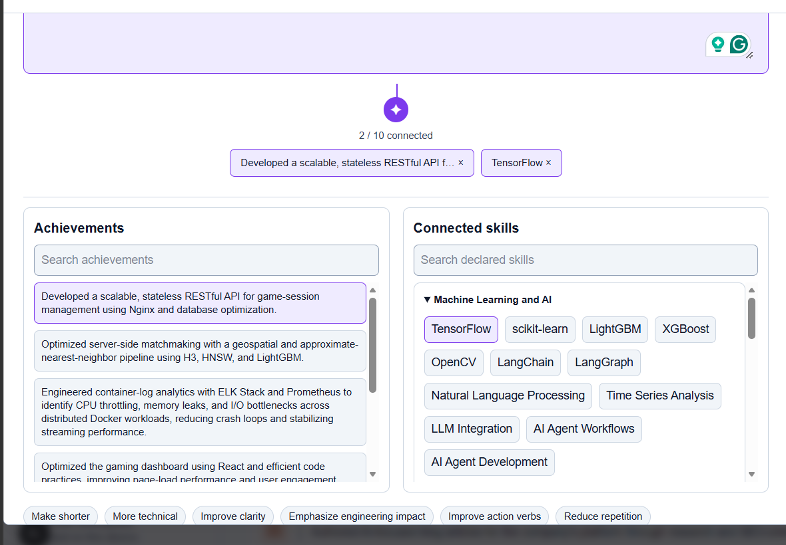

**Acceptance:** Lines terminate at the rendered root and connected chips; count, chips, and selected IDs stay synchronized; drag is not the only way to connect evidence; the max-limit message is visible and announced.

### Task 05: Achievement And Skill Context Libraries

**Scope:** Implement the two searchable context panels beneath the canvas. Preserve destination-scoped, enabled achievement filtering, current achievement text, expandable skill categories, search behavior, selected states, disabled-at-capacity behavior, and independent list scrolling. Add empty/no-results states without fabricated evidence.

**Code ownership:** Add `src/components/imagination-context-libraries.tsx` and component tests for search, destination grouping, category expansion, selected state, and max-item behavior. Use existing `ResumeLibrary`, `groupSkillsForReview`, and current studio point types. Do not alter AI or save contracts.

**Required reference:** Open target list anatomy and both current scrolled/expanded examples.

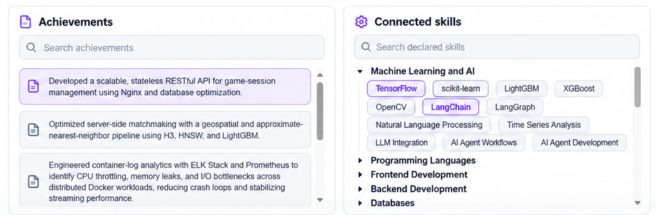

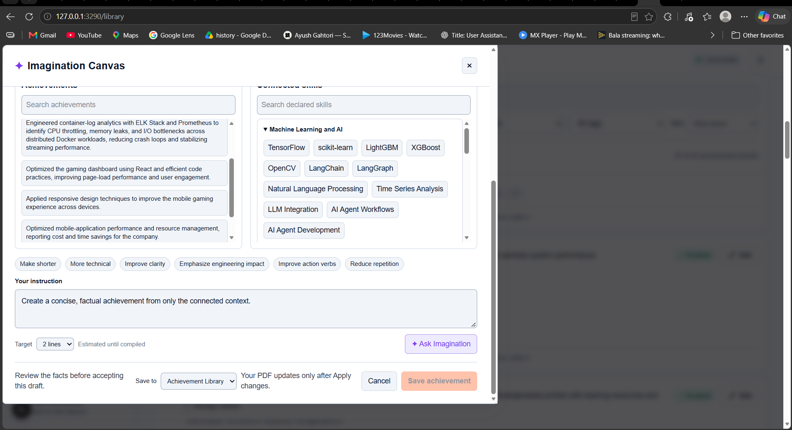

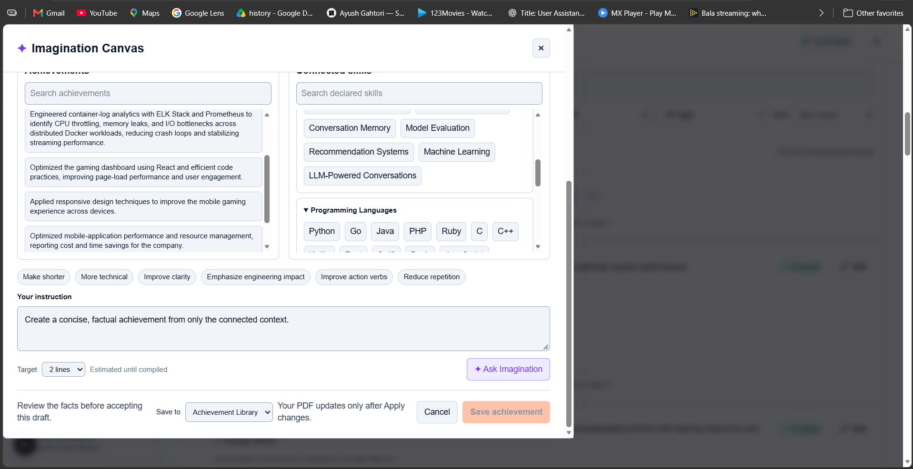

**Acceptance:** Searches are independent; only eligible achievements from the chosen destination appear; skill categories remain navigable; selection changes are accessible and obey the 10-item limit.

### Task 06: Writing Controls And Instruction Editor

**Scope:** Implement the right-column control panel with all six exact presets, a selected-mode state, labeled custom instruction editor, 500-character count/limit for create mode, target-line selector, and Ask Imagination/cancel/loading states. Selecting a preset must not erase custom user text. Do not invent a second generation implementation in the UI.

**Code ownership:** Add `src/components/imagination-writing-controls.tsx` with controlled props and component tests. Keep the typed mode in a stable exported type or existing shared contract; the UI component must not make provider calls directly.

**Required reference:** Open the target controls crop and current controls screenshots before building this panel.

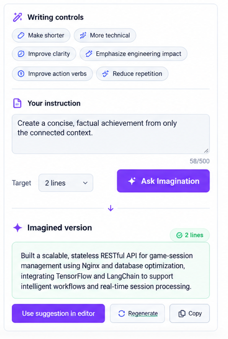

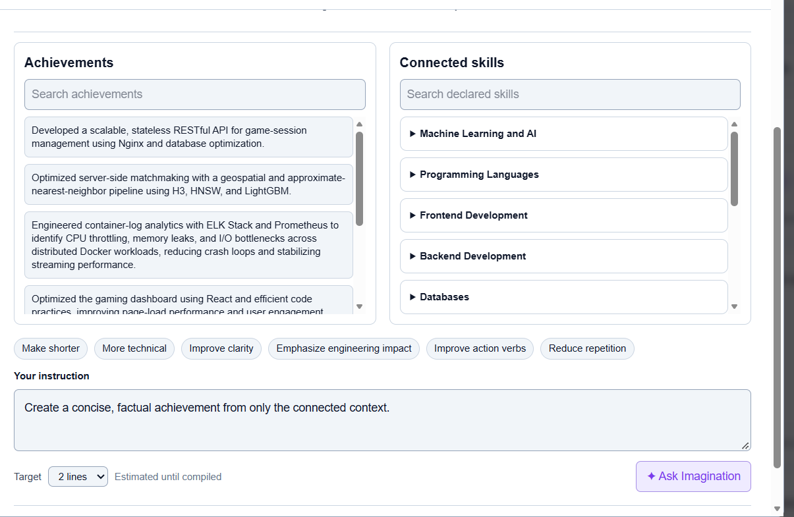

**Acceptance:** All six named modes are selectable, visibly selected, preserve the user's instruction, and submit through the shared page handler; instruction count and target-line feedback are truthful.

### Task 07: Typed Backend Writing Modes And Validation

**Scope:** Extend the existing `/api/ai/achievement` contract so each of the six writing modes is passed as a typed, allowlisted value and mapped to a specific server-side writing directive. Keep one existing endpoint, not six new endpoints. Keep edit/merge limits unchanged; enforce the 500-character instruction limit for create mode only. Preserve destination/source/skill validation, ten-item bounds, numeric/factual checks, unsupported-skill rejection, LaTeX measurement, provider consent/fallback behavior, and no-store responses.

**Code ownership:** `src/app/api/ai/achievement/route.ts`, `src/lib/ai/achievement-writing.ts`, the focused prompt builder if needed, and new `tests/unit/api/achievement-writing-route.test.ts` plus focused AI contract tests. Do not edit UI components or library persistence.

**Required reference:** Open target controls and result crops; use current behavior only to preserve the existing instruction/request relationship.

**Acceptance:** Invalid modes and create instructions over 500 characters are rejected; every mode has a distinct tested instruction; unsupported claims remain rejected; edit/merge requests retain their existing instruction allowance and behavior.

### Task 08: Imagined Result And Review Actions

**Scope:** Build the `Imagined version` result view, measured-line status/warning, editable generated text, and working `Use suggestion in editor`, `Regenerate`, and `Copy` actions. Only show a measured count when the backend reports an actual LaTeX measurement. Copy feedback must cover success and unavailable clipboard; use-suggestion returns focus to the composer.

**Code ownership:** Add `src/components/imagination-result.tsx` and component tests for loading/empty/error/ready states, edited content, copy feedback, and action events. Do not make save decisions or call the AI provider here.

**Required reference:** Open the right-column target result and the current result/form behavior before implementation.

**Acceptance:** Regenerate uses the latest mode/instruction/context; use-suggestion moves editable text into the composer; result status never implies a line check or successful generation that did not happen.

### Task 09: Save Footer, Library Persistence, And Draft Continuity

**Scope:** Implement the review/save footer, save destination choices, cancel behavior, and persistence wiring. Save only the reviewed composer text through the existing `/api/library/points` writer, preserve skill IDs/source attribution and local draft restore, and keep the truthful note that PDF updates only after Apply changes. The generated suggestion is not silently saved.

**Code ownership:** Add `src/components/imagination-save-footer.tsx`; wire its controlled callbacks in the page integration owned by the assigned agent or a dedicated integration PR. Add focused tests around the existing save route/writer and component states. Do not change library schema or PDF application semantics.

**Required reference:** Open the target footer and current save-footer examples before changing the save flow.

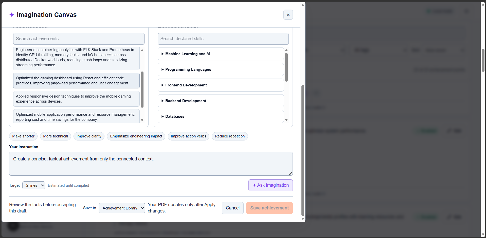

**Acceptance:** Save is disabled until valid text exists and while saving; errors are visible; save-to options respect personal/demo and current resume availability; saving does not update the resume/PDF prematurely.

### Task 10: Motion, Accessibility, And End-To-End Visual QA

**Scope:** Add the upward-emerging/fading arrow cue around connected context, reduced-motion behavior, and full-page keyboard/screen-reader interaction coverage. Verify the integrated page against the exact target and current-state references, including pointer/drag, keyboard selection, focus, zoom, responsive wrapping, theme, and all visible states. This is a standalone audit from current `main`: record gaps with tests and implement only accessibility/motion fixes in its own owned files; do not assume another task's implementation is present.

**Code ownership:** Add scoped motion styles in a new `src/components/imagination-canvas-motion.css` (or an equivalent isolated component stylesheet) and a focused `tests/e2e/imagination-canvas.spec.ts`. Keep other agents' feature files untouched; report integration-only gaps rather than editing files outside this task's scope.

**Required reference:** Open the target full-page, connector, writing-control, and current popup overflow/connected-context crops. Compare browser screenshots after running on an unused port; never stop another agent's server.

**Acceptance:** Motion is subtle, non-blocking, and disabled under reduced motion; drag has keyboard/tap alternatives; focus, live status, contrast, and responsive screenshot checks pass; the task reports any integration gaps without depending on another numbered task.

## Reference Interpretation

### Page Destination And Hierarchy

Implement the canvas as a normal workspace page at `/library/imagination`, not as a modal, dialog, drawer, or overlay on `/library`. Keep the existing app shell, sidebar, theme toggle, and shared navigation. Keep Achievement Library active in the sidebar for this nested route and show the breadcrumb `Workspace / Achievement library / Imagination Canvas`. Update the library’s Add achievement action to navigate to the page; closing/canceling returns to the library without saving. Preserve the current data source and destination semantics when navigating.

**Required reference:** Inspect the complete target and the current popup top before routing or shell changes. Only the canvas becomes a dedicated page; the target board’s illustrative global search, notification/avatar, sidebar labels, and unrelated app chrome are not authorization to redesign shared navigation.

### Title, Icon, And Draft Composer

Use the exact product title **Imagination Canvas**, with a violet Lucide `Sparkles` icon. Use the target subtitle: “Turn rough notes and connected evidence into a factual achievement statement.” Keep the title and icon as a compact app-page heading, not the oversized presentation-board title. Show the resume destination selector above the working area and populate it only from real jobs/projects in the selected library. Do not hardcode “Software Developer · JoyArc.”

The left work area begins with a clearly labeled `New achievement` composer and a `Start with a draft` affordance. Use the target placeholder “Write what you built, improved, or accomplished…” and preserve multiline editing, focus visibility, draft persistence, and the existing 8,000-character achievement limit. The composer must remain editable regardless of whether evidence is connected. Keep any third-party writing-assistant adornments only if they are existing supported integrations; do not imitate brand marks with text or decorative glyphs.

The target’s violet create-mode information banner explains that the new item is saved to the Achievement Library and does not update the PDF until the user applies changes. Render this copy only when it is true for the selected source/save destination. Keep it dismissible only if dismissal does not hide a required warning or change save behavior.

**Required reference:** Open both composer crops before implementing the editor, title/icon, destination, or banner.

### Connection Canvas And Evidence Libraries

Below the composer, create a bounded, visible connection canvas. It must show a central sparkle/root, the live count `N / 10 connected`, helper text, a drop target, and one removable connected chip for every selected achievement or skill. The target instructs users to hold and drag evidence into the canvas; keep click/tap selection as an equivalent input so drag is never the only way to connect context. Preserve the ten-distinct-items limit, prevent duplicates, expose a clear max-limit message, and ensure removing a chip updates the count and subsequent AI request.

Draw visible connector paths from the root/count node to each connected chip. Lines must follow actual rendered node positions as chips wrap, resize, reorder, or disappear; do not bake the lines into a screenshot or use fixed coordinates that drift. Use an SVG overlay or an equivalent responsive implementation, with decorative paths hidden from assistive technology. Selected list items and connected chips must share a stable identity and selected state. On destination changes, clear or reconcile achievements that no longer belong to that destination; never submit cross-destination evidence. Skills remain selectable only from the loaded library and are validated again by the server.

Add the subtle upward-arrow particle cue shown around the connected count/text: arrows emerge near the root/connected evidence, travel upward, and fade out. Use a restrained, short CSS/SVG animation that does not obscure text, connector endpoints, focus rings, or pointer targets. It must not continuously distract or communicate selection by motion alone; stop/reduce it for `prefers-reduced-motion: reduce` and provide a fully static equivalent.

Keep searchable `Achievements` and `Connected skills` libraries below the canvas, side by side on wide layouts. Preserve current destination-scoped achievement filtering, enabled-only points, searchable expandable skill groups, selected styling, and independent list scrolling. Every source row and skill chip must remain keyboard operable and announce its selected state. Provide an explicit empty state when a destination has no achievements or no skills match the search.

**Required reference:** Open the target connector/canvas and context-list crops, then compare with the current selected-context crop. The missing relationship lines and the new animated cue are intentional required changes.

### Writing Controls And AI Contract

On desktop, place the writing controls in a persistent right-hand column beside the left work area. Match the target order and exact labels: `Make shorter`, `More technical`, `Improve clarity`, `Emphasize engineering impact`, `Improve action verbs`, and `Reduce repetition`. Show a clear selected mode. Keep a labeled `Your instruction` textarea, visible character counter, target line selector, and `Ask Imagination` action. Follow the target’s 500-character instruction limit for this canvas and validate it on both client and server without weakening existing edit/merge limits for other operations.

The six controls must not be decorative. A click selects a writing mode, preserves the user’s custom instruction, and affects the next generation. Send a typed allowlisted mode to the existing `/api/ai/achievement` route (or an equivalent validated service contract); map it to a specific, tested writing directive server-side. Do not add six separate endpoints or depend only on replacing the textarea with an unstructured label. Preserve the current generation route’s destination checks, ten-item validation, factual/numeric-claim validation, unsupported-skill rejection, no-store response, provider fallback behavior, and LaTeX line measurement. Use only connected context plus the user’s draft/instruction; never infer missing facts or invent metrics.

The target default instruction is “Create a concise, factual achievement from only the connected context.” The target line selector shows `2 lines`; preserve supported target choices and report measured lines only when LaTeX actually measured them. The helper “Estimated until compiled” must remain explicit when no measurement is available. Disable `Ask Imagination` when there is no draft and no connected achievement evidence, while allowing the server to remain authoritative. Keep busy, cancel, error, and retry states stable and accessible.

**Required reference:** Inspect the target right-column crop and both current writing-control screenshots before changing the controls or request flow.

### Imagined Result And Save Flow

Show the generated result in a distinct `Imagined version` region on the right below the request controls. Keep the generated text editable and reviewable; show a line-count badge only when measured, plus a truthful warning when the target was not met or measurement failed. Provide working `Use suggestion in editor`, `Regenerate`, and `Copy` actions. Copy must use the Clipboard API with visible success/failure feedback. Use suggestion must place the text in the draft editor, preserve its editability, and return focus to that editor. Regenerate must reuse the currently selected evidence, mode, instruction, and line target.

Keep the bottom review/save bar visible on desktop without covering scrollable content. Include the review reminder, truthful `Save to` options supported by the current library/source, the note that PDF changes require `Apply changes`, `Cancel`, and `Save achievement`. On narrow screens the bar may become a non-overlapping stacked footer, but save/cancel must remain reachable without horizontal scrolling. Save only the reviewed editor text through the current library writer; a generated suggestion is not silently accepted. Preserve local unfinished-draft restore, source attribution, selected skill IDs, and existing success/error handling. Saving to the Achievement Library must not claim to update the resume or PDF.

**Required reference:** Inspect target result/footer and the current scrolled footer states before implementing save behavior.

### Visual System, Responsiveness, And Accessibility

Use the application’s existing shared light/dark tokens, including `--imagination`, `--imagination-hover`, and `--imagination-soft`; do not introduce a canvas-only palette or copy the poster’s cream/pink background. Keep the existing font families. Use compact operational typography and hierarchy, crisp borders, restrained shadows, and card radii no greater than 8px unless an established shared component requires otherwise. Use Lucide icons for controls and accessible names for icon-only remove, close, copy, and sparkle actions.

At desktop width, preserve the target’s approximate two-thirds evidence workspace to one-third writing panel proportion, with an independently scrollable evidence area where needed. At tablet and mobile widths, stack the writing controls and result after the composer/canvas/libraries in a clear reading order; avoid clipped labels, nested scroll traps, fixed-width panels, and horizontal page overflow. Check light and dark themes, focus, hover, pressed, disabled, loading, empty, selected, full (10/10), generated, validation-error, and save states. Keep the page title, current route, and primary save action visible or predictably reachable.

Use semantic landmarks and headings, real labels, button state attributes (`aria-pressed` for writing modes and selection), keyboard-accessible list selection/removal, visible focus, live announcements for count/generation/save/copy feedback, and sufficient contrast. Drag-and-drop must have click/tap and keyboard alternatives. Respect reduced motion. No explanatory marketing cards, poster decoration, invented profile values, or dead controls belong in the production page.

### Tests And Visual Verification

- Add focused component and route tests for the dedicated page replacing the dialog, destination changes, draft persistence/restore, selecting/removing evidence and skills, the 10-item limit, duplicate prevention, search/category behavior, and keyboard selection.
- Test connector geometry/state for zero, one, and multiple connected items; verify the SVG/overlay follows wrapped chips and resizes, and that reduced-motion mode disables the particle animation.
- Test all six writing modes reach the existing AI service as their distinct typed mode while preserving custom instructions. Add route/service tests for invalid modes, 500-character create-mode limit, no-context requests, destination/source validation, unsupported facts/skills, and measured/unmeasured line responses. Keep edit/merge behavior and its existing instruction allowance unchanged.
- Test generated-result edit, use-in-editor, regenerate, copy feedback, cancel, and save; verify save writes only the accepted editor text and does not mutate the PDF/resume until the existing Apply changes workflow.
- Run relevant unit tests, `npm run typecheck`, lint, and the focused Playwright flow. Do not weaken tests or change unrelated fixtures to make the redesign pass.
- Start the development server on an unused port; do not stop or reuse a port occupied by another running agent. Open the dedicated page and capture desktop and mobile screenshots in light and dark themes. Compare the rendered app to the exact linked target crops, then fix layout, wrapping, connector alignment, focus/hover states, and overflow and capture again until the differences are resolved. Exercise drag/drop, click/tap, keyboard, zoom, and reduced-motion behavior in the browser.

### Acceptance Criteria

1. Imagination Canvas opens as a dedicated `/library/imagination` workspace page and no longer renders as a popup over the library.
2. The screen has the target heading/icon, destination, draft composer, left-side evidence canvas/libraries, right-side writing controls/result, and reachable review/save footer.
3. Up to ten real distinct evidence/skill items can be selected by drag or accessible click/keyboard; count, chips, and live connector lines stay synchronized.
4. The requested upward/fade arrow cue is subtle, correctly positioned, and disabled/reduced for reduced-motion preferences.
5. All six writing presets produce distinct, tested backend instructions through the existing AI route; custom text is preserved and generated claims remain bounded by evidence.
6. Draft restore, suggestion review, copy, regeneration, save destination, source attribution, and “PDF updates only after Apply changes” behavior remain truthful and functional.
7. No horizontal overflow, modal-only scroll trap, clipped content, broken focus, or lost controls at desktop, tablet, and mobile sizes; light/dark and empty/loading/error/success states are verified.
8. Tests, typecheck, lint, and browser screenshot/interaction review pass, with the exact visual crops in this document opened before implementation.

## Required Image Links

Before implementation, open the full target and each crop relevant to the component being changed. The images are local, versioned references; the full current screenshots preserve the context behind the focused crops.

- Full target: `docs/ui-images/imagination-canvas/target-full-page.png`
- Current full screenshots: `current-popup-top.png`, `current-popup-writing-controls.png`, `current-popup-save-footer.png`, `current-popup-list-scrolled.png`, `current-popup-skills-expanded.png`, and `current-connected-context.png`.
- Page/title: `target-page-heading-and-hierarchy.png`
- Draft: `target-draft-composer.png`
- Connector canvas and particles: `target-connection-canvas.png` and `current-connected-context-no-connectors.png`
- Evidence/skills lists: `target-context-libraries.png` and `current-popup-skills-expanded.png`
- Writing controls and result: `target-writing-controls-and-result.png`, `current-writing-controls-overflow.png`, and `current-popup-writing-controls.png`
- Review/save: `target-review-and-save-footer.png`, `current-footer-layout-overflow.png`, and `current-popup-save-footer.png`
