# Resume Builder UI Redesign Task Plan

## Purpose And Scope

This document is the frontend companion to project-plan.md and the Resume Builder counterpart to UI_Tasks_home.md and UI_Tasks_achievement_library.md. It translates the eight supplied Resume Builder boards into a component-level implementation plan for the existing workflow at /generate. The reference covers the shared workspace shell, builder header and job context, achievement selection, AI tailoring controls, generated-content review, and LaTeX/PDF preview and export.

All eight images were reviewed individually in slide order. Slide 1 shows the product overview and page breakdown; slides 2-7 detail job context, selection, tailoring, generated-content review, preview, and workflow architecture; slide 8 is the component kit. Cropped, unaltered pixel regions are stored under docs/ui-images/resume-builder/. Every task embeds its own required references. The product UI inside the boards is the visual target; poster art, slide labels, explanatory diagrams, and sample personal data are not production content.

| Slide | Source image                                  |
| ----- | --------------------------------------------- |
| 1     | ChatGPT Image Oct 22, 2026, 10_27_38 AM-1.png |
| 2     | ChatGPT Image Oct 22, 2026, 10_27_39 AM-2.png |
| 3     | ChatGPT Image Oct 22, 2026, 10_27_40 AM-3.png |
| 4     | ChatGPT Image Oct 22, 2026, 10_27_41 AM-4.png |
| 5     | ChatGPT Image Oct 22, 2026, 10_27_43 AM-5.png |
| 6     | ChatGPT Image Oct 22, 2026, 10_27_44 AM-6.png |
| 7     | ChatGPT Image Oct 22, 2026, 10_27_45 AM-7.png |
| 8     | ChatGPT Image Oct 22, 2026, 10_27_46 AM-8.png |

This is an implementation plan only. It does not authorize changes to resume schemas, model prompts, data loading, AI provider behavior, PDF/LaTeX contracts, consent, storage, or history semantics. Preserve the existing behavior and APIs. Any visual example that has no working, truthful counterpart in the current product must be omitted or adapted; never ship a dead control, invented score, or fabricated resume data to imitate the board.

**Independent-task rule:** The 29 task numbers are an index, not an execution order or dependency chain. Every task must be implementable from the current main branch and existing application behavior without any other task in this document being completed first. Do not wait for, depend on, revert, or overwrite another agent’s branch or changes. If several tasks run in parallel, work only in the assigned task scope and branch; coordinate shared tokens instead of silently replacing them.

## Reference Interpretation

- **Palette and use:** Slide 8 prints Primary Orange #FF7A18 for the main Generate LaTeX action and warm accents; Secondary Violet #7C3AED for AI actions, selected states, and focus; Accent #A78BFA for lighter violet emphasis; Background #FFF7F1; Surface #F8FAFC; Text Primary #0F172A; Text Secondary #64748B; Border #E2E8F0; Success #16A34A; Warning #F59E0B; and Error #EF4444. Violet is the AI/selection accent, orange is the primary resume action, and semantic colors always carry a truthful label or status.
  **Required reference:** Open and inspect the exact palette crop before selecting or changing any color. The swatches and printed hex values are authoritative; do not sample the poster backdrop.

  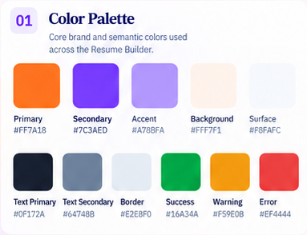

- **Shared-token conflict:** The existing app and home plan already use shared orange/violet/border values that may differ from this board. Do not add a Resume Builder-only palette to hide that mismatch. Use the current shared tokens unless a coordinated, app-wide token decision explicitly changes them; record the delta in the plan or review notes and keep the home, library, and builder consistent.

- **Dark palette behavior:** Slides 1-6 show dark builder panels with deep ink surfaces, readable pale text, muted neutral borders, and restrained orange/violet controls. The board does not print exact dark hex values, so dark equivalents are estimates. Preserve the app’s existing dark-mode tokens; separate nested surfaces by a small tonal step and border, not glow, large gradients, or pure-black panels.
  **Required reference:** Inspect the paired light/dark product crops and dark interaction states before changing any dark surface.

  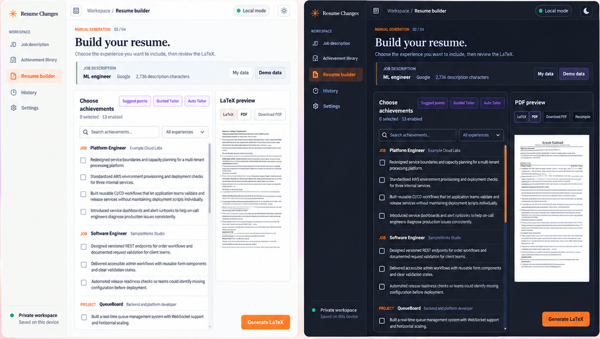

  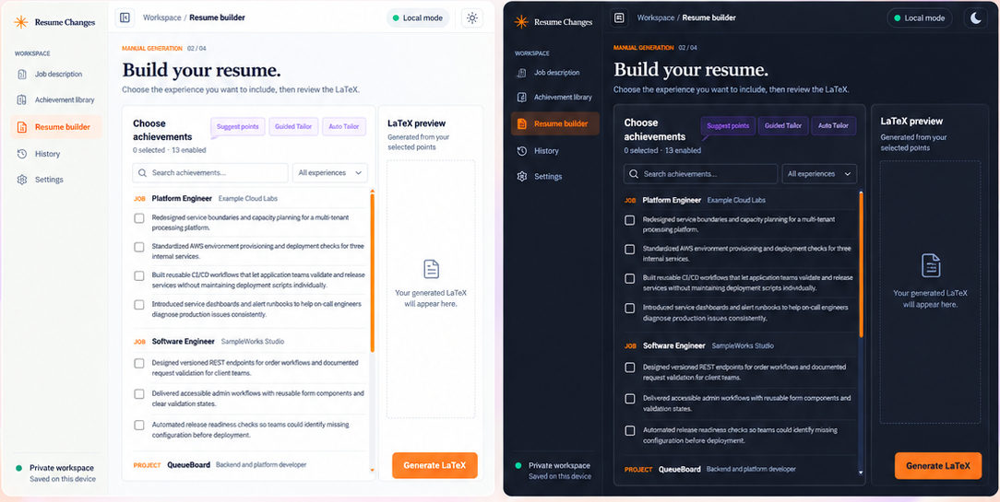

  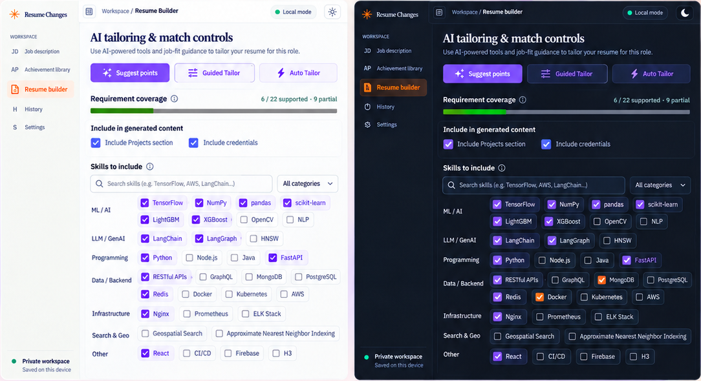

- **Type and exact scale:** Slide 8 labels Playfair Display and Inter, but these are board annotations, not authorization to replace the application fonts. Preserve the current Georgia/Times serif heading treatment and Arial/Helvetica operational UI; do not fetch remote fonts or add a new font dependency. Use the board scale as guidance: H1 about 40/48 desktop, H2 32/40, H3 24/32, H4 20/28, body 16/24, standard UI text 14/20, small labels 12/16, and captions 12/16. Keep the product title compact and the list/editor text comfortable to scan.
  **Required reference:** Inspect the exact type specimen and the in-product title/input samples. Poster heading scale is not the product page scale.

  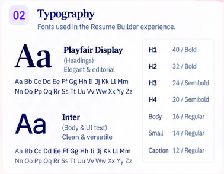

  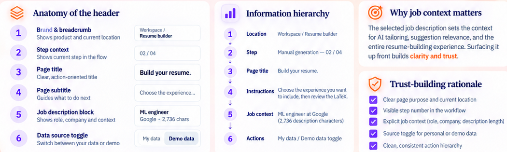

  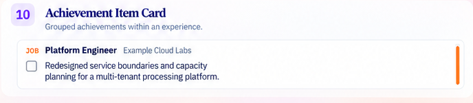

- **Spacing, proportion, border, and shadow:** The board uses a 4/8/16/24/32/48/64px rhythm and demonstrates 4/8/12/16/24px corner values. Keep the builder as an unframed application workspace, with a flexible selection column beside the preview on desktop and a deliberate stacked layout on narrow screens. Prefer crisp 1px borders and the existing restrained shadow tokens. Follow the application’s compact component rule: controls near 6px radius, cards no more than 8px unless an existing shared component requires otherwise, and full rounding only for chips/pills. Never place decorative cards inside cards.
  **Required reference:** Inspect the full product layout, the spacing/radius board, and the exact form/preview proportions before adjusting geometry.

  

  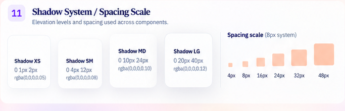

  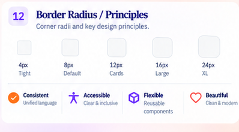

- **Button hierarchy and icons:** Generate LaTeX is the primary orange action. Download PDF is a neutral secondary action. Suggest points, Guided Tailor, and Auto Tailor are violet secondary/AI actions. Select all, Clear, Edit, settings, and trash are shown as low-emphasis controls in the kit, but each may be rendered only where the current product supports its behavior. Use the installed Lucide icon set instead of letter glyphs or emoji. Keep labels on unfamiliar or consequential actions.
  **Required reference:** Inspect the button state gallery and the actual selection, tailoring, and preview controls before styling actions.

  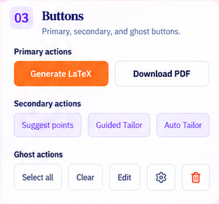

  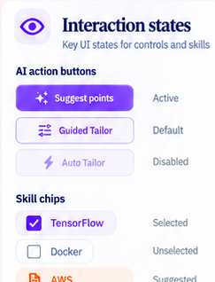

  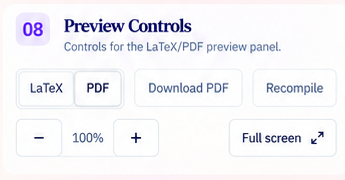

- **Input and selection states:** The board shows default, focused, error, and disabled text fields; search and select controls; unchecked, checked, hover, and disabled checkboxes; and checked skill chips. Use a visible violet focus ring, clear field labels, explicit validation text, and high-contrast disabled styles. Keep native controls keyboard-accessible unless the current component already uses an accessible equivalent.
  **Required reference:** Inspect all four input states and checkbox/skill states before implementing fields or selection.

  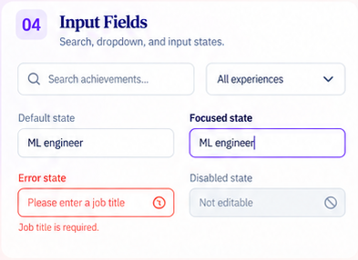

  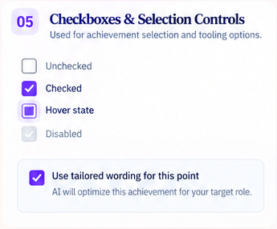

  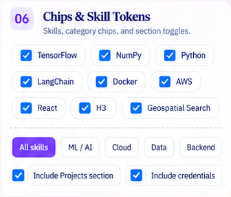

- **Selection and grouped evidence:** Slides 1 and 3 show a searchable list grouped by job/project, selection count, per-achievement checkboxes, and an empty LaTeX preview until generation. Counts, groups, labels, and checked state must come from the current library and selection state. Board names, companies, bullets, and counts are examples only.
  **Required reference:** Inspect the selection workspace and its anatomy crop before changing list grouping or selected-state styling.

  

  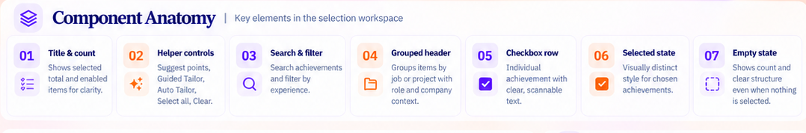

  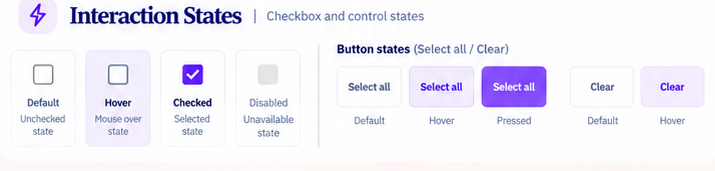

- **AI tailoring and match information:** Slide 4 presents Suggest points, Guided Tailor, Auto Tailor, requirement coverage, inclusion controls, skill search/category grouping, and selected/suggested/available states. Use the existing AI contracts, fallback-consent prompt, analysis result, and measured skill capacity. Never label a count as a match score, predict ATS success, imply AI ran when it did not, or bypass explicit fallback consent.
  **Required reference:** Inspect the tailoring panel, its interactive state strip, and the matching explanation before changing AI controls or skill states.

  

  

  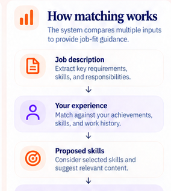

- **Review and preview:** Slides 5-6 show review counts, job analysis, inclusion checkboxes, truthful generated/validation status, LaTeX and PDF modes, zoom controls, a document viewport, and download/recompile actions. Only expose operations already supported by existing handlers/routes. A preview must use the generated document; do not substitute a static sample resume for real output.
  **Required reference:** Inspect the review and preview product crops plus the corresponding empty/loading/ready/error state examples before changing these workflows.

  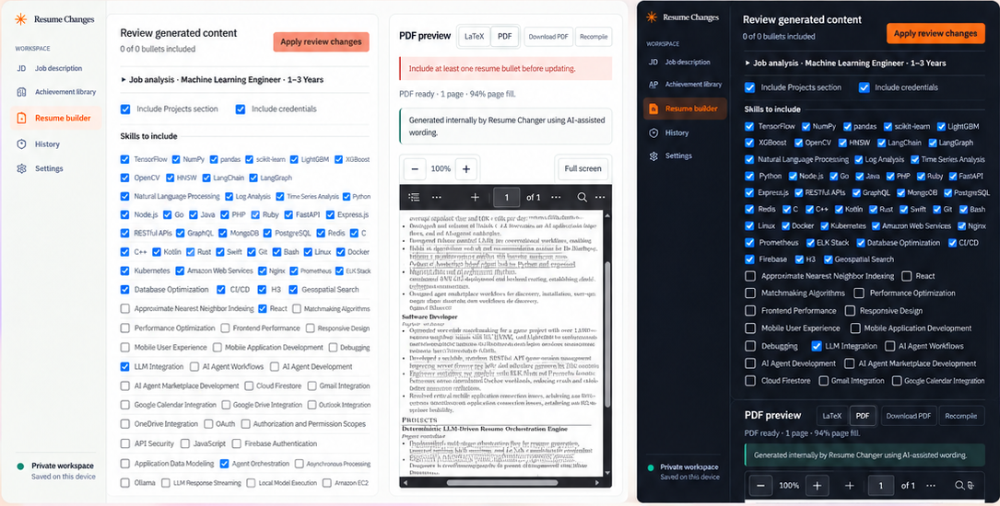

  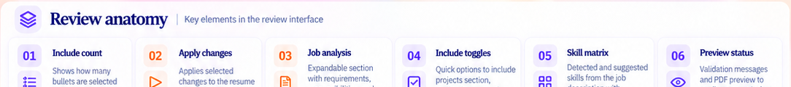

  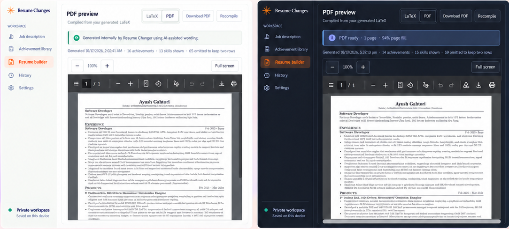

  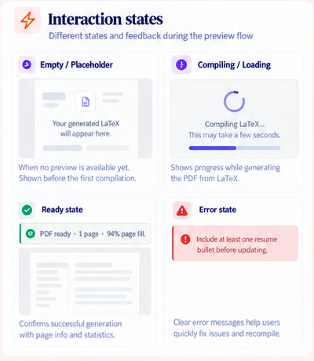

- **Exact reference copy and sample-only data:** Board labels include Build your resume., Choose the experience you want to include, then review the LaTeX., Choose achievements, Suggest points, Guided Tailor, Auto Tailor, LaTeX preview, Generate LaTeX, Download PDF, Recompile, My data, Demo data, Include Projects section, and Include credentials. Use a label only when it describes a real current action. Google, ML engineer, Platform Engineer, Example Cloud Labs, sample bullets, selected skills, percentages, generated output, dates, and counts are illustration data, not production defaults.

- **Product UI versus presentation board:** Recreate only the actual application panes. Do not build the slide background, oversized poster headline, handwritten callouts, floating cards, decorative orbs/sparkles, progress dots, slide numbering, explanatory diagrams, product marketing content, or the UI-kit board itself. The product is a focused resume-building workspace, not a landing page.

- **Data, AI, and export trust:** Preserve the current personal/demo source selection, job-description draft, selected evidence IDs, AI request/response contracts, consent before local/original-wording fallback, LaTeX generation, compile diagnostics, PDF output, export package, and truthful status. Do not create fictitious job descriptions, accomplishments, fit percentages, credentials, or generated resume content to fill empty states.

### Required Image Links For Reference Interpretation

Before implementing any Reference Interpretation item, open and inspect the exact crop linked here. Every crop referenced by a task is mandatory; do not substitute memory of the full poster. The task’s “Required image inspection” names the crop that must be opened before starting that task.

- **Palette and exact values:** docs/ui-images/resume-builder/ui-kit-color-palette.png

  

- **Dark and light surfaces:** docs/ui-images/resume-builder/builder-overview-light-dark.png, docs/ui-images/resume-builder/selection-workspace-light-dark.png, docs/ui-images/resume-builder/tailoring-light-dark.png, docs/ui-images/resume-builder/review-light-dark.png, and docs/ui-images/resume-builder/preview-light-dark.png

  

  

  

  

  

- **Typography:** docs/ui-images/resume-builder/ui-kit-typography.png, docs/ui-images/resume-builder/header-anatomy-hierarchy.png, and docs/ui-images/resume-builder/ui-kit-achievement-item-card.png

  

  

  

- **Spacing, surfaces, and radius:** docs/ui-images/resume-builder/ui-kit-shadow-spacing.png, docs/ui-images/resume-builder/ui-kit-border-principles.png, and docs/ui-images/resume-builder/builder-overview-light-dark.png

  

  

  

- **Buttons and icon actions:** docs/ui-images/resume-builder/ui-kit-buttons.png, docs/ui-images/resume-builder/tailoring-ai-control-states.png, and docs/ui-images/resume-builder/ui-kit-preview-controls.png

  

  

  

- **Inputs, checkboxes, and chips:** docs/ui-images/resume-builder/ui-kit-input-fields.png, docs/ui-images/resume-builder/ui-kit-selection-controls.png, and docs/ui-images/resume-builder/ui-kit-skill-chips.png

  

  

  

- **Builder header and job context:** docs/ui-images/resume-builder/header-light-dark.png, docs/ui-images/resume-builder/header-anatomy-hierarchy.png, docs/ui-images/resume-builder/header-component-states.png, docs/ui-images/resume-builder/header-design-system.png, and docs/ui-images/resume-builder/ui-kit-job-context-card.png

  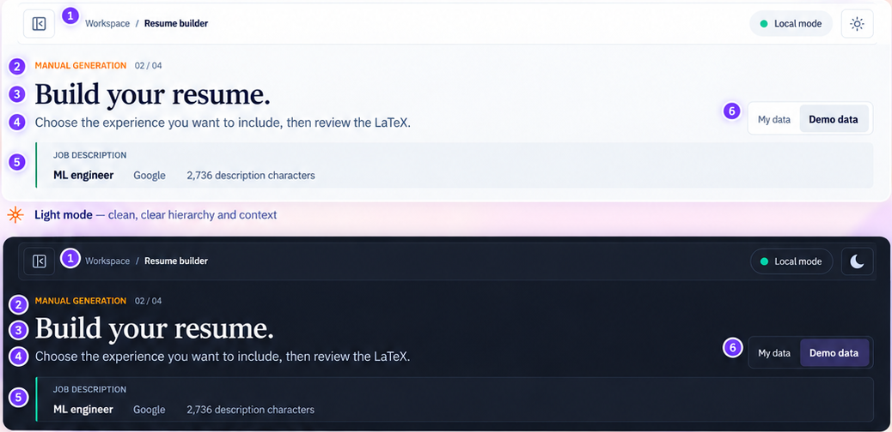

  

  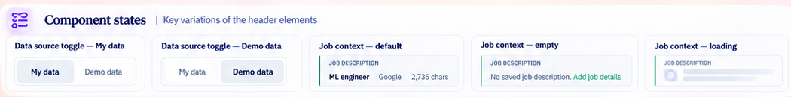

  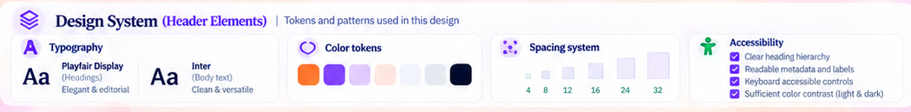

  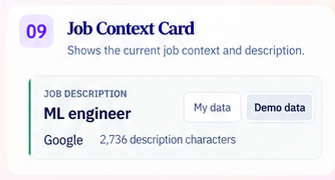

- **Selection and evidence list:** docs/ui-images/resume-builder/selection-workspace-light-dark.png, docs/ui-images/resume-builder/selection-anatomy.png, docs/ui-images/resume-builder/selection-interaction-states.png, and docs/ui-images/resume-builder/selection-logic-accessibility.png

  

  

  

  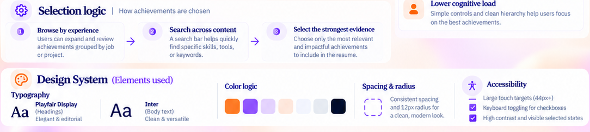

- **AI tailoring and skills:** docs/ui-images/resume-builder/tailoring-light-dark.png, docs/ui-images/resume-builder/tailoring-ai-control-states.png, docs/ui-images/resume-builder/tailoring-match-logic.png, and docs/ui-images/resume-builder/tailoring-design-rationale-system.png

  

  

  

  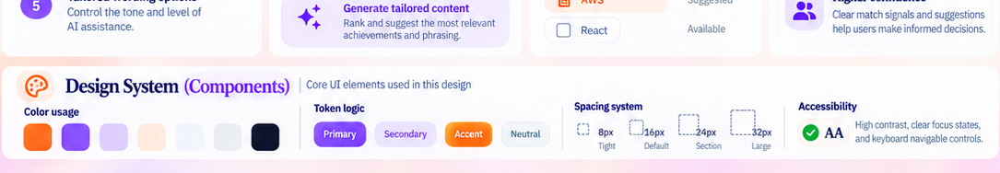

- **Review and generated content:** docs/ui-images/resume-builder/review-light-dark.png, docs/ui-images/resume-builder/review-anatomy.png, docs/ui-images/resume-builder/review-decision-flow-error-states.png, and docs/ui-images/resume-builder/review-accessibility-system.png

  

  

  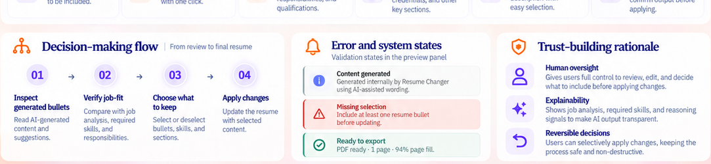

  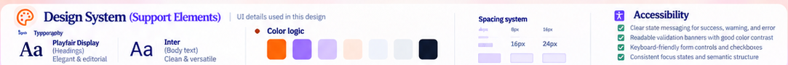

- **LaTeX/PDF preview and export:** docs/ui-images/resume-builder/preview-light-dark.png, docs/ui-images/resume-builder/preview-anatomy.png, docs/ui-images/resume-builder/preview-interaction-states.png, docs/ui-images/resume-builder/preview-benefits-toolbar.png, and docs/ui-images/resume-builder/preview-design-system.png

  

  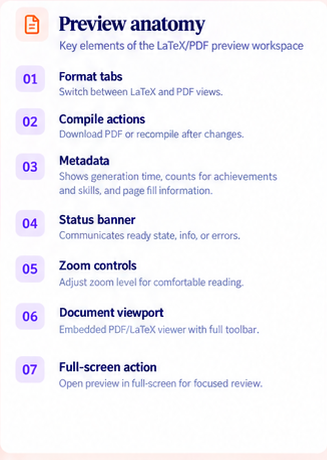

  

  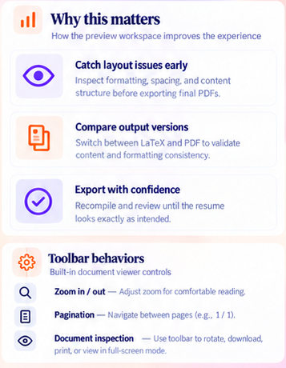

  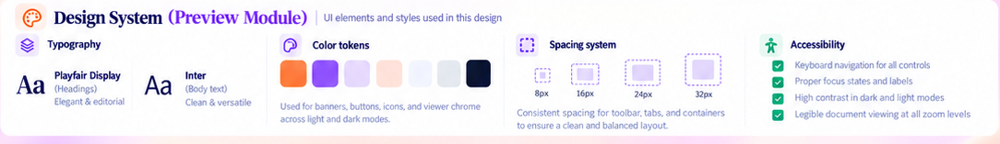

- **Workflow and whole-page acceptance:** docs/ui-images/resume-builder/workflow-before-after.png, docs/ui-images/resume-builder/workflow-page-map-hierarchy-browsing.png, docs/ui-images/resume-builder/workflow-section-anatomy-benefits.png, and docs/ui-images/resume-builder/builder-page-breakdown-design-system.png

  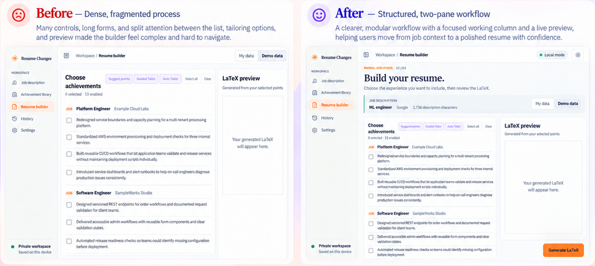

  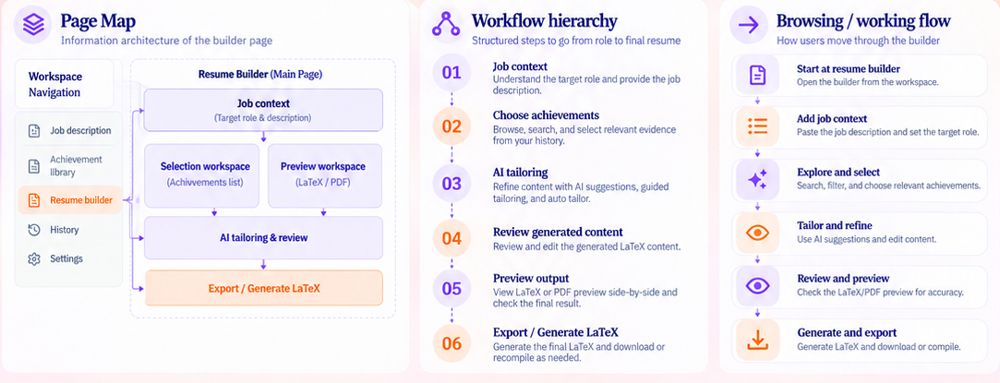

  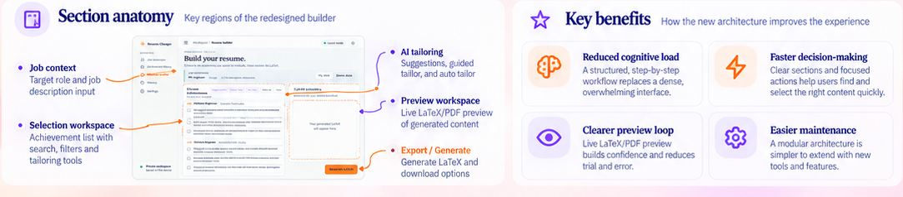

  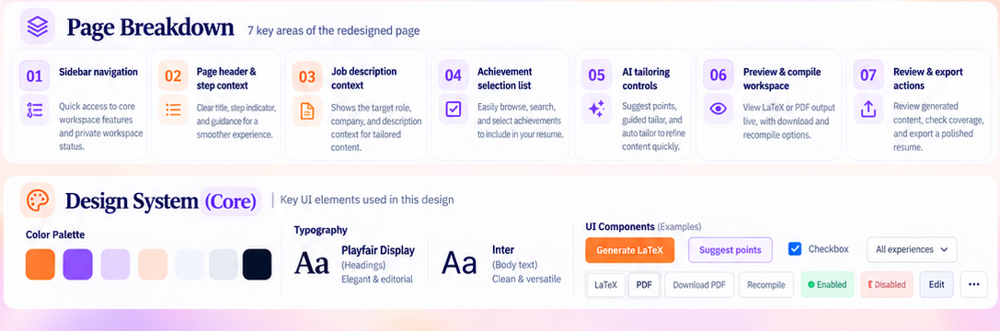

### Additional Exact Token Values From The Boards

The board prints the light values below. Dark colors are visual estimates only; derive them from the current shared dark theme and verify contrast. Do not add a second set of component-specific variables under the builder.

| Token            | Printed light value | Use                                        |
| ---------------- | ------------------- | ------------------------------------------ |
| Primary orange   | #FF7A18             | Generate LaTeX and primary action emphasis |
| Secondary violet | #7C3AED             | AI actions, selected states, and focus     |
| Accent violet    | #A78BFA             | Secondary violet accent                    |
| Background       | #FFF7F1             | Light app canvas reference                 |
| Surface          | #F8FAFC             | Cards, controls, and preview chrome        |
| Text primary     | #0F172A             | Titles and main content                    |
| Text secondary   | #64748B             | Supporting text and metadata               |
| Border           | #E2E8F0             | Inputs, separators, and card outlines      |
| Success          | #16A34A             | Confirmed/generated-success state only     |
| Warning          | #F59E0B             | Actual caution/validation state only       |
| Error            | #EF4444             | Actual failure or invalid-input state      |

The type board prints H1 40/48, H2 32/40, H3 24/32, H4 20/28, Body 16/24, standard UI 14/20, and Small/Caption 12/16. Preserve existing Georgia/Times and Arial/Helvetica. The spacing board shows 4/8/16/24/32/48/64px; use the existing application tokens and compact control/card radius conventions.

## Current Code Map

- src/app/generate/page.tsx resolves the builder route and source, loads the library/job context, and selects the current entry/loading/error experience.
- src/components/workspace-shell.tsx owns the shared brand, sidebar destination, breadcrumb, theme mode, local status, and responsive navigation. Builder tasks must not duplicate the shell.
- src/components/resume-generator.tsx owns job-description draft restoration, selection, AI suggestion/tailoring requests, generation, LaTeX/PDF compile, status, and handoff into ResumeStudio.
- src/components/resume-studio.tsx owns the generated-document tabs, review and editing draft, generated bullets, skills/projects/education, apply flow, local draft history, and preview handoff.
- src/components/studio-skills.tsx owns skill search/filtering and measured two-line capacity feedback. Preserve real measurement and fit behavior.
- src/components/studio-dialog.tsx owns the current editor/dialog integration and its focus/close lifecycle.
- src/app/studio.css contains the resume-studio component styles. src/app/globals.css contains shared tokens and global/shell styling; do not copy shared values into builder-only overrides.
- src/lib/ai/contracts.ts, src/lib/ai/evidence.ts, src/lib/ai/requirement-coverage.ts, src/lib/ai/achievement-selection.ts, and src/lib/ai/tailor-achievements.ts define the current analysis and AI contracts. Visual tasks must not change these contracts or model policy.
- src/lib/generation/manual-generation.ts, studio-generation.ts, studio-document.ts, studio-history.ts, studio-session.ts, review-draft.ts, skill-layout.ts, export-package.ts, and resume-filename.ts own generation, document state, review, measured skills, and export behavior.
- src/lib/latex/ owns resume rendering and validation; current PDF/LaTeX viewer, download, and compile behavior must remain backed by these real outputs and routes.
- Existing focused coverage includes tests/e2e/resume-studio.spec.ts, tests/e2e/resume-journey.spec.ts, tests/e2e/achievement-selection.spec.ts, tests/e2e/studio-overrides.spec.ts, tests/e2e/generation-history.spec.ts, tests/unit/generation/_, tests/unit/latex/_, and tests/unit/pdf/studio-integration.test.ts. Read the relevant test before editing its component.

## Required Workflow And Test Rules

1. Treat every task as independent. Start from the current main branch and existing product behavior; the task number does not establish a prerequisite. Do not wait for, cherry-pick, or overwrite another agent’s work. Use a task-specific branch when parallelized and limit edits to the requested component.
2. Before editing, read the named component and its relevant tests. Record the existing user-visible behavior and API/route that protects it. Preserve behavior unless the task explicitly identifies a supported presentation change.
3. Every new or materially changed interactive component receives a focused, clearly named component test file or a focused addition to its existing owner test; every new non-trivial pure helper receives unit coverage. Do not add duplicate tests that only restate unchanged assertions.
4. Use deterministic synthetic/demo fixtures only. Do not load personal resume files, call live AI providers, rely on external services, or place personal data in screenshots or tests. Mock existing API responses and assert observable behavior.
5. Cover applicable default, hover, keyboard-focus, pressed, disabled/read-only, loading, success, and error states. Do not invent states that the existing data or APIs cannot represent; say why they do not apply.
6. Review light/dark and desktop/tablet/mobile. Check the whole page and nested scroll regions for overflow, long labels, focus visibility, clipped controls, dialog bounds, and preview usability.
7. Run the existing app on an available port without stopping any process already listening. Open the assigned component, exercise pointer and keyboard states, capture a screenshot, and compare it with the exact task crop. Fix visual mismatches, capture again, and repeat until geometry, text, color, spacing, and states are accurate. The board is a visual target, not permission to fake unsupported functionality.
8. Before a UI PR run npm run lint, npm run typecheck, npm test, and the relevant npm run test:e2e suites. Run git diff --check. Report environment/startup failures truthfully; do not say a test passed if it did not run.
9. Keep the PR scoped to the task. No schemas, prompts, API behavior, user data, secrets, local logs, generated build output, unrelated routes, or poster art may be included.

## Task Roadmap

### Task 01: Establish The Resume Builder Baseline

**Required image inspection:** Open the paired product overview and page-breakdown crop before inventory. Inspect the app panes only; the page map is context, not app UI.

Reference files: docs/ui-images/resume-builder/builder-overview-light-dark.png, docs/ui-images/resume-builder/builder-page-breakdown-design-system.png

**Independence:** Inventory only; no other task may rely on this task being completed first. Start from current code and tests.

**Files:** Inspect src/app/generate/page.tsx, src/components/resume-generator.tsx, src/components/resume-studio.tsx, src/components/workspace-shell.tsx, src/app/studio.css, src/app/globals.css, and relevant generation/selection/preview tests. Add no visual component here.

- [ ] Record the current job-context route, source value, draft restore, selection, AI consent/fallback, generation, review, history, compile, download, and error behavior.
- [ ] Capture current light/dark screenshots at 1440x900, 1024x768, 768x1024, 390x844, and 320x740 using synthetic data only.
- [ ] Map every board control to its current handler, derived data, or unsupported status; identify controls that must be omitted rather than faked.
- [ ] Record current section order, viewer states, empty states, API calls, keyboard behavior, and any product data omitted by the board.
- [ ] Run existing focused builder tests before visual work and keep their assertions as regression coverage.

**Acceptance:** A concise inventory and before screenshots exist; no production behavior, data contract, or app styling changes are made.

**Visual specification:** Treat slide 1’s paired product panes as the broad composition reference: shared shell, page/step context, job context, selectable evidence, preview, and primary action. Compare only the operational app surface, never the board’s cream presentation background, annotations, slide title, or page-breakdown cards.

### Task 02: Reconcile Shared Builder Color Tokens

**Required image inspection:** Open the exact palette crop and compare it with existing shared theme tokens before assigning a color.

Reference file: docs/ui-images/resume-builder/ui-kit-color-palette.png

**Independence:** This token review must be actionable from current shared styles; do not wait for Task 03 or any component task.

**Files:** src/app/globals.css and shared token tests if the project has a token contract. Update other UI plans only as part of an explicitly coordinated design-system decision.

- [ ] Use or map the printed orange, violet, accent, background, surface, text, border, and semantic status values from the token table above.
- [ ] Reconcile differences with existing app-wide/home/library values in one shared place; do not add builder-only duplicate tokens.
- [ ] Preserve current dark theme values where the board has no exact dark hex; treat new dark shades as estimates and verify contrast.
- [ ] Keep orange for the main resume action, violet for AI/selected/focus emphasis, and success/warning/error for truthful state only.
- [ ] Add a focused token test only if tokens are represented in a testable structured source.

**Acceptance:** Builder controls use the agreed shared tokens in both themes; no private builder palette or unexplained app-wide color fork is introduced.

**Visual specification:** Most panels remain neutral. Use orange sparingly on Generate LaTeX and important workflow markers; use violet on AI tools and focus/selection. Borders remain visible in both themes. Do not create a large violet/orange surface, full-page gradient, glow, or color-only meaning.

### Task 03: Define Builder Typography Without Changing Fonts

**Required image inspection:** Open the UI-kit type scale and the product header/row examples. Do not select fonts by copying the board’s annotations.

Reference files: docs/ui-images/resume-builder/ui-kit-typography.png, docs/ui-images/resume-builder/header-anatomy-hierarchy.png, docs/ui-images/resume-builder/ui-kit-achievement-item-card.png

**Independence:** Typography can be implemented against current shared styles; do not depend on a token, layout, or component task.

**Files:** src/app/globals.css and component styles only where existing typography is not already tokenized; add computed-style checks to a focused UI test where useful.

- [x] Preserve Georgia/Times for current serif headings and Arial/Helvetica for operational UI. Do not load Playfair Display/Inter or change remote font dependencies.
- [x] Define/reuse responsive sizes: page title near 40/48 desktop and 32/40 mobile; section 24/32; card title 16-20/24; body 14-16/20-24; labels/meta 12/16.
- [x] Use semibold labels/headings, regular explanatory text, and stable tabular counts where the app already uses numeric comparisons.
- [x] Keep letter spacing at zero; do not use viewport-scaled font sizes or shrink text to fit.
- [x] Check long company names, job titles, skill labels, counts, and validation copy wrap without clipping in both themes.

**Acceptance:** Product hierarchy follows the board while retaining the existing fonts and readable line lengths at supported widths.

**Visual specification:** The oversized serif slide heading is not the app heading. Keep the app title compact, section title distinct, and form/list/preview text legible. Fix overflow by changing layout or wrapping, never by squeezing type.

### Task 04: Standardize Builder Spacing, Surfaces, And Radius

**Required image inspection:** Inspect the exact spacing/radius strip and the two-pane builder reference before adjusting dimensions.

Reference files: docs/ui-images/resume-builder/ui-kit-shadow-spacing.png, docs/ui-images/resume-builder/ui-kit-border-principles.png, docs/ui-images/resume-builder/builder-overview-light-dark.png

**Independence:** Apply the shared geometry already present; this task does not wait for any other numbered task.

**Files:** src/app/studio.css and only shared variables in src/app/globals.css when the existing system provides no equivalent.

- [ ] Reuse the 4/8/16/24/32/48/64px rhythm. Keep 24px as a major desktop inset, 16px for compact surfaces, and 8-12px within label/control relationships.
- [ ] Keep controls near 6px radius and cards at 8px maximum; reserve full rounding for chips, status pills, and small circular icon backgrounds.
- [ ] Prefer crisp 1px borders; use at most a subtle existing light shadow on a major surface and no nested-card shadow.
- [ ] In dark mode, distinguish surfaces by tone and border instead of pasting light shadows or glow onto dark cards.
- [ ] Keep stable dimensions for buttons, toolbar controls, selection rows, and badges so states do not shift layout.

**Acceptance:** The builder’s surfaces and controls share consistent geometry without adding decorative nested cards.

**Visual specification:** Retain the unframed app workspace and clean two-pane balance. Separate content with alignment, spacing, and thin borders; do not wrap the entire builder in another card. Narrow layouts should reduce insets rather than force horizontal scrolling.

### Task 05: Standardize Builder Button And Icon Conventions

**Required image inspection:** Inspect the primary/secondary/ghost button gallery, AI action states, and preview action controls.

Reference files: docs/ui-images/resume-builder/ui-kit-buttons.png, docs/ui-images/resume-builder/tailoring-ai-control-states.png, docs/ui-images/resume-builder/ui-kit-preview-controls.png

**Independence:** Apply the conventions only to the assigned action set; do not wait for a shared button task.

**Files:** Relevant builder components, src/app/studio.css, and the existing component E2E test or a clearly named task-specific action test.

- [ ] Use Generate LaTeX as the orange primary action; Download PDF is secondary; AI actions use violet emphasis; low-risk utilities remain neutral/ghost.
- [ ] Use installed Lucide icons where available. Keep visible text on actions whose meaning is not universally obvious.
- [ ] Preserve real onClick handlers, loading/disabled states, and error messages; omit unsupported buttons such as settings/trash where no action exists.
- [ ] Ensure hit areas are stable and comfortably operable, with visible focus, hover, pressed, disabled, and loading treatments where applicable.
- [ ] Respect reduced motion and do not shift adjacent controls when state styling changes.

**Acceptance:** Every displayed action does its named operation and every icon-only control is labeled and keyboard usable.

**Visual specification:** Orange appears on the primary workflow CTA, violet on AI/selection emphasis, and neutral surfaces on clear/download utilities. Focus is an obvious 2px violet ring with offset. Hover/pressed feedback stays subtle and should not resize the control.

### Task 06: Establish The Builder’s Two-Pane Composition

**Required image inspection:** Open the slide 1 paired application panes and slide 7 before/after workspace crop.

Reference files: docs/ui-images/resume-builder/builder-overview-light-dark.png, docs/ui-images/resume-builder/workflow-before-after.png

**Independence:** Build the composition around current components and routes; it must not depend on another task’s implementation.

**Files:** src/components/resume-generator.tsx, src/components/resume-studio.tsx, src/app/studio.css, and a focused layout test.

- [ ] Keep WorkspaceShell as the owner of brand/sidebar/top bar; do not make a second application frame.
- [ ] Preserve the current step from job context to achievement selection, then generated-document review and preview; keep the active content clear without copying poster copy.
- [ ] Use a flexible selection/work area beside the preview on wide screens, with min-width:0 and independent scroll only where current behavior needs it.
- [ ] Preserve existing generate, apply, compile, and export state transitions; do not replace the workflow with static panels.
- [ ] At narrow sizes, stack panes in a useful order and keep the primary action reachable.
- [ ] Test landmarks, pane order, resize behavior, and absence of page-level horizontal overflow.

**Acceptance:** The builder reads as one coherent operational workflow in the shared shell and all existing actions remain reachable.

**Visual specification:** On desktop, balance a wider editing/selection region with a narrower live preview. Keep 24-32px page inset, restrained panel spacing, and the product title/context visible above content. On mobile, stack content at 12-16px inset; no board poster panels or floating artwork belong in the page.

### Task 07: Show Resume Builder As The Active Workspace Destination

**Required image inspection:** Open the full builder app crops and check the sidebar/active route in light and dark themes.

Reference files: docs/ui-images/resume-builder/builder-overview-light-dark.png, docs/ui-images/resume-builder/header-light-dark.png

**Independence:** The existing shell must render correctly without any other task being finished.

**Files:** src/components/workspace-shell.tsx only if route active-state semantics need correction, shared styles, and the existing shell or builder E2E test.

- [ ] Confirm /generate marks Resume builder as the current destination and exposes aria-current="page".
- [ ] Preserve shared destination order, icon-plus-label navigation, collapse/mobile behavior, and accessible names.
- [ ] Apply only the established active-state treatment; do not redesign unrelated navigation routes.
- [ ] Check the active row and keyboard focus in both themes, at desktop and mobile widths.

**Acceptance:** Direct navigation and refresh show the correct active route without changing shell behavior elsewhere.

**Visual specification:** Keep the active icon/text orange with a restrained soft background; other destinations stay neutral. The sidebar remains a quiet, consistent navigation region and does not compete with the builder workspace.

### Task 08: Build The Page Header And Manual-Generation Step Context

**Required image inspection:** Open the header light/dark and anatomy crops before adjusting breadcrumb, step label, title, or supporting copy.

Reference files: docs/ui-images/resume-builder/header-light-dark.png, docs/ui-images/resume-builder/header-anatomy-hierarchy.png, docs/ui-images/resume-builder/header-component-states.png

**Independence:** This header can be matched using the existing route context; it does not rely on tasks 06-07.

**Files:** src/components/resume-generator.tsx, shared breadcrumb only if current route text is wrong, src/app/studio.css, and the existing builder E2E test.

- [ ] Preserve the breadcrumb Workspace / Resume builder and the current manual-generation step indicator 02 / 04 when that step is active.
- [ ] Use the product title Build your resume. and the truthful supporting instruction shown in the crop.
- [ ] Keep page heading, step label, and subtitle in a clear hierarchy; do not copy the poster title or slide number.
- [ ] Keep the Local mode/theme controls owned by WorkspaceShell; do not duplicate them inside the page.
- [ ] Test one h1, route/breadcrumb state, progress label, and wrapping on desktop and narrow viewport.

**Acceptance:** Users can identify their location, active step, and next expectation without confusing the step number with a completion claim.

**Visual specification:** Keep the serif title around 40/48 desktop and 32/40 mobile; step/eyebrow is compact orange uppercase, and instructions use secondary sans-serif text. The header should not consume hero-page space or push the main work below the first viewport.

### Task 09: Present Job Description Context Truthfully

**Required image inspection:** Inspect the job context card in the kit, the header context inset, and the full selection page.

Reference files: docs/ui-images/resume-builder/ui-kit-job-context-card.png, docs/ui-images/resume-builder/header-anatomy-hierarchy.png, docs/ui-images/resume-builder/selection-workspace-light-dark.png

**Independence:** Render current job data as it exists; no AI, typography, or layout task is a prerequisite.

**Files:** src/components/resume-generator.tsx and focused tests/e2e/resume-journey.spec.ts assertions.

- [ ] Show the actual role/company and description length only when present in the restored job-description draft.
- [ ] Use the current job description as context for selection/tailoring; never copy ML engineer, Google, or sample character count as a default.
- [ ] Represent missing context with a clear route/action to provide it, not with invented values.
- [ ] Keep the description summary compact, readable, and safely wrapped; avoid exposing the whole long description in a cramped chip.
- [ ] Test restored, empty, long-title, long-company, and changed-context states with synthetic data.

**Acceptance:** Context is accurate, useful, and traceable to the real draft; empty values remain clearly empty.

**Visual specification:** Use a neutral bordered surface, a small uppercase metadata label, prominent role title, and secondary company/length text. Keep 12-16px internal padding, clear alignment, and a thin semantic accent only if it matches current behavior.

### Task 10: Style The My Data And Demo Data Source Choice

**Required image inspection:** Inspect the source toggle in header and full-page crops and the job context kit example.

Reference files: docs/ui-images/resume-builder/header-component-states.png, docs/ui-images/resume-builder/ui-kit-job-context-card.png, docs/ui-images/resume-builder/builder-overview-light-dark.png

**Independence:** Keep the existing source/query behavior; this is not dependent on Task 09 or another task.

**Files:** src/components/resume-generator.tsx, src/app/generate/page.tsx only if route semantics are broken, and existing source-navigation tests.

- [ ] Preserve the current personal/demo source routes and selection; do not merge two libraries or change data loading.
- [ ] Use a clear two-option segmented link/control with visible selected state, focus ring, and accessible current value.
- [ ] Label source data honestly and preserve read-only/disabled behavior wherever it exists.
- [ ] Do not implement the toggle as a cosmetic preference if selecting it changes the actual loaded source.
- [ ] Test direct load, refresh, back/forward, keyboard activation, and source-bound selection behavior.

**Acceptance:** Source choice selects the actual current data source and remains understandable in both themes.

**Visual specification:** Use two compact equal-height segments with a restrained selected tint and clear text contrast. Keep the choice adjacent to job context; do not use large pill cards or imply cloud sync.

### Task 11: Style AI Suggestion And Tailoring Actions

**Required image inspection:** Open the tailoring panel and its AI action-state crop before changing Suggest points, Guided Tailor, or Auto Tailor.

Reference files: docs/ui-images/resume-builder/tailoring-light-dark.png, docs/ui-images/resume-builder/tailoring-ai-control-states.png

**Independence:** Each action must remain useful against current APIs and state without any other planned task.

**Files:** Existing handlers in src/components/resume-generator.tsx, action styles in src/app/studio.css, and focused tests/e2e/achievement-selection.spec.ts or a named AI-actions spec.

- [ ] Preserve distinct existing operations and handlers for suggestion, guided tailoring, and automatic tailoring.
- [ ] Show a pending/disabled state only while that operation is actually running; preserve cancellation/error feedback if supported.
- [ ] Preserve the explicit user-consent prompt before any available local or original-wording fallback.
- [ ] Do not claim that suggestions have been generated before a successful response; keep resulting selections tied to real evidence IDs.
- [ ] Test each action with mocked success, failure, and fallback-consent paths; do not call a live provider.

**Acceptance:** AI controls are visually distinct, truthful, and retain existing consent and result semantics.

**Visual specification:** Use compact violet secondary buttons with a leading relevant icon and stable width. The actively running action may show a spinner and concise status; inactive actions remain legible. Avoid a filled violet bar behind all controls or glow.

### Task 12: Show Selection Count And Selection State

**Required image inspection:** Open the selection workspace and anatomy crops to see the count and selected evidence treatment.

Reference files: docs/ui-images/resume-builder/selection-workspace-light-dark.png, docs/ui-images/resume-builder/selection-anatomy.png

**Independence:** Use the current selected-ID state; do not wait for the search, row, or bulk-action tasks.

**Files:** src/components/resume-generator.tsx and focused selection component tests.

- [ ] Display selected and available totals from current groups and the selected ID set.
- [ ] Keep counts synchronized after individual selection, clear/select-all, source changes, search, and filtering.
- [ ] Do not count disabled evidence if the current generation flow excludes it.
- [ ] Give the count an accessible name and keep it readable without color-only status.
- [ ] Test zero, partial, all, filtered, and source-changed selection states.

**Acceptance:** Visible counts always match the actual evidence eligible for generation.

**Visual specification:** Place a compact count near Choose achievements, secondary to the heading. Use 12-14px text with a softly tinted count badge; avoid a large metric tile or card nested inside the list panel.

### Task 13: Add Search And Experience Filtering To The Selection List

**Required image inspection:** Inspect the selection search/filter row, the UI-kit input state, and the grouped selection list.

Reference files: docs/ui-images/resume-builder/selection-anatomy.png, docs/ui-images/resume-builder/ui-kit-input-fields.png, docs/ui-images/resume-builder/selection-workspace-light-dark.png

**Independence:** Search/filter must work with the existing selection model before any AI or layout task is complete.

**Files:** Selection controls in src/components/resume-generator.tsx, a pure helper only if justified, and focused tests/e2e/achievement-selection.spec.ts coverage.

- [ ] Keep search tied to existing achievement text/group fields and the existing experience filter.
- [ ] Preserve selected IDs when the visible search/filter changes; filtering must not silently deselect evidence.
- [ ] Provide a clear/reset affordance only while a value/filter is active and keep the result count truthful.
- [ ] Show an understandable no-matches state distinct from no available evidence.
- [ ] Test combined search/filter, keyboard use, clear/reset, long input, zero results, and preservation of hidden selection.

**Acceptance:** Users can locate evidence without changing the selected set except through explicit selection controls.

**Visual specification:** Search uses a leading magnifier, neutral 1px border, 6px radius, and clear 2px violet focus ring. Experience filter is an aligned native select or accessible listbox. Both controls wrap/stack cleanly and never clip dropdowns.

### Task 14: Group Achievement Rows By Their Existing Experience

**Required image inspection:** Inspect the grouped selection workspace and the achievement item sample before adjusting list hierarchy.

Reference files: docs/ui-images/resume-builder/selection-workspace-light-dark.png, docs/ui-images/resume-builder/ui-kit-achievement-item-card.png, docs/ui-images/resume-builder/selection-logic-accessibility.png

**Independence:** Render existing job/project groups without relying on selection search or other tasks.

**Files:** getPointGroups in src/components/resume-generator.tsx or the current list renderer; tests/e2e/achievement-selection.spec.ts.

- [ ] Preserve job/project identity and current group order; distinguish group type with label/icon and text.
- [ ] Show role/project title and available company/context as separate, correctly labeled text.
- [ ] Preserve source IDs and existing selection availability; do not create sample jobs or accomplishments.
- [ ] Handle empty groups by omitting them only when their current behavior does so; do not hide eligible points.
- [ ] Test mixed groups, no enabled points, duplicate-looking titles, and long titles/company names.

**Acceptance:** Every selectable item remains attached to its real experience context and no evidence is duplicated or dropped.

**Visual specification:** Group labels use compact orange uppercase metadata; group title is 14-16px semibold with company/role at 12-14px secondary. Use dividers and spacing rather than a large nested group card. Long labels wrap.

### Task 15: Implement Accessible Achievement Checkbox Rows

**Required image inspection:** Open the checkbox/selection-control crop and the selection interaction-state strip before changing row selection.

Reference files: docs/ui-images/resume-builder/ui-kit-selection-controls.png, docs/ui-images/resume-builder/selection-interaction-states.png

**Independence:** Each row is operable with current selection state and does not wait for bulk controls.

**Files:** Existing point-row component in src/components/resume-generator.tsx, src/app/studio.css, and a focused rendered-state test.

- [ ] Use a labeled native checkbox or equivalent accessible checkbox for each eligible achievement.
- [ ] Keep the selected marker, text, and hit target aligned; the row itself may activate selection only if it does not conflict with links/buttons.
- [ ] Support unchecked, checked, hover, keyboard focus, and genuinely disabled states shown by current data.
- [ ] Preserve selections when editing search/filter and expose checked state to assistive technology.
- [ ] Test mouse, Space/keyboard toggle, focus, disabled behavior, long text, and selected count synchronization.

**Acceptance:** Every eligible evidence row can be selected and deselected by pointer and keyboard with a truthful state.

**Visual specification:** Checkbox is about 18-20px with a clear 2px focus outline; selected state uses violet with a visible check. Row has 10-12px vertical padding, 12px text gap, and a subtle hover fill. Do not rely on background color alone.

### Task 16: Provide Select All And Clear Controls

**Required image inspection:** Inspect select-all/clear states in the selection interaction crop and the button gallery.

Reference files: docs/ui-images/resume-builder/selection-interaction-states.png, docs/ui-images/resume-builder/ui-kit-buttons.png

**Independence:** Bulk actions must operate on the current visible/eligible set as defined here; they do not depend on Task 13 or 15 being merged.

**Files:** Existing selection handlers in src/components/resume-generator.tsx and a focused selection interaction test.

- [ ] Keep Select all and Clear wired to current state handlers; define whether Select all targets filtered or all eligible points and make the label/behavior consistent.
- [ ] Preserve existing selections outside the visible filter if the product contract is global; do not surprise users by clearing hidden selections.
- [ ] Disable or hide an action only when it would do nothing; ensure the disabled visual is honest.
- [ ] Keep selected count and primary generation action synchronized.
- [ ] Test filtered list, partially selected, all selected, empty list, keyboard activation, and repeated clicks.

**Acceptance:** Bulk selection is predictable, reversible through the provided controls, and does not discard hidden selections unexpectedly.

**Visual specification:** Use quiet ghost/outline buttons, 36-40px high where practical, with stable width. Keep them close to the selection heading and lower in emphasis than AI actions and Generate LaTeX.

### Task 17: Show Tailoring Skills And Measured Capacity

**Required image inspection:** Open the tailoring skill panel, skill-chip kit, and tailoring rationale before changing skill controls.

Reference files: docs/ui-images/resume-builder/tailoring-match-logic.png, docs/ui-images/resume-builder/ui-kit-skill-chips.png, docs/ui-images/resume-builder/tailoring-design-rationale-system.png

**Independence:** Use current skills, measurements, and API state directly; this task has no dependency on AI button restyling.

**Files:** src/components/studio-skills.tsx, src/lib/generation/skill-layout.ts only if a visual-only bug is found, and tests/unit/generation/skill-layout.test.ts plus focused E2E coverage.

- [ ] Preserve the current measured two-line LaTeX skill capacity and explanatory uncertainty when measurements are unavailable.
- [ ] Keep skill search and All/Included/Available/Recommended/Cannot fit filters truthful and composable.
- [ ] Distinguish selected, recommended, available, and cannot-fit states with text/state semantics, not color alone.
- [ ] Do not add skills to the generated resume automatically or exceed measured capacity.
- [ ] Test search, filters, selection, capacity boundaries, unavailable measurements, and long skill labels.

**Acceptance:** Skill selection reflects current data and measured fit without changing the resume-generation contract.

**Visual specification:** Use compact outlined chips with violet selection, clear checkbox/checkmark, and category headings. Capacity bars are secondary and labeled with real measured values. Avoid a fake percentage match meter or ornamental metric cards.

### Task 18: Preserve Project And Credential Inclusion Controls

**Required image inspection:** Inspect the checked include controls in the tailoring and review panels plus the checkbox states.

Reference files: docs/ui-images/resume-builder/tailoring-light-dark.png, docs/ui-images/resume-builder/review-anatomy.png, docs/ui-images/resume-builder/ui-kit-selection-controls.png

**Independence:** Control current inclusion state using its existing owner; do not wait for review or layout changes.

**Files:** Existing include controls in src/components/resume-generator.tsx and src/components/resume-studio.tsx; relevant journey/studio tests.

- [ ] Preserve current Projects and credentials inclusion toggles and their actual effect on generated output.
- [ ] Keep checked state and labels accessible and maintain current defaults; do not silently opt in/out.
- [ ] Show a disabled state only when the related section has no data or the current workflow cannot include it.
- [ ] Preserve selected state across supported review/apply transitions and report validation accurately.
- [ ] Test both toggles on/off, missing data, save/apply, and generated document output.

**Acceptance:** Inclusion controls correspond to real persisted/draft output and clearly communicate their state.

**Visual specification:** Keep checkbox + label inline, with 8-12px spacing and a visible selected violet check. Place options in a neutral grouping, not separate floating cards. Wrap long labels naturally.

### Task 19: Present Generated-Content Review And Selection Count

**Required image inspection:** Open review panel, review anatomy, and review decision-state crops before changing the review hierarchy.

Reference files: docs/ui-images/resume-builder/review-light-dark.png, docs/ui-images/resume-builder/review-anatomy.png, docs/ui-images/resume-builder/review-decision-flow-error-states.png

**Independence:** Review the current generated draft as-is; this task does not depend on tailoring or toolbar tasks.

**Files:** src/components/resume-studio.tsx, src/lib/generation/review-draft.ts only if behavior already requires a tested pure helper, and tests/e2e/resume-studio.spec.ts.

- [ ] Show the actual number of included generated bullets and the supported review/apply action.
- [ ] Preserve current job-analysis details and generated-bullet editing/override behavior.
- [ ] Keep Include Projects section and Include credentials tied to current draft state.
- [ ] Never apply a visual sample bullet or claim AI generated content when no response exists.
- [ ] Test zero, partial, and full included count, edits, review action, failure, and successful apply.

**Acceptance:** The review area shows the real generated draft and count and preserves existing draft/apply semantics.

**Visual specification:** Use a concise heading/count row, readable bullet text, clearly grouped analysis/context, and one high-emphasis apply action. Keep controls aligned and do not create a giant dense checkbox wall at narrow widths.

### Task 20: Make Job Analysis And Requirement Coverage Trustworthy

**Required image inspection:** Inspect the review job-analysis area, tailoring coverage panel, and rationale crop.

Reference files: docs/ui-images/resume-builder/review-light-dark.png, docs/ui-images/resume-builder/tailoring-match-logic.png, docs/ui-images/resume-builder/review-decision-flow-error-states.png

**Independence:** Visualize existing JobAnalysisResult and coverage only; this task is not a prerequisite for AI controls.

**Files:** Current analysis presentation in src/components/resume-generator.tsx or src/components/resume-studio.tsx; tests/unit/ai/requirement-coverage.test.ts and focused UI tests.

- [ ] Label job requirements, matched/partial/missing categories only from the existing analysis result.
- [ ] Keep source job context visible enough to explain what the analysis compares.
- [ ] Do not call coverage an ATS score, guarantee interviews, or invent percentages from list length.
- [ ] Distinguish absent analysis, loading, ready, and error states with honest messages and retry only if an existing handler supports it.
- [ ] Test representative success, partial data, empty analysis, stale context, and failure using fixtures.

**Acceptance:** Every displayed insight traces to the current job analysis and has an explicit, truthful state.

**Visual specification:** Make the requirement label/count the first read, then use concise grouped rows with text/icon state. If a real numeric value exists, label and explain its denominator; otherwise omit the progress ring and score bar shown in artwork.

### Task 21: Style Review Toggles And Skill Inclusion Matrix

**Required image inspection:** Open the dense review skills matrix and the inclusion-toggle anatomy; the board’s large skill inventory is illustrative.

Reference files: docs/ui-images/resume-builder/review-light-dark.png, docs/ui-images/resume-builder/review-anatomy.png, docs/ui-images/resume-builder/review-accessibility-system.png

**Independence:** Render only current review controls; do not wait for the generated review layout task.

**Files:** src/components/resume-studio.tsx, src/components/studio-skills.tsx if it owns these controls, and existing review/override tests.

- [ ] Preserve explicit include state for skills, projects, credentials, and any supported sections; do not infer selections from sample imagery.
- [ ] Keep state names and label associations accessible, including mixed/disabled state only when current data supports them.
- [ ] Avoid presenting an exhaustive fake skills matrix; show only real skills and meaningful categories.
- [ ] Preserve keyboard selection and draft persistence; do not silently change inclusion on tab switches or AI responses.
- [ ] Test toggle changes, included count, draft restore, validation, and generated output.

**Acceptance:** Review controls map one-to-one to real draft values and are usable by keyboard and screen readers.

**Visual specification:** Use a compact checkbox grid with enough row spacing and clear label wrapping. Selected states use violet/blue only as an accent plus a checkmark. At narrow widths, flow into multiple rows without clipping or horizontal overflow.

### Task 22: Build The LaTeX/PDF Preview Workspace

**Required image inspection:** Open the paired light/dark preview product crop and the preview anatomy before adjusting panel proportions.

Reference files: docs/ui-images/resume-builder/preview-light-dark.png, docs/ui-images/resume-builder/preview-anatomy.png

**Independence:** The preview must render from the existing generated document and compile state; it cannot depend on other UI task completion.

**Files:** Preview/viewer component in src/components/resume-studio.tsx or its current child, src/app/studio.css, and tests/e2e/resume-studio.spec.ts.

- [ ] Show the actual generated LaTeX or compiled PDF; preserve current mode selection and document state.
- [ ] Keep the viewer readable, scrollable, and bounded within its pane; do not embed a static board resume or sample PDF.
- [ ] Preserve page count and generation metadata only when the real compile response provides them.
- [ ] Handle empty, compiling, ready, and error states without replacing real output with misleading placeholder content.
- [ ] Test both formats, long documents, viewport resize, theme, and successful/failed compile.

**Acceptance:** The preview reflects the current generated output and remains usable without hiding its source or state.

**Visual specification:** Use a neutral preview surface with crisp boundary and toolbar separated from the document viewport. At wide widths, reserve a stable pane beside editing; at narrow widths, place the preview below the primary editing content with a clear return path.

### Task 23: Implement Preview Tabs And Viewer Toolbar States

**Required image inspection:** Open the preview toolbar/anatomy crops and UI-kit preview controls before changing tabs, zoom, full screen, or document actions.

Reference files: docs/ui-images/resume-builder/preview-anatomy.png, docs/ui-images/resume-builder/preview-benefits-toolbar.png, docs/ui-images/resume-builder/ui-kit-preview-controls.png

**Independence:** Preserve the existing viewer API; each supported toolbar action can be styled independently.

**Files:** Existing preview toolbar implementation and src/app/studio.css; add a focused viewer interaction test if a state changes.

- [ ] Keep LaTeX/PDF tabs linked to their real output and expose the selected format accessibly.
- [ ] Preserve supported zoom, page navigation, full-screen, download, print/rotate, or toolbar actions only where the current viewer implements them.
- [ ] Give icon-only controls accessible names and tooltips; do not create inert toolbar icons from the illustrated PDF viewer.
- [ ] Keep zoom within supported bounds and preserve current page/format across relevant interactions.
- [ ] Test keyboard use, focus visibility, zoom boundaries, format switch, and full-screen exit if supported.

**Acceptance:** Every visible viewer control has a working action or is omitted; no toolbar control merely imitates the board.

**Visual specification:** Use a compact 36-40px toolbar with stable icon buttons and visible selected format. Keep 8-12px gaps and a clear separator before the document. Show text labels for less familiar operations and prevent toolbar overflow at 320px.

### Task 24: Communicate Preview And Compile Status

**Required image inspection:** Inspect the preview state gallery and review error/status examples before changing banners or empty states.

Reference files: docs/ui-images/resume-builder/preview-interaction-states.png, docs/ui-images/resume-builder/review-decision-flow-error-states.png, docs/ui-images/resume-builder/ui-kit-status-feedback.png

**Independence:** Status presentation must consume current compile/generation responses directly; no prior preview styling is required.

**Files:** Existing status rendering in src/components/resume-generator.tsx and src/components/resume-studio.tsx; tests/e2e/resume-studio.spec.ts.

- [ ] Distinguish no preview, compiling, PDF ready, LaTeX ready, and failure using existing state/response data.
- [ ] Preserve concise, actionable diagnostics from the current compiler; do not suppress or fabricate a ready state.
- [ ] Keep generation source/provenance language accurate and do not claim “AI-assisted” if output did not use AI.
- [ ] Announce asynchronous status changes accessibly without moving focus or repeatedly interrupting users.
- [ ] Test empty, loading, ready, validation error, compile error, and retry only if the current route supports retry.

**Acceptance:** Status is accurate, visible in both themes, and useful to screen-reader users.

**Visual specification:** Use a compact banner with icon, text, and semantic color: green for confirmed success, blue for neutral information, amber for caution, red for errors. Always include text; do not rely on color or an unexplained progress ring.

### Task 25: Preserve Achievement Item Content And Evidence Context

**Required image inspection:** Open the selection item and kit achievement-card crops; inspect real app text before deciding truncation or row height.

Reference files: docs/ui-images/resume-builder/ui-kit-achievement-item-card.png, docs/ui-images/resume-builder/selection-workspace-light-dark.png, docs/ui-images/resume-builder/selection-anatomy.png

**Independence:** Render current achievement rows and IDs without relying on selection styling tasks.

**Files:** Point row/group renderer in src/components/resume-generator.tsx and focused achievement-selection E2E coverage.

- [ ] Preserve the real achievement text and experience title/company context when shown.
- [ ] Keep the checkbox and text relationship clear; preserve selected IDs through rendering and reordering.
- [ ] Do not inject sample metrics, company names, bullet text, dates, or tags from the board into production data.
- [ ] Wrap long text and keep important content inspectable; only truncate when there is a working disclosure.
- [ ] Test long/short bullets, missing optional metadata, duplicate display text with distinct IDs, and disabled points.

**Acceptance:** The rendered list preserves every eligible real point and communicates enough context for an informed selection.

**Visual specification:** Row text is 13-14px/20, context is 11-12px/16, and group heading is 14-16px semibold. Use a thin neutral divider and consistent 8-12px vertical rhythm. Avoid fixed-height rows or extra nested card decoration.

### Task 26: Style Download, Recompile, And Export Actions

**Required image inspection:** Open the preview action crop and the preview workspace; distinguish downloading from compiling and exporting.

Reference files: docs/ui-images/resume-builder/ui-kit-preview-controls.png, docs/ui-images/resume-builder/preview-light-dark.png, docs/ui-images/resume-builder/preview-benefits-toolbar.png

**Independence:** Use current compile/export routes directly; this task is independently actionable.

**Files:** Existing handlers in src/components/resume-generator.tsx and src/lib/generation/export-package.ts integration; tests/e2e/resume-studio.spec.ts and tests/unit/generation/export-package.test.ts.

- [ ] Keep Download PDF wired to the latest valid PDF and Recompile wired to the current generated LaTeX.
- [ ] Preserve export filename, generation metadata, and existing validation gates.
- [ ] Show pending/disabled/error state based on the operation; do not allow duplicate submission while busy.
- [ ] Never label an unavailable or stale PDF as ready; explain missing compile output and required next action.
- [ ] Test successful download, missing PDF, compile failure, disabled state, and export package content using fixtures.

**Acceptance:** Download/export actions deliver the current real artifact and accurately communicate readiness.

**Visual specification:** Download is a neutral outlined secondary control and Recompile is a compact utility action. Use orange primary emphasis only for the actual main workflow CTA. Keep action order and controls stable in both themes and narrow widths.

### Task 27: Clarify Builder Workflow Architecture Without Adding Steps

**Required image inspection:** Open the slide 7 before/after and page-map crops, then compare them with the existing route/session flow.

Reference files: docs/ui-images/resume-builder/workflow-before-after.png, docs/ui-images/resume-builder/workflow-page-map-hierarchy-browsing.png, docs/ui-images/resume-builder/workflow-section-anatomy-benefits.png

**Independence:** This is a standalone hierarchy/transition audit against current steps, not a prerequisite for any component task.

**Files:** src/components/resume-generator.tsx, src/components/resume-studio.tsx, and focused journey test assertions only where a real navigation/context defect exists.

- [ ] Make current job context, achievement choice, AI assistance, review, preview, and export discoverable in the flow already supported by the app.
- [ ] Preserve existing navigation, draft, back/forward, and apply behavior; do not add a new backend workflow or duplicate step state.
- [ ] Keep two-pane working/preview relationship clear; avoid presenting the slide’s diagram as a new app page.
- [ ] Use contextual labels to explain the next action without claiming completion before the underlying work succeeds.
- [ ] Test transitions with interrupted, empty, failed, and successful generation/compile fixtures.

**Acceptance:** The existing workflow is easier to understand without adding dead steps, fake progress, or new data behavior.

**Visual specification:** Use concise headings and clear stage labels in the active work area. Keep the selection/review content primary and preview secondary but persistent on desktop. No numbered progress bar should imply steps the application does not actually enforce.

### Task 28: Complete Responsive And Accessible Builder States

**Required image inspection:** Open the overall product, selection states, review accessibility, and preview state crops. Boards do not supply a complete mobile page, so use conservative responsive behavior.

Reference files: docs/ui-images/resume-builder/builder-overview-light-dark.png, docs/ui-images/resume-builder/selection-interaction-states.png, docs/ui-images/resume-builder/review-accessibility-system.png, docs/ui-images/resume-builder/preview-interaction-states.png

**Independence:** Test the existing whole workflow and only the assigned accessibility/responsive fixes; no other task must be merged first.

**Files:** Relevant builder components, src/app/studio.css, and focused responsive/keyboard tests owned by the changed component.

- [ ] Check 320, 390, 768, 1024, and 1440 CSS pixel widths in both themes; stack panes and controls without hiding actions.
- [ ] Verify no page/nested horizontal overflow, clipped focus ring, clipped tooltip, inaccessible scroll area, or dialog outside the viewport.
- [ ] Preserve headings, labels, native semantics, visible focus, keyboard operation, announcements, and reduced-motion behavior.
- [ ] Keep empty, loading, error, demo/read-only, and success states distinct and text-backed.
- [ ] Test long job titles, skills, achievements, diagnostics, and filenames at small widths; never shrink type to fit.

**Acceptance:** All current actions and content remain usable at supported sizes and with keyboard/screen-reader navigation.

**Visual specification:** Mobile uses one column, 12-16px outer inset, wrapping controls, vertically growing rows, and a preview after the current editing task. Focus uses a clear violet ring; state always uses text or icon plus color. Sticky content must not cover focused controls.

### Task 29: Add Component Tests And Final Visual Acceptance

**Required image inspection:** Before final review, open the exact crop for every changed component plus the paired overall composition. The overview and kit references are the minimum page-level checks.

Reference files: docs/ui-images/resume-builder/builder-overview-light-dark.png, docs/ui-images/resume-builder/ui-kit-color-palette.png, docs/ui-images/resume-builder/ui-kit-typography.png, docs/ui-images/resume-builder/workflow-before-after.png, docs/ui-images/resume-builder/preview-light-dark.png

**Independence:** Final acceptance applies to the task branch as it exists; do not wait for or combine unrelated agent branches.

**Files:** Preserve and extend tests/e2e/resume-studio.spec.ts, tests/e2e/resume-journey.spec.ts, tests/e2e/achievement-selection.spec.ts, and the relevant generation/LaTeX unit suites. Add clearly named component tests for new interactive behavior; do not rename the entire suite.

- [ ] Every new or materially changed interactive component has its own focused test file or focused owner-suite coverage; every new pure helper has unit tests.
- [ ] Preserve source, context draft, search/filter, evidence IDs, AI consent/fallback, inclusion toggles, review/apply, skill capacity, history, LaTeX/PDF compile, export, and failure regressions.
- [ ] Compare app-only screenshots in light/dark at 1440x900 and 390x844; also check 1024x768 and 320px for wrapping and overflow.
- [ ] Exercise actual pointer and keyboard controls, hover/focus/pressed/loading/disabled states, modal flows, empty/error states, source switching, zoom, and download where supported.
- [ ] Run npm run lint, npm run typecheck, npm test, relevant npm run test:e2e, and git diff --check; report anything blocked by environment.
- [ ] Confirm the diff contains only the assigned task, its tests, and relevant reference crops; exclude personal data, secrets, logs, generated output, and unrelated working-tree changes.

**Acceptance:** Focused and existing tests pass, both themes and responsive states are visually reviewed against the exact crops, and all actions remain truthful and functional.

**Visual acceptance checklist:** Confirm hierarchy, shared palette, unchanged fonts, real context/source, truthful selection counts, search/filter semantics, grouped evidence, actual AI responses and consent, measured skill limits, review edits and toggles, generated output, compile status, download/export, keyboard access, and no overlap or horizontal overflow. Fix each mismatch, recapture, and compare again until the product component matches its reference as closely as its real behavior permits. Do not ship sample data, fake match scores, dead buttons, poster decorations, page-wide gradients, decorative orbs, clipped text, or unsupported preview tools.

## Out Of Scope And Dependencies

- Changes to project-plan.md API/schema contracts, resume-library/job-description storage, AI prompts/providers, fallback consent, local data paths, LaTeX generation semantics, compilation, PDF generation, export packaging, or history persistence are out of scope.
- The board’s Playfair Display/Inter labels do not override the existing Georgia/Times and Arial/Helvetica font system.
- Shared token differences must be coordinated app-wide. Do not add a builder-only palette or claim exact color fidelity while the shared decision is unresolved.
- Names, companies, roles, accomplishment text, skills, counts, scores, dates, and generated resume pages shown in the boards are illustrative only. Never ship them as production defaults or use personal resume content in tests.
- Only existing AI actions, API routes, preview controls, and export operations may be rendered. Do not invent a fit/ATS score, sample document, PDF toolbar action, or completion state.
- Poster backgrounds, slide numbers, callout arrows, handwritten annotations, floating document art, decorative sparkle/orb imagery, presentation cards, and UI-kit panels must not be included in the app.
- These tasks are intentionally independent: none may assume another numbered task’s code, tokens, test file, or screenshots have already been merged. Shared contracts are consumed as they currently exist.
